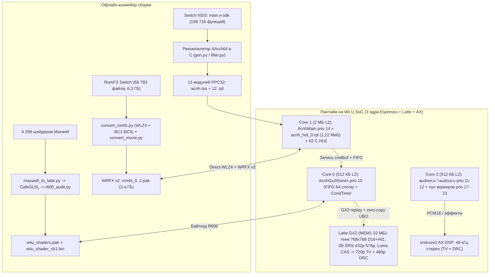

# Animal Crossing: New Horizons (Wii U) — статическая рекомпиляция AArch64 → PPC32

:::warning Статус проекта: Wave 9 (активная разработка и профилирование)
Проект представляет собой экспериментальный порт **Animal Crossing: New Horizons v1.0.0** с Nintendo Switch (AArch64 Little-Endian, GPU Maxwell / API NVN) на Nintendo Wii U (PowerPC 750CL Big-Endian, GPU Latte R600 / API GX2) методом **статической рекомпиляции** (AArch64 → C → PPC32) с нативным графическим и звуковым рантаймом. На вехе **Wave 9** сборка стабильно загружается, проходит экран запуска, сцену аэропорта и загружает сохранённый 3D-остров в Cemu 2.6, а WUP-образ проходит криптографическую верификацию; при этом производительность на тяжёлом открытом острове остаётся ограниченной однопоточным бюджетом `AcnhMain` (`10–14 FPS` в Cemu), а полноценный телеметрический прогон на физическом железе Wii U является следующим этапом.
:::

## 1. Паспорт проекта и аппаратный контекст

В отличие от эмуляторов с JIT-трансляцией во время выполнения, система переносит бинарный код `main` и достижимое подмножество `sdk` в нативные исполняемые модули Cafe OS на этапе офлайн-сборки. Работа ведётся строго в пределах аппаратных квот Wii U без расширения памяти и без динамической генерации кода.

| Параметр | Значение |
|---|---|
| **Веха документации** | Wave 9 (активная разработка; дальнейшие волны профилирования в работе) |
| **Исходная сборка (Switch)** | Animal Crossing: New Horizons `v1.0.0` (`01006F8002326000`, AArch64 LE, NVN) |
| **Wii U Title ID / код** | `0005000021AC0001` / `WUP-P-ACNH` |
| **Целевой CPU** | Espresso PowerPC 750CL, 3 ядра Big-Endian @ 1,24 ГГц (L2: `2 МБ` на Core 1, по `512 КБ` на Core 0 и Core 2) |
| **Целевой GPU и память** | Latte R600/R700 @ 550 МГц; `32 МБ` MEM1 eDRAM + `~849 МБ` доступной MEM2 DDR3 |
| **Гостевая арена в MEM2** | `838 МиБ` (`heap_max = 786 МиБ`), компактные 32-битные гостевые VA |
| **Исполняемые модули (`code/`)** | 13 модулей (~67 МБ суммарно): `acnh.rpx` + 12 `.rpl` |
| **Объём RomFS / итогового WUP** | `6,3 ГБ` (Switch) → `3,4 ГБ` (`WRFX v2` паки) / **`3,6 ГБ`** (крипто-верифицированный WUP) |
| **Ограничения Cafe OS WUP** | `31` файл в титуле (лимит `256`), `00000000.app <= 32 КиБ`, паки `<= 1,6 ГиБ`, `bootMovie.h264 = 80 696 Б` |

---

## 2. Архитектура статического рекомпилятора AArch64 → C → PPC32

Офлайн-конвейер (`tools/recomp/`: `nso.py`, `analyze.py`, `lifter.py`, `simd_c.py`, `gen.py`, `rpl_pack.py`) декодирует `149 716` функций из бинарника `main` и достижимые процедуры из `sdk`, поднимает их в промежуточное представление C с явной эмуляцией Little-Endian доступа к памяти (`guest_mem.h`) и компилирует через `devkitPPC` в нативный код PowerPC32.



### 2.1 Разбиение модулей и кэш-локализация L2

Один монолитный `.rpx` не укладывается в ограничения линковки и ухудшает локальность инструкций на 32-разрядном PowerPC. Рекомпилированный код разделён на 13 модулей с явной стратификацией по горячести:

| Модуль | Размер на диске | Назначение и режим сборки |
|---|---:|---|
| `acnh.rpx` | `848 КБ` | Ядро рантайма, планировщик, 62 C HLE, `fontll`/AES, NVN → GX2, аудио, ФС |
| `acnh_rt.rpl` | `74 КБ` | Мост-рантайм для RPL: быстрый `rt_dispatch`, `memcpy`/`memmove`/`memset` на `dcbz`/`dcbt`/`lfd`/`stfd` |
| `acnh_hot_0.rpl` | `1,4 МБ` | PGO-упорядоченный горячий модуль (`1 400` функций); рабочий набор `t0 + t1 + t2 = 1,22 МиБ` целиком в 2 МБ L2 Core 1; хвост `zzz_slow` на `-Os` |
| `acnh_main_0..8.rpl` | `6,3–7,9 МБ` каждый | Холодные и средне-горячие функции `main` (9 сбалансированных сегментов) |
| `acnh_sdk_0.rpl` | `3,3 МБ` | Достижимые функции Nintendo SDK, включая `61` горячую функцию Monotype `nn::fontll` на `-O2` |

### 2.2 Регистровый бюджет PPC32, сужение типов и инварианты

Ключевое несоответствие между AArch64 и PowerPC 750CL — разрядность и число регистров: 31 64-битный GPR (`x0..x30`) и 32 128-битных SIMD-регистра на Switch против 32-битных GPR и 32 FPR/Paired Singles на Espresso. Прямое хранение всех `x0..x30` в структуре `Cpu *c` в памяти создаёт массовый трафик load/store. В `gen.py` реализованы следующие проходы:

1. **Регистро-бюджетное промоутирование (`10/18` регистров PPC32)**: локальные переменные промоутируются в регистры с учётом наличия вызовов в функции (лимит `<= 8` локальных `float` с вызовами и `<= 10` в листовых функциях). Это сократило число stack spills на **`68,3 %`**.
2. **Автоматическое сужение до 32 бит (`_wN` и `_sp32`)**: поскольку вся гостевая арена уложена в нижние 32 бита адресного пространства (`upper32 == 0`), статический анализ доказывает 32-битность указателей и счётчиков, устраняя 64-битную арифметику на 32-битном ALU.
3. **Инлайнинг и холодные байпасы**: `194` короткие листовые функции инлайнятся непосредственно внутри `acnh_hot_0.rpl`, а по всем сегментам `acnh_main_0..8.rpl` внедрено **`51 357` холодных байпасов** (`__cxa_guard_acquire`, `GetTlsValue`/`SetTlsValue`, прямые вызовы `libc` через `acnh_rt.rpl` без обёрток `errno`/`getreent`).
4. **Защита от `FTZ=1` (subnormal-to-zero)**: на Espresso с `FPSCR[NI]=1` прогон сырых 32-битных целых чисел `0x00000001..0x007FFFFF` через `lfs -> stfs` занулял поля `gridX` и `instance_count` в функциях `f_1568360` и `f_28d0e30`, из-за чего пропадал 3D-ландшафт (`draws = 232` вместо `2 383`). Проблему решил обратный CFG-анализ `v_unsafe` (запрещающий загрузку сырых 32-битных слов в `float`) и подъём `SCVTF`/`UCVTF` через целочисленный `v_get32`.
5. **Строгие флаги сборки и инварианты упаковки WUP**: все 13 модулей собираются с `-fno-jump-tables -fno-if-conversion -fno-if-conversion2`. Автоматический бинарный аудит гарантирует `0` инструкций `lwarx`/`stwcx.` с `rA != 0` (обход известного бага PPC JIT в Cemu 2.6) и `0` неразрешённых переходов `b .` во всех 12 `.rpl`. Чтобы исключить системную ошибку `157-9999` на физической Wii U, скрипт `pack_console.py` проверяет лимиты Cafe OS (`<= 256` файлов в титуле, `00000000.app <= 32 КиБ`, единый `acnh.rpx`, автоматический расчёт `max_codesize` по 13 модулям, удаление AppleDouble `._*` и полная крипто-верификация `CRYPTO-VERIFIED PASS!`).
6. **Синхронизация часов (`mftb` clock-skew)**: попытка читать аппаратный timebase `mftbu`/`mftb` напрямую в `acnh_rt.rpl::rt_ticks()` вызывала расхождение с `OSGetSystemTime()`, что приводило к спину в `TimedWaitLightEventImpl` и многократному замедлению загрузки сейва. Возврат на `g_hooks.rt_ticks()` немедленно восстановил время загрузки `save_3` до `~9,5 с`.

### 2.3 Распределение потоков по 3 ядрам Espresso

Планировщик `runtime/core/kernel.c` жёстко привязывает подсистемы к ядрам с учётом асимметрии кэша L2:

- **Core 1 (`2 МБ L2`)**: монопольно отдаётся главному игровому потоку `AcnhMain` (`prio 14`) в 3D-сценах, чтобы активный рабочий набор `acnh_hot_0.rpl` (`t0` — ~150 наиболее горячих функций длиной `<= 300` ARM64-инструкций на `-O2`, плюс `t1` и `t2`, суммарно `1,22 МиБ`) не вытеснялся из кэша. Холодный хвост `zzz_slow` вынесен в конец секции `.text` и собран с `-Os`.
- **Core 0 (`512 КБ L2`)**: обслуживает графический поток `AcnhGx2Owner` (`prio 10`), таймер условных переменных `AcnhCondTimer` (`prio 13`) и свободные кванты для фоновых воркеров.
- **Core 2 (`512 КБ L2`)**: обслуживает аудиопотоки `ACNHAudrenC2` (`prio 11`), `ACNHAudoutC2` / `ACNHVsync` (`prio 12`) и пул рабочих потоков игры (`prio 17–23`).
- **Динамическая аффинность воркеров**: во время загрузки (когда `draws < 60`) рабочие потоки получают маску `0x7` (`CPU0 | CPU1 | CPU2`) для параллельной декомпрессии и инициализации; при переходе в 3D (`draws >= 60`, с 15-кадровым гистерезисом) маска сужается до `0x6` (`CPU0 | CPU2`), освобождая Core 1. Дополнительно введён шардированный `g_arb_lock` и исправлена утечка Priority Inheritance в `svc_wait_process_wide_key()`.

---

## 3. Нативные C HLE и дифференциальная верификация

Наиболее горячие вычислительные циклы, где даже оптимизированный рекомпилированный C уступает ручной реализации из-за семантики AArch64 NEON, переписаны на нативный C (`runtime/hle/game_hot_hle[_t2..t5].c`).

### 3.1 Состав 62 игровых C HLE и использование Paired Singles

В вехе Wave 9 активны **62 игровые и воркерные C HLE** (Tiers 1–5), разделённые на пять уровней внедрения:

| Уровень (Tier) | Кол-во функций | Основные охватываемые подсистемы |
|---|---:|---|
| **Tier-1** (`game_hot_hle.c`) | 21 | Иерархия скелетов `g3d`, 2D-решатель сетки ветра (`0x0172a300`, `0x01728800`), индексация BCSV (`0x02665ea0`), флаги `GrowUp` |
| **Tier-2** (`game_hot_hle_t2.c`) | 12 | Горячие циклы трансформации и фильтрации объектов сцены |
| **Tier-3** (`game_hot_hle_t3.c`) | 16 | `g3d::SkeletonObj::CalculateWorldMatrix` (`0x02960c30`), `SkeletalAnimObj` Euler → Mat34 (`0x02959320`), запросы поля ветра (`0x0171dd40`), 3D AABB (`0x017956e0`) |
| **Tier-4** (`game_hot_hle_t4.c`) | 7 | 8-угловой OBB (`0x02aa3e80`), построение фрустума (`0x02a39990`, 626 инстр.), цилиндрическая кривизна мира (`0x0173ca90`), 3D-сетка AABB (`0x0173f7b0`), отсекатель полигонов окклюзии (`0x02aa6f60`), иерархия UI2D (`0x02d5cf30`), аудио-распаковщик воркера (`0x0201e810`) |
| **Tier-5** (`game_hot_hle_t5.c`) | 6 | `g3d::SkeletonObj::CalculateMtxBlock` (`0x02963080`), полигоны окклюзии (`0x02aa72f0`), обход сцены (`0x01202000`), листва/ветер (`0x0171abb0`), построитель 4×4 матриц LiSPSM и окклюзии (`0x02aa4a40`, 916 инстр. / 574 SIMD/FP-операции), цикл частиц `nn::vfx` (`0x028d8760` + 11 `memcpy`) |

:::note Инженерный компромисс: граница целесообразности HLE
Профилирование показало, что перенос сверхмалых листовых функций длиной 1–11 инструкций (`0x029c4870`, `0x02904810`, `0x029dad00`, `0x02ce2d80`, `0x010019c0`) и воркер-диспетчера `0x031fff60` (содержащего 18 обратных `guest_call`) в `hle_override` **ухудшает** производительность: кросс-RPL вызов дороже самого тела функции и блокирует инлайнинг внутри `acnh_hot_0.rpl`. Такие функции сознательно оставлены в рекомпилируемом горячем модуле; в C HLE выносятся только тяжёлые вычислительные ядра.
:::

Для сохранения 0-ULP точности во всех HLE отключена неявная контракция FP (`#pragma STDC FP_CONTRACT OFF`), а операции `fmla`/`fmls` выражаются явным `fmaf()`. На целевой сборке Wii U (`__WIIU__`) в векторных хелперах Tier-5 задействованы аппаратные **Paired Singles SIMD** процессора Espresso (`psq_l`, `ps_mul`, `ps_muls0`, `ps_madd`, `ps_madds0`), обрабатывающие по две 32-битные операции с плавающей точкой за такт с сохранением одиночного округления FMA:

```c
/* Фрагмент 4-элементного векторного FMA (runtime/hle/game_hot_hle_t5.c, __WIIU__) */
__asm__ volatile (
    "psq_l     %[va0], 0(%[a]), 0, 0\n\t"
    "psq_l     %[va1], 8(%[a]), 0, 0\n\t"
    "psq_l     %[vc0], 0(%[acc]), 0, 0\n\t"
    "psq_l     %[vc1], 8(%[acc]), 0, 0\n\t"
    "ps_madds0 %[vr0], %[va0], %[s], %[vc0]\n\t"
    "ps_madds0 %[vr1], %[va1], %[s], %[vc1]\n\t"
    ...
);
```

На хостовой сборке (при верификации в Unicorn) те же хелперы компилируются в скалярные вызовы `fmaf()`, что гарантирует побитовую эквивалентность между эталоном AArch64 и кодом PowerPC750CL.

Помимо 62 игровых функций, в рантайме работают:
- **20 перехватов `nn::fontll::ScalableFontEngine`** (`fontll_hle.c`): мемоизация `SetFont` с быстрым переключением шрифтов, кэширование `CheckGlyphExist` и `GetKerning`, нативный разбор таблиц `AcquireOtfKerning*`;
- **Нативные криптографические примитивы** (`libc_hle.c`): 4-килобайтные T-table реализации `AES-128-CTR` и `CBC-MAC` (ускоряющие чтение и проверку сохранений);
- **HLE вибромоторов**: `VibrationNode::Update`.

### 3.2 Дифференциальное тестирование (Unicorn ARM64 vs C)

Каждая HLE-функция проверяется на автоматическом дифференциальном стенде (`tools/test_game_hot_hle*.py`, `test_fontll_hle.py`), который подаёт идентичные случайные и граничные векторы в оригинальный машинный код ARM64 под эмулятором Unicorn и в нативную C-реализацию, сверяя регистры и память побитово:

| Набор тестов | Пройдено / Всего | Макс. ошибка FP |
|---|---:|---:|
| Tier-1 (`test_game_hot_hle.py`) | `2 940 / 2 940` | `0 ULP` |
| Tier-2 (`test_game_hot_hle_t2.py`) | `1 780 / 1 780` | `0 ULP` |
| Tier-3 (`test_game_hot_hle_t3.py`) | `1 920 / 1 920` | `0 ULP` |
| Tier-4 (`test_game_hot_hle_t4.py`) | `1 800 / 1 800` | `0 ULP` |
| `nn::fontll` (`test_fontll_hle.py`) | `1 896 / 1 896` | `0 ULP` |
| `AES-128-CTR` + `CBC-MAC` | `42 / 42` | побитовое совпадение |
| **Базовый сводный набор (Tiers 1–4 + fontll + crypto)** | **`10 378 / 10 378 PASS`** | **`0 ULP`** |

Все 6 функций Tier-5 дополнительно проходят собственный дифференциальный прогон `tools/test_game_hot_hle_t5.py` с тем же критерием `0-ULP exact`.

---

## 4. Транслятор графики NVN → Latte GX2 (Core 0)

Графическая подсистема (`runtime/nvn/` и `runtime/nvn/gx2/`) переводит команды Nintendo Switch NVN в вызовы Latte GX2, разделяя запись буфера команд на Core 1 и их воспроизведение на Core 0.

### 4.1 Офлайн-компиляция 4 299 шейдеров (Maxwell → R600)

Шейдеры ACNH извлекаются из бинарников Maxwell и проходят офлайн-цепочку (`tools/shaders/`):

`Maxwell bytecode` → `maxwell_cli` → `GLSL 420` → `CafeGLSL` → `R600 .gsh` → автопатчер и аудитор `r600_audit.py` → big-endian пакет **`wiiu_shaders.pak`** (`84 МБ`).

- Валидировано **`4 299 / 4 299`** пар шейдеров: `ok: true`, `errors: 0`, `r123_collisions: 0` (устранены чёрные пятна на кронах дубов), `zero_ubo_tex_ld_vs: 0`.
- Отдельно упакован индекс константных буферов `wiiu_shader_cb1.bin` (`3 873` записи CB1, `240 КБ`).

### 4.2 Асинхронная очередь GX2, кэши и zero-copy UBO

1. **Быстрая запись и 64-слотовое FIFO-кольцо**: `cmdbuf.c` использует быстрый путь `rec_try_fast()` (устранивший 168-байтный stack spill при записи команд) с внутрибуферной дедупликацией состояний и отправляет пакеты в асинхронную очередь на 64 слота, разбираемую потоком `AcnhGx2Owner` на Core 0.
2. **Коалесцирование `GX2Invalidate` (-90 %)**: итеративный престейджинг `prestage_scan_frames()` (с поддержкой вложенных `CMD_CALL`) объединяет сбросы кэша до начала прохода рендера. На тяжёлой 3D-сцене количество вызовов `GX2Invalidate` снижено с **`788`** до **`71–82`** за кадр.
3. **Zero-copy когерентные UBO**: для буферов констант, синхронизированных аппаратно, данные передаются без копирования через двойной кольцевой буфер `ubo_ring` (`6 МиБ × 2`), обеспечивая **`1 452–1 758`** zero-copy попаданий за кадр (`czc`).
4. **Кэш non-coherent BFRES и линейные шрифтовые атласы**:
   - 2048-слотовый кэш `(ga, sz)` со 128-байтным сэмпл-хэшем в `gx2_textures.c` устранил белые полосы в аэропорту (`cDeparture`), возникавшие при переиспользовании страниц `ExpHeap`, одновременно сэкономив `10–16 МиБ/кадр` пропускной способности DDR3.
   - Полнострочный 4×-развёрнутый хэш-сканер `hash_guest_linear_tex()` (`row_step <= 2`) и пред-проходная синхронизация `gx2_tex_sync_dirty_linear_outside_pass()` устранили пропадание узких глифов (8–24 px) на первом кадре диалогов.

### 4.3 Бюджет MEM1 eDRAM, DRS и апскейлинг Luma CAS

Узкий по объёму, но высокоскоростной буфер MEM1 (`32 МБ eDRAM`) используется для минимизации трафика в медленную DDR3 MEM2:

- **Теневая карта в MEM1**: постоянная поверхность `s_shadow_persist` (`768×768 D16 + HiZ`, `1 152 КиБ`) жёстко закреплена в MEM1 (`MEM1=1`, `fb=0`, свободный запас MEM1 составляет `2,58–2,69 МиБ`). Обновление теней троттлится до `15/10 Гц` с мгновенным принудительным перерисованием при резком повороте камеры (по изменению `lightViewProj`). Карта окружения `ActorEnvMapField` обновляется по таймслайсингу с каденсом `16`.
- **Динамическое разрешение 3D-only (DRS)**: контроллер управляет разрешением 3D-рендера через `RScale` UBO без переаллокации буферов в MEM1 (`fb=0`). Базовая 5-ступенчатая сетка охватывает диапазон **`75 %–100 %`** (`768×432`..`1024×576`) с дополнительным аварийным шагом `68,75 %` (`704×396`). Все ступени кратны `64×36` под аппаратный тайлинг Latte (и дают точные целые размеры для полуразрешающих буферов `512×288`):

| Ступень | Масштаб | Разрешение 3D | Доля пикселей от 576p | Условие переключения (гистерезис) |
|---|---:|---:|---:|---|
| 0 (аварийная) | `68,75 %` | `704×396` | `47,3 %` | 6 кадров подряд с GPU busy выше `30,5 мс` |
| 1 | `75,00 %` | `768×432` | `56,3 %` | Базовый нижний порог 5-ступенчатого профиля |
| 2 | `81,25 %` | `832×468` | `66,0 %` | Плавное ступенчатое масштабирование |
| 3 | `87,50 %` | `896×504` | `76,6 %` | Плавное ступенчатое масштабирование |
| 4 | `93,75 %` | `960×540` | `87,9 %` | Плавное ступенчатое масштабирование |
| 5 (макс.) | `100,00 %` | `1024×576` | `100,0 %` | 30 кадров подряд ниже `24,0 мс` или `draws < 250` |

- **Luma AMD FidelityFX CAS и нативный 720p UI**: 3D-кадр масштабируется в `1280×720` за один проход шейдером Luma CAS, а весь игровой интерфейс (текст, иконки, диалоговые окна) рендерится в нативном `1280×720` поверх. Экран запуска (`bootTvTex.tga` `1280×720` и `bootDrcTex.tga` `854×480`) формируется из полнокадрового 16:9 ключ-арта.

---

## 5. Аудио, переупаковка RomFS и Off-TV Play

### 5.1 Аудиоподсистема (`audren:u` / `audout:u` → `sndcore2` AX)

Модуль `runtime/services/audio_wiiu.c` реализует гостевые аудиосервисы Switch `audren:u` и `audout:u` поверх аппаратного `sndcore2` AX DSP (48 кГц стерео, синхронный вывод на TV и DRC) на выделенном Core 2 (`prio 11/12`). Поддержаны форматы PCM16 и ADPCM, сплиттеры `SNDI` (с исправленным шагом структуры `0x1C + n * 4`), субмиксы и граф DSP-эффектов (`BufferMixer`, `Aux`, `Delay`, `Reverb`, `I3dl2Reverb`, `BiquadFilter`). В рабочих прогонах подтверждено живое микширование (`9–10` активных голосов, `36–42` splitter destinations, `12` эффектов, `peak = 2 907..10 450`).

### 5.2 Переупаковка RomFS (`6,3 ГБ → 3,4 ГБ`) и транскодирование видео

Оригинальный RomFS Switch (`66 793` файла) содержит тысячи Zstd/Yaz0-архивов и текстур в форматах ASTC/BC6H/BC7 с тайлингом Tegra GOB, декодирование которых на CPU Espresso заняло бы десятки секунд на сцену. Офлайн-конвейер (`tools/assets/convert_romfs.py`, `build_romfs_index.py`, `convert_movie.py`) выполняет полную пересборку ресурсов:

1. **Переупаковка архивов (`61 597` файлов)**: `.zs` (Zstd) и `.szs` (Yaz0) перепакованы в формат **`WLZ4`** (заголовок `WLZ4` + 32-битный big-endian размер + сырой LZ4-блок), который декодируется на Espresso в 3–5 раз быстрее. В рантайме реализован **Direct-WLZ4 bypass** (`fs_rom_try_direct_wlz4`), распаковывающий данные напрямую без четырёх промежуточных копий.
2. **Транскодирование текстур**: внутри рекурсивно разобранных контейнеров SARC → FRES (BFRES v9) → BNTX текстуры ASTC/BC6H/BC7 декодируются через `texdecode_cli` и перекодируются (`etcpak`) в аппаратные для Latte форматы **BC1–BC5** (с раздельной фильтрацией RGB и straight-alpha мипмапов). В заголовки BRTI записывается линейная раскладка (`tile_mode = 1`, `flags |= 0x80`), чтобы CPU Wii U не тратил время на программный Tegra GOB deswizzle; таблица `ResourceSizeTable.srsizetable` (RSTB) автоматически пересчитывается.
3. **Упаковка `WRFX v2`**: все `66 793` файла объединены в три пака `romfs_0.pak` (`1,6 ГБ`), `romfs_1.pak` (`1,6 ГБ`) и `romfs_2.pak` (`233 МБ`) с бинарным хэш-индексом `romfs_index.bin` (`6,3 МБ`, типы кодирования `ROM_ENC_RAW`, `WLZ4`, `WLZ4_ZS`, `WLZ4_SZS`), что исключает рекурсивное сканирование ФС при старте (открытие индекса занимает `~0,02 с`) и соблюдает лимит Cafe OS на число файлов и размер одного файла. В рантайме применены `64 КиБ` буферы `setvbuf` и per-pak блокировки `g_pak_lock[]` с lock-free LZ4. Сохранения пишутся в `/vol/save/common/acnh/`.
4. **Вступительный ролик (`OpeningMovie`)**: оригинальный `OpeningMovie.webm` (VP9 + Vorbis) перекодирован под аппаратный декодер Wii U `H264DEC` в поток **H.264 Main Profile Level 4.0 `1280×720@30fps` Annex-B** без B-кадров (`-bf 0`, `-refs 2`, `34,3 МБ`, 30-кадровый GOP, повторяемые SPS/PPS и AUD для минимального буфера DPB) и несжатый `48 кГц` стерео `OpeningMovie.s16be.pcm` (`12,5 МБ`, `3 134 528` сэмплов, длительность `65,3 с`) для прямой подачи в AX DMA без перестановки байтов.

| Артефакт RomFS / Медиа | Исходный формат (Switch) | Целевой формат (Wii U) | Итоговый размер |
|---|---|---|---|
| Архивы и ресурсы (`66 793` файлов) | `61 597` Zstd/Yaz0 + Tegra ASTC/BC7 | `WRFX v2` (`WLZ4` + линейные BC1–BC5) | `3,4 ГБ` (было `6,3 ГБ`) |
| Индекс файловой системы | Иерархия директорий RomFS | `romfs_index.bin` (хэш-таблица `WRFX v2`) | `6,3 МБ` (`~0,02 с` загрузка) |
| Видео `OpeningMovie` | `OpeningMovie.webm` (VP9 + Vorbis) | `OpeningMovie.h264` (`720p30` Main L4.0) + `.s16be.pcm` | `34,3 МБ` + `12,5 МБ` |
| Установочный образ WUP | NSP Switch | 31 файл (13 модулей `code/` + `content/` + `meta/`) | `3,6 ГБ` (`CRYPTO-VERIFIED`) |

### 5.3 Off-TV Play и подсистема ввода

Вывод изображения зеркалируется на Wii U GamePad в его нативном разрешении **`854×480`** (DRC scanbuffer выделяется из foreground heap), а `runtime/hle/input_wiiu.c` транслирует контроллеры Wii U (VPAD/KPAD) в `nn::hid`:
- кнопки, стики и виброотклик GamePad / Pro Controller;
- калиброванный резистивный тачскрин GamePad с проецированием координат в сенсорное пространство Switch `0..1279 × 0..719`;
- 6-осевой датчик движения (гироскоп + акселерометр).

---

## 6. Замеры производительности и честный разбор узких мест Wave 9

Все приведённые ниже измерения сняты в воспроизводимых релизных прогонах Cemu 2.6 (`ACNH_CPUPROF 0`, `acnh_bot` исключён из релизного WUP, эталонный сейв `tools/test_save_3` и чистый старт в аэропорту `cDeparture`).

| Сцена / метрика | Ранняя сборка (Wave 1) | Веха Wave 8–9 (Cemu 2.6, релизный профиль) | Комментарий |
|---|---|---|---|
| **Загрузка `save_3` (`mount → Scene #2`)** | `~136,4 с` | **`9,49 с`** | Ускорение WLZ4 + AES HLE + возврат `rt_ticks()` |
| **Загрузка до `System_GrowUp`** | `+107,0 с` | **`+40,81 с`** | Ускорение `2,6×` (оценка на Wii U — не более `60 с`) |
| **Смена сцены `cTitle`** | `~35 с` | **`~10 с`** | Per-pak locks + Direct-WLZ4 |
| **Экран загрузки `LLoadIsland` (`d = 41`)** | `0,26–0,93 FPS`, мерцания | **`57–60 FPS`** | `cpu = 2,0–2,3 мс`, `rep = 0,6 мс`, `0` мерцаний |
| **Аэропорт `cDeparture` (чистый старт)** | Полосы за стойкой | **`14,5–20,7 FPS`** | `cpu = 48,3–69,1 мс`, `rep = 1,8–2,4 мс`, `0` полос и пропусков глифов |
| **Полный 3D-остров (`cTitle` / Tom Nook, `d = 1 200–1 841`)** | `7,1 FPS` (`cpu = 141,4 мс`, `uinv = 788`) | **`10–14 FPS`** (средн. `12,5–13,8 FPS`, пик **`24,3 FPS`**) | `min = 41,1 мс`, `cpu = 72,5–80,1 мс`, `rep = 6,9–7,2 мс`, `uinv = 71–82` (`-90 %`), `czc = 1 452–1 758` |
| **DRS и память MEM1** | Без DRS, тени в MEM2 | **`drs = 81% → 94% → 100%`** | `s_shadow_persist` в MEM1 (`1 152 КиБ`), свободно `2,58–2,69 МиБ`, `fb = 0` |

### 6.1 Открытые узкие места и предстоящие шаги

1. **Однопоточный CPU-бюджет `AcnhMain` на открытом 3D-острове**:
   Воспроизведение GX2 на Core 0 уже занимает всего `6,9–7,2 мс`, тогда как основной поток симуляции и подготовки кадра `AcnhMain` тратит **`72,5–80,1 мс`** (в Cemu). На это накладывается квантизация `SwapInterval=2` (`33,3 → 66,7 → 100 мс`) и `wait = 18–19 мс`, что удерживает средний показатель на уровне `10–14 FPS` даже при пиковых кадрах `41,1 мс` (`24,3 FPS`). Для дальнейшего снижения времени кадра ниже барьера `33,3 мс` требуется перенос оставшихся тяжёлых циклов обхода сцены, травы, деревьев и воркеров (`0x01768dc0`, `0x02adc4e0`, `0x02b52790`, `0x01539a10`, `0x01619570`) в нативные C HLE и дополнительная PGO-перегруппировка `acnh_hot_0.rpl`.
2. **Необходимость прогона на физической консоли Nintendo Wii U**:
   Cemu 2.6 исполняет PPC32-код через собственный JIT на хостовом процессоре и не воспроизводит реальные характеристики 2 МБ кэша L2 Core 1, пропускной способности MEM2 и скорости растеризации Latte @ 550 МГц. Собранный WUP (`3,6 ГБ`) уже соответствует всем структурным и криптографическим инвариантам Cafe OS (`CRYPTO-VERIFIED PASS!`), однако финальная оценка реального FPS и калибровка порогов DRS/троттлинга возможны только после живого прогона на физической консоли и анализа телеметрии из `/vol/external01/acnh_wiiu.log`.

### 6.2 Инженерные критерии приёмки сборки

Перед упаковкой любого релизного кандидата Wave 9 выполняется обязательный набор проверок (с нулевым допуском к регрессиям):

```text
1. Аудит PPC32-кода (13 модулей): 0 lwarx/stwcx. с rA != 0; 0 неразрешённых b . в 12 .rpl.
2. Аудит шейдеров (r600_audit.py): 4 299 / 4 299 ok: true, errors: 0, r123_collisions: 0.
3. Дифференциальный стенд Unicorn: 10 378 / 10 378 PASS (0 ULP) + Tier-5 0-ULP PASS.
4. Чистота релизного титула: ACNH_CPUPROF 0, acnh_bot.txt отсутствует, 0 файлов ._* / .DS_Store.
5. Упаковка WUP (pack_console.py): 31 файл, 00000000.app <= 32 КиБ, CRYPTO-VERIFIED PASS!
```
