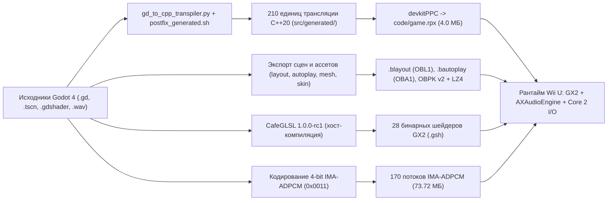

# Buckshot Roulette (Wii U): трансляция GDScript в C++20, GX2 и AX DSP

Порт **Buckshot Roulette** (исходная база **OpenBuckshotRoulette** на Godot 4) для Nintendo Wii U реализован без переноса самого движка Godot на PowerPC. Вместо портирования тяжёлой среды исполнения с интерпретатором GDScript и OpenGL/Vulkan-бэкендом проект транслирует исходные игровые скрипты и сцены в самостоятельный нативный исполняемый файл C++20 поверх WUT/Cafe OS, графического API GX2 и аппаратного аудиопроцессора AX DSP.

## 1. Паспорт сборки

| Параметр | Значение (Build 116 / v44) |
|---|---|
| **Title ID / Product Code** | `000500001337B001` / `WUP-P-OBR0` |
| **Сборка / версия пакета** | Build **116**, title version **44** (2026-11-27), Region Free |
| **Исполняемый файл (`code/game.rpx`)** | `4 167 116` байт (~`4,0 МБ`), `-O3 -ffast-math -fno-exceptions` |
| **Формат поставки (WUP)** | `328 571 516` байт (~`313 МБ`), 17 файлов установщика, 9 `.app`, 472 файла содержимого |
| **Формат поставки (Aroma WUHB)** | `318 047 300` байт (~`303 МБ`), единый пакет `BuckshotRoulette.wuhb` |
| **Кадровый и видеопрофиль** | Ограничение `30 FPS`; 3D-рендер `1280×720` → вывод TV `1920×1080` (AMD CAS), DRC `854×480` |
| **Локализация** | 17 языков (`BRLOC1` каталоги `.loc` + предсобранные `.r8`-атласы шрифтов) |
| **Сохранения** | `SD:/save/openbr/` (`/vol/external01/save/openbr[/u_<pid>]`, резерв `/vol/save/openbr/playerdata.cfg`) |

### Отказ от портирования рантайма Godot 4 на PowerPC

Официального бэкенда Godot 4 под Nintendo Wii U не существует. Прямой перенос движка упирается в три системных ограничения архитектуры Espresso/Latte:

1. **Графический стек**: Godot 4 опирается на Vulkan, Direct3D 12 или OpenGL ES 3. На Wii U доступен только низкоуровневый проприетарный API **GX2** (GPU AMD TeraScale 2 / R600) с бинарным форматом шейдеров GFD (`.gsh`) и раздельным управлением `32 МБ` eDRAM MEM1 и `1 ГБ` DDR3 MEM2.
2. **Порядок байтов (big-endian) и CPU**: процессор IBM Espresso — это трёхъядерный big-endian PowerPC 750CL с in-order-исполнением на `1,24 ГГц`. Современные подсистемы сериализации Godot 4 и его сторонние зависимости не поддерживают big-endian PowerPC.
3. **Накладные расходы среды исполнения**: на `1,24 ГГц` in-order CPU интерпретация байткода GDScript, динамический обход дерева узлов и программное микширование аудио создают избыточную нагрузку, особенно при одновременном рендеринге двух экранов (TV + GamePad).

Вместо этого построен офлайн-конвейер (`tools/wiiu_port/`) и специализированный C++20-рантайм (`ports/wiiu/src/`), воспроизводящий семантику сцен, сигналов, корутин и анимаций оригинала непосредственно в машинном коде PowerPC.



## 2. Трансляция GDScript в C++20 и бинарные форматы ресурсов

### Транслятор и C++20-корутины (`co_task.h`)

Вся сценарная хореография Buckshot Roulette (тайминги дилера, выстрелы, анимации предметов, реанимация, переходы) построена на цепочках асинхронных ожиданий `await get_tree().create_timer(t).timeout` и вложенных вызовов корутин. Транслятор `tools/wiiu_port/gd_to_cpp_transpiler.py` вместе с этапом постобработки `postfix_generated.sh` переводит исходные `.gd`-файлы в **210** единиц трансляции C++20 в каталоге `ports/wiiu/src/generated/` (включая 92 менеджера мультиплеера и все менеджеры одиночной кампании).

Среда выполнения корутин реализована в `ports/wiiu/src/core/co_task.h` (`co::BasicTask<Checked, Result>`, псевдонимы `co::Task`, `co::CheckedTask`, `co::CheckedValueTask<T>`) с учётом ограничений PowerPC-тулчейна devkitPPC:

- **Ленивое создание с немедленным запуском**: `initial_suspend()` возвращает `std::suspend_always`, после чего `co::detach()` или `co_await` сразу вызывает `resume()`, синхронно выполняя тело корутины до первой точки приостановки — в точном соответствии с GDScript.
- **Симметричный переход (symmetric transfer)**: `FinalAwaiter::await_suspend()` возвращает `std::coroutine_handle<>` вызывающей корутины. Варианты с возвратом `bool` или `void` в целевом GCC под PowerPC генерировали некорректный код возврата.
- **Пользовательский аллокатор фреймов**: `promise_type::operator new` и `operator delete` принудительно используют `std::malloc` и `std::free` (отключая HALO). Внешний type-erased вызов `handle.destroy()` на данном тулчейне PowerPC приводил к зависаниям и отказам памяти; поэтому `destroyIfOwned()` для завершившихся (`handle_.done()`) корутин освобождает фрейм напрямую через `std::free(handle_.address())`, так как локальные переменные уже разрушены компилятором до финальной приостановки, а `promise_type` тривиально разрушаем.
- **Кооперативная отмена и единая очередь таймеров**: при выгрузке сцены или удалении узла-владельца (`runtime_owner::Context`) зарегистрированные ожидания (`WaitRegistration`) переносятся в очередь `cancelledWaits()` и безопасно докручиваются до `co_return` через `drainDeferredDestroy()`. Ожидания `co_await co::wait(t)` планируются в `TimerQueue` (`ports/wiiu/src/core/timer_queue.h`), там же определён динамический тип `Variant` на базе `std::variant` (`bool`, `int64_t`, `double`, `std::string`, `Vec2/3/4`, `GdArray`, `GdDict`, `Node*`, `InputEvent*`).

```cpp
// Фрагмент модели исполнения корутин из ports/wiiu/src/core/co_task.h
// GDScript: await get_tree().create_timer(t).timeout  ->  co_await co::wait(t)
// GDScript: obj.AsyncMethod(args)                     ->  co::detach(obj->AsyncMethod(args))
// GDScript: await obj.AsyncMethod(args)               ->  co_await obj->AsyncMethod(args)
void destroyIfOwned() noexcept {
    if (handle_ && handle_.done()) {
        std::free(handle_.address()); // обход дефектного внешнего handle_.destroy() на devkitPPC
    }
    handle_ = {};
}
```

### Система сигналов (`scene_signal_bindings.h`)

Статические подключения сигналов из `.tscn` привязываются через `SceneSignalBindings::bind()` (`ports/wiiu/src/scene/scene_signal_bindings.h`). Операция атомарна на уровне сцены: сначала разрешаются все источники (`GodotSignal*`), получатели (`Node*`) и методы с проверкой итоговой арности (`emittedArguments - unbindArguments + boundArguments.size()`), и лишь после валидации всех записей регистрируются коллбэки (`connect`, `connectOnce`, `connectDeferred`). Каждый вызов защищён проверкой времени жизни получателя (`receiver.alive()`) и `runtime_owner::Guard`.

### Бинарные форматы `.blayout`, `.bautoplay` и архивы `OBPK`

Текстовый разбор `.layout` и открытие тысяч мелких файлов через файловую систему Wii U (FSA/MLC) вызывали многосекундные задержки. В релизной сборке используются три бинарных формата с нативным для PowerPC порядком байтов big-endian (`ports/wiiu/src/content/binary_io.h`):

1. **`.blayout` (магическое число `OBL1`)** — скомпилированное дерево сцены и префабов (`layout_loader.cpp`): узлы 3D и UI (`main.layout` — `345` `ui_node`, `menu.layout` — `228` `ui_node`), материалы, источники `OmniLight3D` и направленного света, коллайдеры (`BOX`, `SPHERE`, `CAPSULE`, `CONCAVE`, `CYLINDER`), сокеты камер, спикеры `AudioStreamPlayer`, треки музыки, `@export`-привязки менеджеров и таблица сигналов. Читается за один вызов `fread()`.
2. **`.bautoplay` (магическое число `OBA1`)** — предэкспортированные клипы `AnimationPlayer` (`main.autoplay` содержит `201` анимацию, `826` треков, `40` `method_call` и `58` `audio_call`; `menu.autoplay` — `17` анимаций и `16` треков), включая скелетные треки `Skeleton3D:Bone` и режимы интерполяции. Верификация геометрии подтверждает побитовое соответствие по всем `2 399` поверхностям мешей и `153` скиннинг-поверхностям (`513 514` вершин).
3. **Архивы `OBPK` v1/v2 (`ports/wiiu/src/content/asset_pack.h`)** — индексированный контейнер, устраняющий тысячи системных вызовов `open`/`stat`/`close` на FSA при загрузке сцен и префабов. Для последовательного чтения сгруппированных по сценам данных используется буфер `setvbuf` объёмом `512 КБ`.

| Секция `OBPK` (big-endian) | Смещение / размер | Поля и назначение |
|---|---|---|
| Заголовок | `16` байт (`0..15`) | `magic = "OBPK"`, `version` (`1` или `2`), `entryCount`, `nameTableBytes` |
| Каталог записей | `entryCount × 24` байта | `nameOffset` (u32), `nameLength` (u32), `dataOffset` (u64), `dataSize` (u32), `flags` (u32; бит `0` = сырой блок **LZ4** с 4-байтным BE `rawSize`) |
| Таблица имён | `nameTableBytes` байт | NUL-терминированные UTF-8 ключи ассетов |
| Данные (payload) | Выравнивание `4` Б (v2) / `64` Б (v1) | В v2 отсортированы по сценам для минимизации seek на MLC/SD |

В Build 116 статические ресурсы объединены в четыре пакета внутри `content/assets/`: `textures.pack` (`96 МБ`), `meshes.pack` (`32 МБ`), `fonts.pack` (`16 МБ`) и `skins.pack` (`11 МБ`).

## 3. Графический конвейер GX2 и шейдеры

Ранние прототипы порта использовали обёртку `SDL_RenderGeometry` с CPU painter sort без Z-буфера, выдавая `11 FPS` в главном меню и `3 FPS` в игровом зале. В актуальном рендерере (`ports/wiiu/src/gfx/gx2_renderer.h`) вся отрисовка переведена на прямой **GX2**.

### Размещение буферов в MEM1/MEM2 и кадровый цикл

| Ресурс | Область памяти | Обоснование |
|---|---|---|
| `GX2ColorBuffer` TV (`1280×720×4` ≈ `3,7 МБ`) | MEM1 (`32 МБ` eDRAM) | Высокая пропускная способность (~`140 ГБ/с`) для ROP и пост-проходов |
| `GX2ColorBuffer` DRC (`854×480×4` ≈ `1,6 МБ`) | MEM1 | Отдельный целевой буфер экрана GamePad |
| `GX2DepthBuffer` `D24S8` (`1280×720×4` ≈ `3,7 МБ`) | MEM1 | Аппаратный Z-тест и раннее Z-отсечение GPU7 |
| Буферы постобработки `postColor_[0..1]` | MEM1 | Регистрация в ProcUI-коллбэках `RELEASE`/`ACQUIRE` |
| Текстуры (`GX2Texture`, BC1–BC3 / R8) и VBO/IBO | MEM2 (`1 ГБ` DDR3) | Однократная загрузка (`mesh_gpu_buffer.h`), достаточно ~`12,8 ГБ/с` |

Статическая непрозрачная геометрия объединяется в мировые батчи по ключу `texture + layerMask`. В каждом кадре непрозрачные объекты сортируются от ближних к дальним (depth-test ON, depth-write ON), а полупрозрачные — от дальних к ближним (depth-test ON, depth-write OFF). Отключён принудительный `GX2DrawDone()` в конце кадра WHB — синхронизация освобождения ресурсов ведётся по трёхстраничным временным меткам (timestamp fences).

```text
Последовательность кадра (ports/wiiu/src/gfx/gx2_renderer.h):
  1. Вне render pass: Core 2 promotion -> GX2CopySurface (tiled BC1/BC2/BC3 с полным mip-chain)
  2. beginFrame()
  3. TV Pass (1280x720 -> postColor_[0] -> 1920x1080 CAS):
       - applyScreenPerspective(TV)  [в MP: P1 FP + P2 TP]
       - Opaque front-to-back (Z-test ON, Z-write ON) -> Sky (Z-test ON) -> Alpha back-to-front (Z-write OFF)
       - Post-processing (vignette + posterize + saturation + AMD CAS)
       - UI pass (uScreenSize = TV) + onOverlayTV (nn::swkbd при открытой клавиатуре)
  4. DRC Pass (854x480 -> postColor_[1]):
       - applyScreenPerspective(DRC) [в MP: P2 FP + P1 TP]
       - Независимый 3D/post/UI проход + onOverlayDRC (nn::swkbd)
  5. endFrame() -> timestamp fence + VSync swap (лимит 30 FPS)
```

### 28 предкомпилированных шейдеров CafeGLSL и постобработка

Все **28** шейдерных программ (`content/shaders/*.gsh`, манифест `native-shaders.json`) компилируются офлайн на хосте закреплённой версией **CafeGLSL 1.0.0-rc1** в формат GFD с верификацией SHA-256 и контролем числа регистров (`ps_gprs` от `4` до `12`, `ps_stack = 0`). Это исключает рантаймовую компиляцию на консоли.

| Группа шейдеров | Файлы `.gsh` | Назначение |
|---|---|---|
| Базовые и UI | `mesh.gsh`, `ui.gsh`, `native-mesh.gsh`, `native-mesh-unshaded.gsh`, `native-ui.gsh`, `native-ui-solid.gsh` (6) | Базовая 3D-геометрия без освещения, 2D/3D UI и текстовые атласы |
| Специализированное освещение | `native-mesh-lit-0`, `lit-dir1`, `lit-fast`, `lit-fast2`, `lit-att1-{1,2,4,5,8}`, `lit-pow{2,4,8}` (12) | Предспециализированные варианты по числу источников `OmniLight3D` и показателю затухания без динамических ветвлений |
| Небо и панорама | `native-sky.gsh`, `native-sky-copy.gsh`, `native-procedural-sky.gsh` (3) | Звёздная панорама `1500×1500` и процедурное небо (рисуются за непрозрачными мешами с Z-тестом) |
| Эффекты лобби (VHS) | `native-lobby-bleed.gsh`, `native-lobby-grain.gsh` (2) | Переведённые canvas-шейдеры лобби: цветовой bleed и анимированное VHS-зерно с шумовой текстурой |
| Постобработка и CAS | `native-post-cas`, `cas-light`, `cas-light-envonly`, `native-post-native`, `native-post-native-envonly` (5) | Объединённый проход: виньетирование (`vignette`), постеризация (`posterization`), цветокоррекция/обесцвечивание смерти и масштабирование **AMD CAS** (`720p → 1080p` TV) |

Профиль вывода по умолчанию — 3D-рендер `1280×720` с масштабированием через **AMD CAS** до `1920×1080` на TV. Необязательный файл `SD:/openbr_render.cfg` позволяет явно выбрать режим `720` (CAS), `1080` (нативный рендер) или `auto`.

### Асинхронная загрузка tiled BC-текстур на Core 2

Аппаратный журнал с физической консоли в Build 85 зафиксировал тайм-аут GPU Latte на кадре `1826` (`smoking dude_cigarette`, шейдер `LitPow4`, submitted timestamp `1876`, retired `1875`). Причиной стала сжатая текстура BC1 (формат `49`) с линейной раскладкой `GX2_TILE_MODE_LINEAR_ALIGNED` (tile mode `1`) и единственным mip-уровнем. Как следует из драйвера Mesa (`r600_texture.c`), архитектура R600/Latte допускает линейную раскладку BC-текстур только для staging-копирования, но требует **tiled**-раскладку для выборки шейдером (Cemu такую ошибку пропускал).

Начиная с Build 86 загрузчик (`ports/wiiu/src/gfx/gx2_texture_cache.h`, `texture_upload_policy.h`) соблюдает строгие инварианты:

- Все сжатые материалы **BC1/BC2/BC3** загружаются исключительно в tiled-формате с полным исходным mip-chain.
- Дисковый ввод-вывод и чтение из `textures.pack` выполняются асинхронно в потоке на **Core 2** (`OS_THREAD_ATTRIB_AFFINITY_CPU2`).
- Текстуры, запрошенные внутри активного render pass, никогда не перехватываются синхронным чтением — они ставятся в очередь следующего кадра, где `GX2CopySurface` выполняется строго до привязки render target-ов. Меш с незагруженной текстурой не попадает в статический батч с белым заглушечным цветом и переподключается после завершения копирования GPU.

## 4. Нативный аудиодвижок `AXAudioEngine`

Ранний звуковой бэкенд `SDL2_mixer` выполнял программное микширование на Espresso CPU (~3–5 % на канал). Он полностью заменён на **`AXAudioEngine`** (`ports/wiiu/src/audio/ax_audio_engine.h`) поверх системной библиотеки `sndcore2` (аппаратный DSP чипа Latte, частота `kAXNativeSampleRate = 48000` Гц, громкость в фиксированной точке Q1.15 `0x8000`, обязательный `DCFlushRange` перед передачей буферов DSP).

### 4-bit IMA-ADPCM с `O(1)` seek и сжатие дистрибутива

Все **170** аудиофайлов выпуска перекодированы в формат **Microsoft 4-bit IMA-ADPCM** (`wFormatTag = 0x0011`) и суммарно занимают `73,72 МБ`. Собственный big-endian-безопасный декодер (`ports/wiiu/src/audio/wav_decoder.h`) разбирает заголовок `fmt `, считывает точное число сэмплов из чанка `fact` и декодирует моно/стерео-блоки (4-байтный заголовок канала с 16-битным предиктором и индексом шага `0..88`, далее чередующиеся 4-байтные группы по 8 нибблов для L и R).

Поскольку размер каждого блока фиксирован (`blockAlign`) и содержит известное число сэмплов (`samplesPerBlock`), функция `openbr_wav::decodeWavFramesAt()` выполняет позиционирование по номеру кадра за **`O(1)`** без декодирования от начала файла, а кэш `WavDecodeCache` исключает повторный разбор граничного блока между последовательными refill-запросами. В сумме с архивами `OBPK`/LZ4 и BC-текстурами это сократило объём образа более чем в 4 раза:

- **Build 95 (PCM16 WAV)**: `1 281 366 808` байт (~`1,28 ГБ`, 19 файлов установщика, 11 `.app`);
- **Build 116 (4-bit IMA-ADPCM + OBPK v2)**: `328 571 516` байт (**`313 МБ`** WUP / **`303 МБ`** `.wuhb`, 17 файлов установщика, 9 `.app`).

### Стриминг на Core 2 и маршрутизация TV/DRC

| Параметр `AXAudioEngine` | Значение |
|---|---|
| Пул голосов коротких SFX (`kMaxSFXVoices`) | `14` стереопар голосов AX (резидентный PCM16 в MEM2) |
| Порог потокового чтения (`kStreamThresholdBytes`) | `512 КБ` (треки от `512 КБ` стримятся с диска на Core 2) |
| Параллельные стриминговые слоты | `6` SFX/эмбиент-слотов (`kMaxSFXStreamSlots`) + `2` голоса музыки (L+R) |
| Размер полубуфера кольца (`kStreamHalfFrames`) | `16 384` сэмпла (~`371 мс` при `44,1 кГц`, двойная буферизация) |
| Маршрутизация (`AXSetVoiceDeviceMix`) | `AudioRoute::Both`, `AudioRoute::TVOnly`, `AudioRoute::DRCOnly` |

В Build 115 устранена гонка перезапуска стримингового слота (замечание `R1` из ревью Build 114), при которой остановка могла переиспользовать слот до того, как воркер Core 2 выставлял флаг занятости (`ports/wiiu/src/audio/stream_slot_sync.h`).

Разделение вывода `AudioRoute` обслуживает асимметричный режим 1v1: музыка, эмбиент комнаты, выстрелы и звуки третьего лица направляются в `AudioRoute::Both`, тогда как личные звуки первого лица (фоли предметов в руках, Burner Phone, дефибриллятор, клики UI) маршрутизируются строго в `AudioRoute::TVOnly` для Игрока 1 и в `AudioRoute::DRCOnly` для Игрока 2. Независимый регулятор `setDeviceGain(0/1, gain)` приглушает и восстанавливает звук при смерти/реанимации только на устройстве выбывшего игрока.

## 5. Локальный асимметричный режим 1v1 и подсистема ввода

### Независимый двухэкранный рантайм

Оригинальный мультиплеер (`mp_lobby.tscn`, `mp_main.tscn`, 92 MP-скрипта) переведён на локальную игру вдвоём за одной консолью (`ports/wiiu/src/scene/mp_dual_screen_runtime.h`, `mp_view_visibility.h`):

- **Внутрипроцессная авторитетность**: сетевой стек Steam P2P заменён локальной доставкой пакетов (`MP_PacketManager`, `MP_MemberChecker`) без сетевой задержки.
- **Раздельные камеры и перспективы FP/TP**: оба экземпляра `user_instance_main_1` владеют собственным `AutoplayRuntime`. Перед рендером TV и DRC функция `applyScreenPerspective()` назначает видимость так, чтобы TV рисовал Игрока 1 от первого лица и Игрока 2 от третьего, а GamePad — наоборот, не затрагивая исходные флаги `visible` дочерних узлов (например, скрытых до получения урона дефибрилляторов). Зеркальные FP/TP-анимации выстрела и предметов выполняют общие геймплейные события (списание патронов, урон) строго однократно.
- **Изоляция смерти и паузы**: обесцвечивание зрителя (`screen_saturation[0/1]`) влияет только на дисплей выбывшего участника; внутриигровое меню паузы (`MP_IngameLobbyUI`) рендерится и принимает команды только на экране игрока, вызвавшего паузу (`pause_owner_screen`).
- **Системные аккаунты Wii U (`wiiu_accounts.h`)**: перечень Mii-профилей читается через `nn::act`; при наличии лишь одной системной учётной записи добавляется синтетический профиль `Guest` с гарантированно непересекающимся положительным MP-идентификатором (коллизия с `0x80000002` устранена в Build 115).

### Контроллеры, фильтрация дрожания, `nn::swkbd` и ProcUI

Подсистема ввода (`ports/wiiu/src/input/input_manager.h`, `input_manager.cpp`) назначает Игроку 2 GamePad (`VPAD` + откалиброванный через `VPADGetTPCalibratedPoint()` тачскрин), а Игроку 1 — **Wii U Pro Controller**, **Wii Classic Controller / Classic Controller Pro** или **Wii Remote + Nunchuk** через `KPAD` (`WPADEnableURCC(1)`).

| Экран / роль | Поддерживаемые устройства | Особенности обработки на Wii U |
|---|---|---|
| **Игрок 1 (TV)** | Pro Controller, Classic Controller (Pro), Wii Remote + Nunchuk (`KPAD`) | ИК-указатель Wii Remote: мёртвая зона `3,0 px` + адаптивное сглаживание; `L` переключает профиль Mii в лобби |
| **Игрок 2 (GamePad DRC)** | GamePad (`VPAD`) + резистивный тачскрин | Калибровка `VPADGetTPCalibratedPoint()`, мёртвая зона удержания `2,5 px`; `R` переключает профиль Mii в лобби |
| **Общие игровые функции** | Оба контроллера независимо | Свободный обзор (`L`/`ZL` + левый/правый стик без дрейфа), переназначение клавиш (`KeyRebinding`), гистерезис луча `Node::pickingHoverOffset` |

- **Антидребезг сенсоров и гистерезис наведения**: при удержании пальца на резистивном экране GamePad применяется мёртвая зона **`2,5 px`** (`dx² + dy² >= 2.5²`), для ИК-указателя Wii Remote (`KPADStatus.pos`) — **`3,0 px`** с адаптивным по скорости сглаживанием (`alpha = 0.35 + 0.65 * (dist - 3.0) / 17.0`). В `ScenePicking` добавлено поле `Node::pickingHoverOffset`: пока предмет приподнят анимацией наведения (`+0,24..0,43` по оси `+Y`), луч проверяет объединение исходной и приподнятой поз, устраняя осцилляцию `BeginPickup() ↔ Revert()` на границе коллайдера.
- **Системная клавиатура (`ports/wiiu/src/ui/wiiu_swkbd.h`)**: переименование игроков в MP-лобби использует нативную `nn::swkbd` (конвертация `UTF-16 ↔ UTF-8`, автоматический выбор региона через `MCP_GetSysProdSettings` и языка через `UCReadSysConfig`). Лимит длины установлен в `kMaxPlayerNameChars = 14` символов с посимвольной UTF-8 обрезкой (`clampUtf8Chars`), рассчитанной по реальной ширине глифов `fonts_fake_receipt__39.fontatlas`. Рабочая память (`memalign(0x40, GetWorkMemorySize(0))`) выделяется строго на время показа клавиатуры; отрисовка подключена через хуки `onOverlayTV` / `onOverlayDRC` с восстановлением `GX2ContextState`.
- **Корректный жизненный цикл ProcUI (`WIIU_PROCUI_EXIT_SOLUTION.md`)**: в Build 104 устранено бесконечное зависание при выходе в Wii U Menu (как по `HOME → Close Software`, так и через пункт `EXIT`):
  1. Контракт однократного выхода `WHBProcIsRunning()` — после возврата `FALSE` функция больше не вызывается (повторный вызов на остановленном ProcUI блокировал `main()` навсегда).
  2. Передача `gpuActive = false` при выгрузке — запрет `GX2DrawDone()` и `GX2CopySurface()` после `PROCUI_STATUS_RELEASE_FOREGROUND`.
  3. Регистрация коллбэков для MEM1-буферов `postColor_[0..1]`: `PROCUI_CALLBACK_RELEASE` (приоритет `200`, строго до WHB `100`) и `PROCUI_CALLBACK_ACQUIRE` (приоритет `50`, строго после WHB `100`).
  4. Строгий порядок завершения (10 шагов в `main.cpp`): сброс сцены и менеджеров → `uiRend.shutdown()` → `audio.shutdown()` (`OSJoinThread` Core 2) → `gfx.shutdown(false)` → `AssetPackRegistry::closeAll()` → `deferred_files::shutdown()` → `SDL_Quit()` → `network_diagnostics::shutdown()` → закрытие `openbr_debug.txt` → `WHBLogCafeDeinit()` → `WHBProcShutdown()`.

## 6. Форматы поставки, верификация и известные ограничения

### Сравнение `.wuhb` и WUP-пакета

Поскольку порт собран в виде единого самодостаточного WUT-модуля `game.rpx` без внешних динамических `.rpl`, он доступен в обоих форматах:

- **Aroma WUHB (`303 МБ`)** — копируется в `SD:/wiiu/apps/BuckshotRoulette.wuhb` и запускается с домашнего экрана под Aroma без установки во внутреннюю память.
- **WUP-установщик (`313 МБ`, 17 файлов)** — копируется в `SD:/Install/BuckshotRoulette_WiiU` для установки через WUP Installer GX2 или NUSspli; включает логотипы и 20-секундную загрузочную музыку. Скрипт `pack_console.py` после упаковки через `NUSPacker.jar` выполняет независимую расшифровку всех 9 `.app`-контейнеров с проверкой `TMD`, хеш-деревьев `H0/H1/H2/H3`, `FST` и побайтовой сверкой всех `472` файлов.

Сохранения пишутся в текстовом формате `key=value` (`NativeSaveFileManager`, асинхронный коммит через `deferred_file_store.h` на Core 2) в каталог `SD:/save/openbr/` с разделением по аккаунтам `u_<pid>` и не затираются при обновлении пакета.

### 17 языков локализации и тестовое покрытие

Модуль `ports/wiiu/src/core/localization.h` считывает бинарные словари `.loc` (`BRLOC1`) для всех **17** языков оригинала: `BR`, `DE`, `EE`, `EN`, `ES`, `ES LATAM`, `FR`, `IT`, `JA`, `KO`, `PL`, `PT`, `RU`, `TR`, `UA`, `ZHS`, `ZHT`. Символы всех алфавитов и CJK предварительно растеризованы в `.r8`-атласы шрифтов внутри `fonts.pack`.

Перед выпуском Build 116 автоматизированный набор проверок (`check_host.sh` под ASan/UBSan, `test_console_metadata.py`, `check_mesh_attributes.py` и сценарные прогоны Cemu) верифицирует:

| Контур проверки | Объём и критерий |
|---|---|
| Хост-тесты C++ и транслятора (`ASan/UBSan`) | Корутины `checked-await`, сигналы, `Variant`, `ScenePicking` с `pickingHoverOffset` (`60` кадров без осцилляции под поворотом `-90°`), `693` эталонных сэмпла анимационных кривых Godot |
| Геометрия, скиннинг и локализация | `2 399` поверхностей мешей, `153` скиннинг-поверхности (`513 514` вершин), все `17` каталогов `.loc`, перенос `heaven.tscn` с `GPUParticles3D` |
| Сценарные прогоны SP и MP (Cemu) | Одиночные концовки (поражение/реанимация, победа, `heaven`, Double or Nothing), полный 3-раундовый MP-матч (`25` выстрелов, `25/25` попаданий луча, изоляция паузы), живой тест `nn::swkbd` |
| Исправления ревью Build 114 (закрыты в Build 115) | Захват слота стриминга (`R1`), непересекающиеся ID аккаунта и `Guest` (`R2`), повторное разрешение поздно созданных целей в `AutoplayRuntime` (`R3`), сохранение типов `Node*` при повторной трансляции (`R4`), контроль формул постобработки (`R5`), устранение strict aliasing в `node.h` (`R6`), инициализация `HealthCounter` в SP (`R7`) |
| Криптопроверка WUP и Cemu-копии | Независимая AES-расшифровка `9` `.app`, проверка `H0/H1/H2/H3`, `TMD`, `FST` и побайтовое совпадение `472` файлов |

:::note Воспроизводимая сборка
Полный цикл сборки, хост-проверок, компиляции `28` шейдеров `CafeGLSL`, криптоупаковки WUP и формирования `.wuhb` автоматизирован скриптом `tools/wiiu_port/build_install_sd.sh` (с режимом `--build-only` на хосте и SHA-256 верификацией копирования на SD-карту).
:::

:::warning Известные ограничения сборки Build 116 / v44
- **Отсутствие сетевой игры**: функции Steam P2P и пункт `Join Game` вырезаны; мультиплеер работает исключительно в локальном режиме TV + GamePad на одной консоли.
- **Загрузочный спайк и аппаратная проверка**: на тестовых прогонах в Cemu синхронный переход в `mp_main.layout` давал одиночный кадр длительностью ~`1,55 с`. Исправления Build 115–116 прошли хост-тесты с ASan/UBSan и прогоны в Cemu, однако стабильность кадрового времени `30 FPS` и длительные игровые сессии Build 116 на физической Wii U требуют отдельной консольной верификации.
:::
