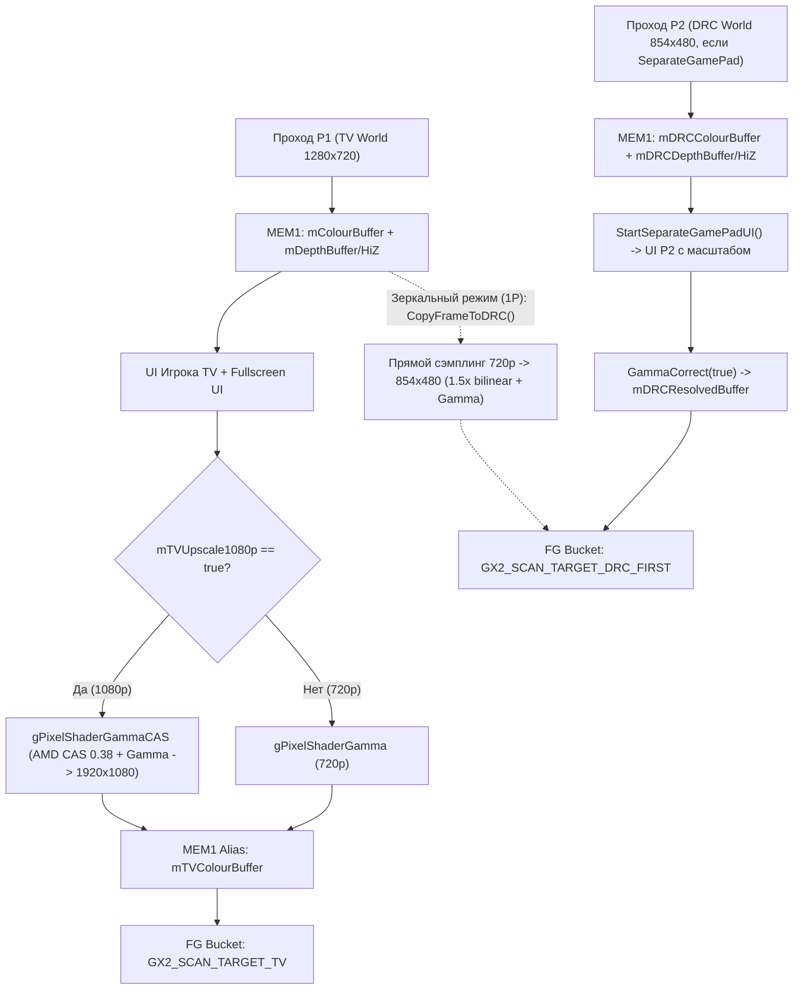

# Minecraft: Wii U Edition — реконструкция C++, DualScreen и AMD CAS

Данный документ описывает инженерную архитектуру C++-реконструкции **Minecraft: Wii U Edition** (кодовая база 4J Studios Legacy Console Edition, обновление **v688**) и внесённые поверх неё доработки: независимый двухэкранный локальный кооператив (**DualScreen / SeparateGamePad**), апскейлинг 720p → 1080p на базе **AMD FidelityFX CAS**, а также раздельную 3D-маршрутизацию звука между телевизором и Wii U GamePad.

Проект представляет собой **декомпиляцию (реконструкцию исходного C++)**, а не статическую рекомпиляцию: исполняемый файл `Minecraft.Client.rpx` собирается целиком из исходного кода без бинарных фрагментов оригинального кода. Из легального пользовательского дампа игры на этапе `tools/prepare.py` извлекаются только скомпилированные шейдеры, таблицы конвертации, ключи и игровые ресурсы.

## 1. Паспорт проекта

| Параметр | Значение |
| :--- | :--- |
| **Идентификатор тайтла (EUR)** | Base: `00050000101D7500` · Update: `0005000E101D7500` (`WUP-P-AUMP`) |
| **Идентификатор тайтла (US)** | Base: `00050000101D9D00` · Update: `0005000E101D9D00` |
| **Целевая версия** | Update **v688** (`title_version = 0x02B0`, Cafe SDK `21301`) |
| **Исходная кодовая база** | 7626 файлов `.cpp` / `.hpp` (C++11 / C99), разделённых по platform seam |
| **Оригинальные шейдеры** | 31 шейдерный объект рендерера (`RendererShaders.inc`) + 2 шейдера FFL (Mii) |
| **Дополнительный шейдер** | `GammaCASShader.inc` (`gPixelShaderGammaCAS`, 230 слов / `0x398` байт) |
| **Лимит памяти (`cos.xml`)** | `max_size = 0x40000000` (1 ГБ MEM2), `max_codesize = 0x0E000000` (224 МБ) |
| **Форматы поставки** | `.wuhb` (~1.51 ГБ для Aroma) и WUP-пакет (`00000000.app`–`0000000A.app` + `.h3`/TMD) |

### Структура исходного дерева

Кодовая база строго разделена границей переносимости (**platform seam**): ни один файл в `source/game/` не вызывает напрямую API Cafe OS или GX2.

- `source/game/` — платформонезависимое ядро (`core`, `world`, `entity`, `item`, `network`, `server`, `minigame`, `ui`, `client/render`, `client/audio`).
- `source/platform/wiiu/` — реализация интерфейсов `C4J*`/`C*` (`Renderer.cpp`, `Main.cpp`, `C4JThreadImpl.cpp`, `CStorage.cpp`, `CInput.cpp`, `CProfile.cpp`, `NQRNetworkManager_WiiU.cpp`, `pead.cpp`).
- `source/vendor/` — реконструированные сторонние библиотеки, статически линкуемые в RPX: Miles Sound System (`Miles*.cpp`), декодер Bink Audio (`BinkA*.cpp`), голосовой кодек (`VCT*`), `dlmalloc.cpp`, `stb_truetype`.
- `source/nn/` — реконструированные библиотеки Nintendo (`nex`, `pia`, `save`, `swkbd`, `erreula`, `crypto`, субмодуль `ffl` v1.5.6 для иконок Mii).
- `source/cafe/` — декларации GX2/GFD, матричная математика (`mtx`, `mtx44`), системный слой `libsys` и поддержка C++ ABI `libsedg` (`operator new`/`delete`, RTTI, `__call_dtors`).

## 2. Инструментарий сборки, ABI и управление памятью

### RedHills Clang 19 и Green Hills C++ ABI

Оригинальный бинарник `Minecraft.Client.rpx` собирался проприетарным компилятором Green Hills Software (GHS), чей C++ ABI отличается от Itanium ABI (GCC/стандартного Clang) расположением указателей `vptr`, раскладкой виртуальных баз, структурами RTTI и соглашениями вызова конструкторов/деструкторов. Поскольку системные библиотеки и структуры движка завязаны на этот ABI, сборка выполняется форком **RedHills** (Clang 19, ветка `ghs-rtti-vbases`) с инструментами линковки **LLVM 22** (`ld.lld`, `llvm-ar`, `llvm-nm`) и заголовками/экспортами **WUT** (`legacy-console-recon`).

Ключевые флаги компиляции в `tools/rpx/build_redhills.py`:

```text
-target powerpc-eabi -mcpu=750 -O2 -ffunction-sections -fdata-sections
-fno-delete-null-pointer-checks -std=gnu++11 -fshort-wchar -fsigned-char
-frtti -fno-exceptions -fno-threadsafe-statics
-DCAFE=2 -DPLATFORM=CAFE -DESPRESSO -D__WIIU__ -D__WUT__
-DBOOST_SP_ENABLE_THREADS -DBOOST_SP_NO_SYNC -DBOOST_NO_EXCEPTIONS
```

Этапы сборки RPX:

1. Компиляция C/C++ рантайма (`tools/redhills/build_runtime16.py`): `newlib 4.6.0` и `libstdc++` (GCC 16.1.0) с 2-байтным `wchar_t`; пересборка `libstdc++` и `libm` компилятором RedHills для исключения паттернов регистров условий (`CR`), некорректно обрабатываемых рекомпилятором Cemu.
2. Сборка статических провайдеров: `libpng 1.6.2` и приватная копия `zlib 1.2.5` для NEX с переименованием символов через префикс `quazal_` (собственные вызовы zlib игры идут в системную `zlib125.rpl`).
3. Двухпроходная линковка `ld.lld` по скрипту `tools/redhills/cafe.ld`: секции `.syscall` и `.text` размещаются с `0x02000000`, `.rodata`/`.data`/`.bss` — с `0x10000000`. Первый проход определяет импортируемые символы, `tools/rpx/imports.py` генерирует стабы `.fimport_*`/`.dimport_*`, второй проход собирает `minecraft.elf`.
4. Верификация бинарника утилитой `tools/redhills/crscan.py` и конвертация в `Minecraft.Client.rpx` (`tools/rpx/elf2rpx.py`).

### Раскладка потоков по ядрам Espresso

Абстракция `C4JThreadImpl` (`source/platform/wiiu/C4JThreadImpl.cpp`) устанавливает квант планировщика `OSSetThreadRunQuantum(..., 8000)` и привязывает потоки к ядрам через `SetProcessor(0 | 1 | 2)`:

| Ядро Espresso | Кэш L2 | Назначенные подсистемы и потоки |
| :--- | :--- | :--- |
| **Core 1** | 2 МБ | Главный поток `s_mainThread` (`Main.cpp`): цикл `Minecraft::run_middle()`, GX2-рендеринг, FUI/HUD, `ProcUI`, ввод VPAD/WPAD |
| **Core 0** | 512 КБ | Интегрированный сервер (`CGameNetworkManager.cpp` → `serverThread`), фоновое сохранение чанков (`McRegionChunkStorage`, `ClientChunkCache`), загрузка скинов (`ConsoleUIController::m_skinThread`), генерация превью биомов и экраны прогресса |
| **Core 2** | 512 КБ | Аудиоподсистема (`PlatformSoundEngineImpl::initAX` → `AXInitThread`, потоки открытия музыки `OpenStreamThreadProc`), фоновые обновления рендера (`GameRenderer::sRenderUpdateThread`), обновления блоков (`ServerLevel::sBlockUpdateThread`), пост-обработка генерации (`MinecraftServer::postProcessThread`), сетевые потоки `CPlatformNetworkManagerNintendo` |

### Кастомный аллокатор `dlmalloc` в MEM2

В хуке `__preinit_user` (`source/platform/wiiu/Main.cpp`), вызываемом загрузчиком Cafe OS до `main()`, приложение забирает весь доступный объём системной кучи MEM2 единым арено-блоком (`MEMGetAllocatableSizeForExpHeapEx(*mem2, 4)`), выравнивает верхнюю границу `gHeapTop` по странице 4096 байт и перенаправляет системные указатели `MEMAllocFromDefaultHeap`, `MEMAllocFromDefaultHeapEx` (с округлением до 64-байтных кэш-линий при `alignment == 64`), `MEMFreeToDefaultHeap` и аллокатор `OSDynLoad_SetAllocator` на встроенный `dlmalloc` (`source/vendor/dlmalloc.cpp`, компилируемый как C). Это устраняет фрагментацию и накладные расходы системного `ExpHeap` при частых мелких аллокациях движка.

## 3. Графический конвейер GX2, бюджет MEM1 и AMD CAS

Инициализация GX2 (`source/platform/wiiu/Renderer.cpp`) выделяет командный пул `COMMAND_BUFFER_POOL_SIZE = 0x400000` (4 МБ) и три динамических вершинных буфера по `0x200000` (2 МБ каждый, тройная буферизация по индексу `mDynamicVertexBufferIndex % 3`) в MEM2, а также настраивает регистры шейдеров:

```cpp
GX2SetShaderModeEx(GX2_SHADER_MODE_UNIFORM_REGISTER, 48, 64, 0, 0, 200, 192);
```

### Бюджет MEM1 и схема алиасинга буферов

Функция `Renderer::MemoryInit()` забирает всю свободную память `MEM_BASE_HEAP_MEM1` в `mMEM1Heap` и всю память `MEM_BASE_HEAP_FG` в `mBucketHeap`. В `Renderer::Initialise()` порядок аллокации спроектирован так, чтобы режим 1080p CAS и DualScreen никогда не привели к отказу на реальной консоли:

1. **Foreground Bucket (`mBucketHeap`)**: первым выделяется двойной scan-буфер `mDRCScanBuffer` (854×480 `RGBA8`), чтобы GamePad гарантированно получил память. Только после этого проверяется, помещается ли 1080p-буфер `mTVScanBuffer` (1920×1080 `RGBA8`, `GX2_TV_RENDER_1080`); при нехватке или если системный режим не равен `GX2_TV_SCAN_MODE_1080P`, выполняется откат на `GX2_TV_RENDER_720`.
2. **Постоянные поверхности в MEM1**:
   - `mColourBuffer` — основной буфер цвета TV (`1280×720`, `TCS_R8_G8_B8_A8_UNORM`);
   - `mDepthBuffer` + `hiZPtr` — буфер глубины TV (`1280×720`, `D_D24_S8_UNORM` + Hi-Z);
   - `mDRCColourBuffer` — основной буфер цвета DRC (`854×480`, `TCS_R8_G8_B8_A8_UNORM`).
3. **Зарезервированный блок `reservedSize = 0x1600000` (~22 МБ) в MEM1**:
   - Начало блока (`alphaImage`) **алиасируется** тремя поверхностями, чьи проходы строго последовательны: буфер OIT-прозрачности TV (`mAlphaColourBuffer`, 1280×720 `R16G16B16A16_FLOAT`), буфер OIT-прозрачности DRC (`mDRCAlphaColourBuffer`, 854×480 `R16G16B16A16_FLOAT`) и финальный целевой буфер TV (`mTVColourBuffer`, 1280×720 или 1920×1080 `RGBA8`).
   - Сразу за областью `sharedSize = max(mTVColourBuffer, mAlphaColourBuffer, mDRCAlphaColourBuffer)` с соблюдением аппаратного выравнивания размещаются **непересекающиеся** поверхности режима DualScreen:
     - `mDRCResolvedBuffer` (854×480 `RGBA8`) — финальный гамма-скорректированный кадр DRC;
     - `mDRCDepthBuffer` (854×480 `D_D24_S8_UNORM`) — независимый буфер глубины GamePad;
     - `mDRCDepthBuffer.hiZPtr` — независимая таблица Hi-Z для GamePad.

Перед активацией режима `mTVUpscale1080p` функция `Renderer::Initialise()` аналитически проверяет, что `mTVColourBuffer` (1920×1080) + `mDRCResolvedBuffer` + `mDRCDepthBuffer` + `drcHiZSize` целиком укладываются в `0x1600000` байт.



### Fused-шейдер `GammaCASShader` (720p → 1080p) и прямой сэмплинг DRC

В `Renderer::GammaCorrect(bool gamePad)` стандартный проход гамма-коррекции для TV при `mTVUpscale1080p == true` заменяется объединённым (fused) фрагментным шейдером **`gPixelShaderGammaCAS`** (`source/platform/wiiu/shaders/GammaCASShader.inc`, 230 слов микрокода GPU7, один `vec4` униформ `cas_params` в регистре `0` и сэмплер `screen_texture` с билинейным фильтром `mTVUpscaleSampler`).

Шейдер объединяет **квазилинейный AMD FidelityFX Contrast Adaptive Sharpening (CAS)** при апскейлинге 1280×720 → 1920×1080 и гамма-коррекцию за **один проход** без промежуточных буферов:

```cpp
// Renderer::GammaCorrect (source/platform/wiiu/Renderer.cpp)
const float casSharpness = 0.38f;
float casParams[4];
casParams[0] = 1.0f / (float)mScreenWidth[0];   // 1 / 1280
casParams[1] = 1.0f / (float)mScreenHeight[0];  // 1 / 720
casParams[2] = -1.0f / (8.0f - 3.0f * casSharpness);
casParams[3] = 0.5f * gammaVal;
GX2SetPixelUniformReg(0, 4, casParams);
```

Значение `casSharpness = 0.38f` выбрано эмпирически: оно повышает чёткость шрифтов UI и пиксельных текстур 16×16 без появления гало-артефактов (ringing) на высококонтрастных краях блоков.

:::tip Соблюдение критерия Найквиста при копировании на GamePad
В обычном (зеркальном) режиме `Renderer::CopyFrameToDRC()` при активном 1080p CAS **не** сэмплирует итоговый буфер `mTVTexture` (1920×1080 → 854×480 дало бы коэффициент сжатия `2.25x`, превышающий предел Найквиста `2x` для билинейного фильтра и вызывающий муар и мерцание). Вместо этого шейдер `mGammaPixelShader` сэмплирует напрямую исходный 720p-буфер `mColourTexture` (`1.5x` билинейный даунскейл + гамма), сохраняя стабильную картинку на DRC.
:::

## 4. Архитектура двухэкранного кооператива (SeparateGamePad)

Режим независимых экранов управляется настройкой `eGameSetting_SeparateGamePad` (`UIScene_SettingsListMenu.cpp`, чекбокс ID `33`). Проверка активности выполняется каждый кадр функцией `Minecraft::findSeparateGamePadPlayer()`:

- включена опция `gApp.GetSeparateGamePadEnabled()`;
- активна локальная сессия (`CGameNetworkManager::sInstance.IsLocalGame()`);
- рендерер успешно выделил буферы DRC (`Renderer::CanRenderSeparateGamePad()` проверяет `mForegroundAcquired && mDRCResolvedBuffer.surface.imagePtr != NULL`);
- в игре ровно **2 локальных игрока**, оба контроллера подключены, и один из них — Wii U GamePad (`g_pInput->IsPadDRCController(i)`).

### Независимые камеры, вьюпорты и цикл рендера

При активации `mSeparateGamePadPlayer >= 0` метод `Minecraft::updatePlayerViewportAssignments()` назначает **обоим** игрокам полноэкранный вьюпорт (`mViewport = 0`) вместо сплит-скрина (`1`/`2` или `3`/`4`), отключая сжатие FOV/соотношения сторон, характерное для split-screen. В `GameRenderer::getFovAndAspect()` для игрока на GamePad выставляется точное соотношение сторон `854.0f / 480.0f`.

В главном цикле `Minecraft::run_middle()` рендер проходит по всем активным локальным игрокам:

1. Для игрока TV мир рендерится в `mColourBuffer` / `mDepthBuffer` (1280×720).
2. Для `gamePadPlayer` вызывается `gRenderer->StartGamePadWorld()` (переключение RT на `mDRCColourBuffer` и `mDRCDepthBuffer`, viewport 854×480), рендерится мир P2, после чего `gRenderer->StartFrame()` возвращает контекст на TV.
3. Далее `ConsoleUIController::renderScenes()` рисует FUI-сцены игрока TV и `EUIGroup_Fullscreen` в TV-буфер, вызывает `gRenderer->StartSeparateGamePadUI()` (выполняет `GammaCorrect()` для TV, переключает экран на DRC, выставляет флаг `mSeparateGamePadFrame = true` и очищает глубину DRC) и рисует HUD/меню игрока P2 в `mDRCColourBuffer`.
4. На `Renderer::Present()` при `mSeparateGamePadFrame == true` выполняется `GammaCorrect(true)` (`mDRCColourBuffer` → `mDRCResolvedBuffer`), после чего `mDRCResolvedBuffer` копируется в `GX2_SCAN_TARGET_DRC_FIRST`, а `mTVColourBuffer` — в `GX2_SCAN_TARGET_TV`.

### Масштабирование меню P2 и пересчёт касаний VPAD

Поскольку FUI-сцены свёрстаны в логическом пространстве `1280×720`, на физическом 6.2-дюймовом экране 854×480 инвентарь и мелкие иконки без масштабирования становятся плохо читаемыми. Чтобы сохранить единую систему координат FUI:

- `Renderer::StateSetScissorRect()` при `mSeparateGamePadFrame && mScreen == 1` пропорционально переводит прямоугольник отсечения из пространства `1280×720` в `854×480`.
- `ConsoleUIController::GetGamePadSceneTransform(UIScene*, scale, pivotX, pivotY)` возвращает индивидуальный коэффициент масштабирования и опорную точку для сцен игрока на GamePad (`UIScene::render()` передаёт их в `gFui->render`):

| Группа сцен P2 (FUI) | Коэффициент `scale` | Опорная точка `(pivotX, pivotY)` |
| :--- | :--- | :--- |
| Инвентарь, верстак (classic), печь, раздатчик, воронка, наковальня, стол зачарований, торговля, обычный сундук | `1.35` | `(640.0, 390.0)` |
| Крафт 2×2 / 3×3, креативное меню | `1.20` | `(640.0, 400.0)` |
| Меню паузы, настройки, опции хоста/игрока, табличка, диалоги, телепорт | `1.20` | `(640.0, 385.0)` |
| Списки настроек, выбор языка, справка | `1.18` | `(640.0, 350.0)` |
| Большой сундук (`isLargeChest`), зельеварка, маяк | `1.14` | `(640.0, 445.0)` |

Чтобы сенсорный ввод VPAD попадал точно в отмасштабированные элементы управления, функции `ConsoleUIController::TouchBoxHit()` и обработчик касаний вызывают обратное преобразование `ConsoleUIController::TransformGamePadTouch()`:

```text
x' = floor((x - pivotX) / scale + pivotX + 0.5)
y' = floor((y - pivotY) / scale + pivotY + 0.5)
```

## 5. Аудиоподсистема на Core 2: Miles, BinkA и 2P-маршрутизация

Аудиодвижок реконструирован на базе **Miles Sound System** и декодера **Bink Audio (`BinkADec_RIB_Main`)**, работающих поверх системного **AX DSP** (`source/game/client/audio/PlatformSoundEngineImpl.cpp`, `SoundEngine.cpp`, `source/vendor/MilesMem.cpp`).

### Инициализация и потоковая модель

При старте `PlatformSoundEngineImpl::init()`:

1. Регистрирует статический провайдер `BinkADec`.
2. Запускает одноразовый поток `AXInitThread` с привязкой **`SetProcessor(2)`**, который вызывает `AXInit()` на Core 2 — это гарантирует, что прерывания и сервисный поток AX исполняются на Core 2, не конкурируя с главным рендер-потоком на Core 1.
3. Инициализирует `MIXInit()`, файловые колбэки (`WiiUMilesFileSystem.cpp`), `AIL_startup()` и открывает цифровой драйвер:

```cpp
pProvider = AIL_output_ax(3);
m_pDigitalDriver = AIL_open_generic_digital_driver(32000, 16, 128, 0, pProvider);
```

Параметры драйвера: частота **32 кГц**, **16-бит PCM**, **128 виртуальных голосов**, звуковой банк `WiiU/Sound/Minecraft.msscmp` (буфер очереди событий `0x20000`, пул `0x40000`). Открытие потоковых музыкальных файлов `.binka` (`music/` и `cds/`) выполняется асинхронно в `OpenStreamThreadProc`, также закреплённом за **Core 2** (`SetProcessor(2)`).

### Раздельный 3D-звук для двух игроков (TV vs DRC)

В оригинальном Miles один глобальный 3D-слушатель (`AIL_set_listener_3D_position`). Для двухэкранного режима в реконструкцию добавлена двухслушательная архитектура:

1. **Два слушателя**: в `SoundEngine::tick()` при 2 валидных игроках и активном `getSeparateGamePadPlayer()` запоминаются индексы `m_tvListener` и `m_gamePadListener`.
2. **Дублирование событий**: при вызове `SoundEngine::play()` и `SoundEngine::playUI()` каждый игровой звук (или UI-клик) запускается парой инстансов с `info.routeToDRC = true` и `info.routeToDRC = false` (для `SoundInstance` используется флаг `instance->drcClone`).
3. **Преобразование координат источника**: в `SoundEngine::UpdateSound()` для каждого экземпляра позиция источника `(info->x, info->y, info->z)` переносится и поворачивается в локальную систему координат соответствующего слушателя (TV или GamePad), тогда как глобальный слушатель Miles фиксируется в начале координат `(0, 0, 0)`:

```cpp
const float dx = info->x - listener.x;
const float dz = listener.z - info->z;
*x = dx * listener.forwardZ + dz * listener.forwardX;
*y = info->y - listener.y;
*z = dz * listener.forwardZ - dx * listener.forwardX;
```

4. **Развязка шин в микшере Miles**: на уровне `MilesMem.cpp` каждому сэмплу передаются флаги `pSample->outputToDRC` и `pSample->separateOutputs`. Когда `separateOutputs == true`:
   - строки матрицы микширования выше `MERGE_DRC_DOWNMIX_ROW` (шина DRC) обнуляются для TV-сэмплов, а TV-строки обнуляются для DRC-сэмплов;
   - для 3D-сэмплов DRC выполняется стерео-даунмикс 5.1 → L/R (`(pLevels[0] + pLevels[4] + pLevels[2] * 0.5) / 3`);
   - принудительно обнуляется посыл на общую шину реверберации (`fWet = ZERO`), поскольку legacy-шина эффектов Miles физически общая для TV и GamePad и иначе «протекала» бы между экранами.
5. **Два независимых музыкальных потока**: `PlatformSoundEngineImpl::openStream()` открывает два раздельных дескриптора `m_pStream` (TV) и `m_pStreamDRC` (DRC), позволяя в том числе корректно позиционировать 3D-пластинки из проигрывателя (Jukebox, `is3D = true`) независимо относительно каждого игрока.

## 6. Подсистема сохранений и форматы поставки

### Работа с `nn::save` и структура миров

В `meta/meta.xml` для тайтла объявлена квота `account_save_size = 0x20000000` (**512 МБ** на профиль пользователя, `common_save_size = 0`). При запуске `Main.cpp` инициализирует хранилище вызовом:

```cpp
gStorage->Init(0, L10N::GetString(0xc0b26be6), "savegame.dat", 51000000,
               CConsoleMinecraftApp::DisplaySavingMessageWiiU, &gApp, "", &noSpaceForSaveQuota);
gStorage->SetMaxSaves(99);
```

Реализация `CStorage` (`source/platform/wiiu/CStorage.cpp`) работает с `SAVEInit()` / `SAVEInitSaveDir(nn::act::GetSlotNo())` в выделенных фоновых потоках (`m_saveThreads[0..4]`) и гарантирует атомарность записи через `SAVEFlushQuota()` / `SAVERollbackQuota()`:

- **Миры**: для каждого мира хранится пара файлов — основной бинарный файл сохранения и метаданные `<name>.ext`, содержащие 256-байтный (`0x100`) заголовок названия мира и миниатюру 64×64 PNG (снимаемую через цепочку 4 линейных буферов `mThumbnailColourBuffer[0..3]` от 512×512 до 64×64 в Foreground Bucket). Поддерживается до **99 сохранений**.
- **Настройки профиля**: сохраняются в файлы `options_<XUID>` с 2-байтным заголовком версии (`m_profileVersion`) и поддержкой миграции старых версий (`m_oldProfileVersionCallback`).
- **Учёт квоты NAND**: `CStorage::GetFileNANDSize()` округляет размер каждого файла по реальным кластерам файловой системы Wii U (8 КБ для файлов менее 40 КБ, 64 КБ до 320 КБ и 512 КБ для более крупных файлов).

### Форматы дистрибуции: `.wuhb` vs WUP

Сборка на выходе формирует два готовых артефакта (распространяемых через инфраструктуру `parhelio.ru` SmartMirror):

- **`Minecraft.WiiU.wuhb`** (~1.51 ГБ): самодостаточный пакет для Aroma CFW, удобный для быстрого запуска с SD-карты без установки в системную память.
- **WUP-пакет (`Minecraft_WiiU/`)**: набор шифрованных контентных файлов `00000000.app`–`0000000A.app` (основной контент-архив `0000000A.app` ~1.52 ГБ, бинарник `00000009.app` ~9.4 МБ), хэш-деревья `.h3`, `title.tmd`, `title.tik`, `title.cert` и контрольные суммы SHA-256. WUP-установка в NAND/USB обеспечивает максимальную скорость загрузки миров и стриминга `.binka`, а также нативную работу с квотой `nn::save` по собственному `Title ID`.

## 7. Известные ограничения, компромиссы и верификация

- **Статус паритета декомпиляции**: реконструкция покрывает 100% исполняемого кода (линкуется без объектных файлов оригинала), но побайтовое совпадение отдельных функций продолжает уточняться и измеряется скриптом `tools/measure/parity.py`.
- **Защита от ошибок рекомпилятора Cemu**: на каждом билде запускается статический сканер `tools/redhills/crscan.py`, прерывающий сборку при обнаружении PowerPC-последовательностей, которые некорректно транслируются стоковым Cemu 2.6.
- **Компромисс шины эффектов в 2P DualScreen**: в режиме раздельного вывода TV/DRC глобальная шина реверберации Miles принудительно отключается (`fWet = ZERO`), чтобы избежать акустического перекрёстного проникновения между игроками.
- **Условия активации 1080p CAS**: апскейлинг `GammaCASShader` включается автоматически только при системном режиме вывода `GX2_TV_SCAN_MODE_1080P` и успешном прохождении проверки бюджета MEM1 (`0x1600000`) и Foreground Bucket; при 720p/480p или нехватке памяти рендерер бесшовно откатывается на нативный 720p-вывод.
- **Сетевые функции**: серверы Nintendo Network для Wii U были отключены в апреле 2024 года; онлайн-модули `nn::nex`/`nn::pia` реконструированы для структурной целостности и локальной игры, но взаимодействие с оригинальной инфраструктурой Nintendo не верифицировалось.
- **Резервное копирование**: несмотря на использование нативного транзакционного слоя `nn::save` (`SAVEFlushQuota`), перед запуском модифицированных сборок на реальной консоли рекомендуется создавать резервную копию каталога сохранений.
