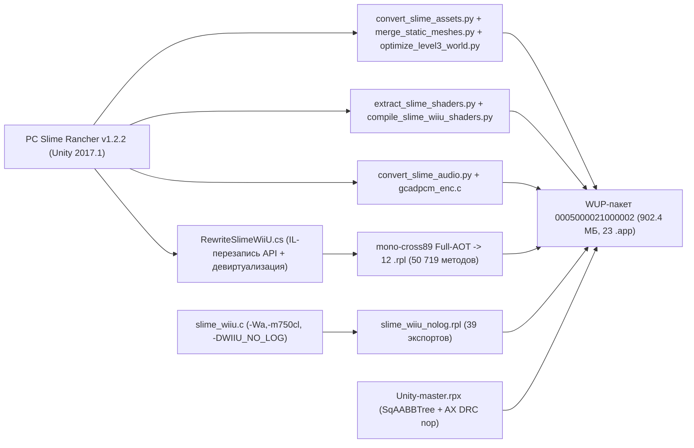
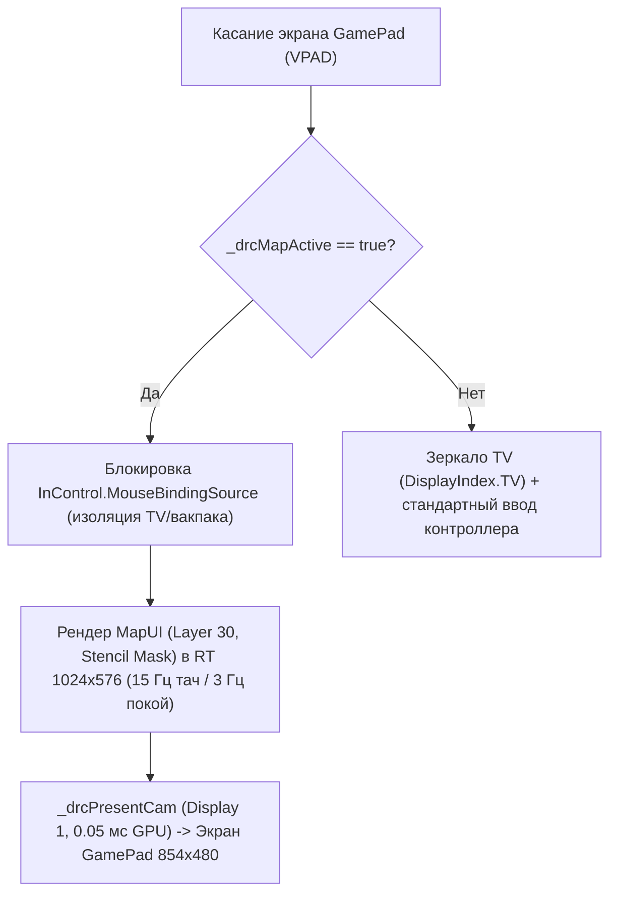

# Slime Rancher (Wii U): Full-AOT Unity 5.6, Core 2 SIMD и WPVS

Порт **Slime Rancher v1.2.2** на Nintendo Wii U (выпуск **v42 NoLog**) представляет собой перенос коммерческой 3D-игры с ПК-ветки **Unity 2017.1.3f1** на консольный рантайм **Unity 5.6.5p4 (`cafe_master_WiiU`)**. Для удержания `28–30 FPS` на стоковом железе Wii U (`1,24 ГГц` in-order Espresso, `550 МГц` Latte, `849 МБ` доступной MEM2) потребовалась полная AOT-компиляция всех `50 719` методов C#, вынесение горячих вычислений в нативный Paired Singles SIMD-плагин на Core 2, офлайн-перестройка геометрии/PVS/шейдеров и перевод 100 % звука на аппаратный 120 МГц AX DSP.

## 1. Паспорт сборки и аппаратные рамки

| Параметр | Значение (v42 NoLog) |
|---|---|
| **Title ID / Product Code** | `0005000021000002` / `WUP-P-SLIM` |
| **Исходная / целевая платформа** | Slime Rancher `v1.2.2` (`Unity 2017.1.3f1`) → `Unity 5.6.5p4` Wii U (`targetPlatform = 36`) |
| **Релизный профиль** | **v42 NoLog** (без SD-логов и без `seed_save`), Region Free (`FFFFFFFF`), `drc_use = 1` |
| **Установочный пакет (WUP)** | `946 183 492` байт (~`902,4 МБ`), 23 `.app` (макс. чанк `857,1 МБ`), 58 файлов |
| **Исполняемый код (`title/code/`)** | `Unity-master.rpx` (`21 МБ`) + **12** Mono AOT `.rpl` + **1** нативный `slime_wiiu.rpl` (`14,5 КБ`) |
| **Резерв кода (`cos.xml`)** | `max_codesize = 0x09400000` (`148 МБ`), общий доступный бюджет MEM2 ~`849 МБ` |
| **Видеовывод и частота** | `30 FPS` (`vSyncCount = 2`), TV `1280×720` (DRS `720p → 648p → 576p` + CAS), DRC `854×480` |

### Распределение ядер и ограничения `Unity-master.rpx`

| Подсистема Wii U | Характеристики и назначение в порте |
|---|---|
| **Core 0** (`512 КБ` L2) | Системные службы Cafe OS, `UnityGfxDeviceWorker` (GX2); в отладочной сборке — `SlimeLogWriter` (приоритет `28`) |
| **Core 1** (`2 МБ` L2) | Главный поток Unity, Mono Full-AOT, однопоточный PhysX 3.3, куллинг, uGUI |
| **Core 2** (`512 КБ` L2) | `AxTunnel` (приоритет `1`), минимальный микшер FMOD (`GCADPCM`), нативный воркер `SlimeSpatialC2` (приоритет `20`) |
| **GPU AMD Latte** (`550 МГц`) | `320` VLIW5 ALU, `16` TMU, `8` ROP; узкие места — выборки TMU, fillrate/overdraw и число draw calls (цель `<= 280–350`/кадр) |
| **MEM1 eDRAM / MEM2 DDR3** | `32 МБ` сверхбыстрой eDRAM под фреймбуферы и активный RT; `1 ГБ` общей MEM2 (`12,8 ГБ/с`), игре доступно ~`849 МБ` |
| **AX DSP** (`120 МГц`) | Аппаратное декодирование **GCADPCM** (сжатие `3,5×`), снимает декодирование аудио с CPU почти до `0 %` |

Движок `Unity-master.rpx` имеет жёсткие платформенные ограничения: отсутствуют `graphicsJobs`, `Graphics.DrawMeshInstanced`, пользовательские GX2 Display Lists из C#, многопоточный PhysX и поддержка `gl_FrontFacing` в пиксельных шейдерах; `Cursor.lockState` заглушен в `None`, `Display.RelativeMouseAt` возвращает нулевой вектор, а `System.IO.File.Copy` / `File.Move` на `/$SAVE` завершаются ошибкой Win32 error `50`.

### Почему возможна только установка через WUP Installer (невозможность `.wuhb`)

В отличие от одномодульных WUT-приложений, консольный Unity-проект состоит из основного `Unity-master.rpx` (`22 054 988` байт) и **13** сопутствующих динамических библиотек `.rpl` в `/vol/code/`:

| Модуль в `title/code/` | Размер | Назначение |
|---|---|---|
| `Unity-master.rpx` | `21 МБ` | Ядро Unity 5.6.5p4 Wii U (GX2, PhysX `SqAABBTree`, FMOD, Cafe OS) |
| `Assembly-CSharp_dll.rpl` | `4,8 МБ` | Full-AOT код основной логики Slime Rancher и `SlimeWiiUHelper` |
| `UnityEngine_dll.rpl` / `mscorlib_dll.rpl` | `2,6 МБ` / `2,2 МБ` | Базовые библиотеки Unity и BCL (с `4096` трамплинами IMT/RGCTX) |
| `System_Xml_dll.rpl` / `System_dll.rpl` / `System_Core_dll.rpl` | `1,0 МБ` / `971 КБ` / `392 КБ` | Стандартные сборки .NET, перештампованные по MVID |
| `UnityEngine_Networking_dll.rpl` / `UnityEngine_UI_dll.rpl` | `747 КБ` / `580 КБ` | Подсистемы сети и uGUI |
| `Assembly-CSharp-firstpass_dll.rpl` / `Mono_Security_dll.rpl` | `331 КБ` / `294 КБ` | Вспомогательные сборки игры и безопасности Mono |
| `Logger_dll.rpl` / `Assembly-UnityScript_dll.rpl` | `5,1 КБ` / `4,4 КБ` | Служебные игровые сборки |
| `slime_wiiu.rpl` (`slime_wiiu_nolog.rpl`) | `14,5 КБ` (NoLog) | Нативный C/PPC плагин с Core 2 SIMD и `WiiU_RubberBoneStep4` (39 экспортов) |

Загрузчик `OSDynLoad` разрешает 13 `.rpl` из `/vol/code/` установленного тайтла при резервировании `max_codesize = 0x09400000` (`148 МБ`) в `cos.xml`, а сохранения завязаны на системный квотируемый раздел `/$SAVE` (`SaveCommand.FlushQuota()`). Формат Aroma `.wuhb` не предоставляет ни многомодульной загрузки `/vol/code/` с 148-мегабайтным `max_codesize`, ни нативного `/$SAVE`, поэтому сборка распространяется исключительно как универсальный WUP-пакет (`console_id = 0`, шифрование общим Wii U Common Key из `otp.bin[0xE0:0xF0]`, независимая AES-CBC + TMD + H0–H3 + FST верификация в `pack_slime_wiiu_console.py`).



## 2. Миграция Unity 2017.1 → 5.6.5p4 и 100% Full-AOT компиляция

### IL-перезапись и совместимость API

Инструмент `tools/slime-compat/RewriteSlimeWiiU.cs` (на `Mono.Cecil`) приводит бинарные сборки Unity 2017.1.3f1 к ABI рантайма Unity 5.6.5p4:

- замена отсутствующих API: `System.IO.InvalidDataException → IOException`, `Environment.ProcessorCount → SystemInfo.processorCount`, no-op заглушка `UnityEngine.ScreenCapture`, локальная заглушка `UnityEngine.Analytics` (`UnsupportedPlatform = 7`);
- вырезание ПК-зависимостей (`System.Web.Services`/`MantisConnect`, Steam, Discord, GifRecorder, InControlNative, XInput) и подмена `UnityInputDeviceManager` на `WiiUInControlDevice` (одновременная работа GamePad и Pro Controller на каналах `0..1`, программный `vp_Utility.LockCursor`);
- замена медленного Regex-парсера локализации на однопроходный `O(N)` `WiiUFastLocalization` (~100× быстрее на PowerPC, экономит `3–4 с` на старте) и замена `iTween` на zero-GC `WiiUFastTween` с отсечкой микроколебаний менее `0,002` (прекращает ежекадровую перестройку коллайдеров плодов в PhysX);
- жёсткий инвариант для инжектируемого `SlimeWiiUHelper.cs`: ноль `try`/`catch`/`finally`/`foreach`/`using`/`lock` и ноль прямых межклассовых вызовов (коммуникация только через `Type.GetType` + `AddComponent` + `SendMessage`), поскольку клонировщик типов и Mono AOT v67 на PowerPC ломают таблицы обработчиков исключений.

### 100% Full-AOT, трамплины и сборка `NoLog`

На Wii U JIT-компиляция отключена. Пайплайн `tools/build_slime_aot.py` компилирует игровые DLL через `mono-cross89` (Docker-образ `subnautica-mono-debug`) в PowerPC GHS ABI с покрытием **50 719 из 50 719 методов (100 %)** и перештамповывает MVID/версии/токены 8 донорских BCL/Unity `.rpl`. Чтобы устранить нехватку IMT-трамплинов в Full-AOT, в `mscorlib_dll.rpl` расширены таблицы до **`4096` specific / `4096` rgctx / `4096` imt**, а в `RewriteSlimeWiiU.cs` добавлена автоматическая девиртуализация `DevirtualizeGenericVirtualCalls`.

Исполняемые файлы RPX строго разделены (`tools/patch_slime_rpx.py`): в консольный пакет попадает только `Unity-master.rpx` со штатным PhysX `SqAABBTree` BVH (`O(log N)`), тогда как `Unity-master-cemu.rpx` с `--cemu-bucket-pruner` (обход бага рекомпилятора Cemu 2.6, работающий в 10 раз медленнее на реальном Espresso при `26 050` коллайдерах) используется исключительно в эмуляторе. В релизной сборке **v42 NoLog** плагин `slime_wiiu.c` собирается с `-DWIIU_NO_LOG`: из `slime_wiiu_nolog.rpl` полностью удалены импорты `FS*`/`OSReport` и поток записи `/vol/external01/slime_wiiu.log` при сохранении всех `39` экспортов.

## 3. Нативный C/PPC плагин `slime_wiiu.rpl` на Core 2

Модуль `tools/native-plugins/slime_wiiu.c` компилируется с `-Wa,-m750cl` под векторные инструкции **Espresso Paired Singles** (2× `float32` за такт) и снимает два тяжёлых класса вычислений с Core 1:

1. **Пространственный куллинг 512 акторов на Core 2 (`SlimeSpatialC2`)**: поток привязан к `OS_THREAD_ATTRIB_AFFINITY_CPU2` с приоритетом `20` (строго ниже приоритета `1` системного `AxTunnel`). Координаты и радиусы передаются с Core 1 за один P/Invoke через закреплённые `GCHandle`-массивы (`WiiU_SpatialSetBulk` + `WiiU_SpatialPollAll`) в двойные 32-байтно выровненные SoA-буферы `SpatialInBuf` / `SpatialOutBuf`. На частоте `10 Гц` воркер классифицирует до `512` слаймов, ларго, кур и пропов по маскам `SP_MASK_IN_FRONT`, `SP_MASK_ANIM_ACT` (`16 м` слаймы / `20 м` ларго), `SP_MASK_NEAR_PHYS` (`18 м`) и `SP_MASK_FAR_CULL` (`35 м`), усыпляя `Animator` и `RubberBoneEffect` без отключения физики и ИИ.
2. **Пружинная физика костей (`WiiU_RubberBoneStep4`)**: обрабатывает 4 кости слайма за один P/Invoke, устраняя ~`56` межмодульных Mono PLT-вызовов на каждого слайма. Интегрирование `XY` и умножение матриц выполняются на `psq_l` / `ps_madds0` / `ps_muls0`, а ограничение максимального отклонения — через аппаратную инструкцию `frsqrte` с двумя итерациями Ньютона–Рафсона (`ppc_rsqrtf`, полная точность `fp32` без `libm`).

```c
/* Горячее ядро spatial_compute_pairs_ps (tools/native-plugins/slime_wiiu.c):
 * 2 актора за итерацию на Core 2; ограничение "b" запрещает r0 (исключает DSI). */
__asm__ __volatile__(
    "dcbt    %[pf], %[px]\n\t"          /* предвыборка 32-байтных кэш-линий (+64 Б) */
    "psq_l   6,  0(%[px]), 0, 0\n\t"    /* fr6 = (px[i], px[i+1]) */
    "psq_l   7,  0(%[py]), 0, 0\n\t"    /* fr7 = (py[i], py[i+1]) */
    "psq_l   8,  0(%[pz]), 0, 0\n\t"    /* fr8 = (pz[i], pz[i+1]) */
    "ps_sub  6, 6, 0\n\t"               /* dx */
    "ps_sub  7, 7, 1\n\t"               /* dy */
    "ps_sub  8, 8, 2\n\t"               /* dz */
    "ps_mul  9, 6, 6\n\t"               /* dx*dx */
    "ps_madd 9, 7, 7, 9\n\t"            /* + dy*dy */
    "ps_madd 9, 8, 8, 9\n\t"            /* distSq */
    "ps_mul  10, 6, 3\n\t"              /* dx*fwd_x */
    "ps_madd 10, 7, 4, 10\n\t"          /* + dy*fwd_y */
    "ps_madd 10, 8, 5, 10\n\t"          /* dotFwd */
    "psq_st  9,  0(%[d2]), 0, 0\n\t"
    "psq_st  10, 0(%[dt]), 0, 0\n\t"
    /* ... */
);
```

В отладочной версии тот же `.rpl` предоставляет аппаратный профилировщик на `OSGetSystemTime()` (~`5 нс`, 0 аллокаций C#) с кольцевым буфером `32 КБ` (сброс на SD потоком `SlimeLogWriter` на Core 0 раз в `2 с`, без блокировки Core 1) и разбиением кадра на подфазы:

| Обозначение | Измеряемый участок кадра |
|---|---|
| `F` | `FixedUpdate` и шаг симуляции PhysX 3.3 |
| `U1` | `Update`, корутины, `Animator`, начало частиц |
| `U2l` / `U2c` | `LateUpdate` до `Canvas.willRenderCanvases` (`U2l`) и пересборка uGUI / ожидание `BeginFrame` GPU (`U2c`) |
| `Rc` / `Rd` | CPU-куллинг `FPSCamera` (`Rc`) и отправка команд GX2 / CPU-скиннинг (`Rd`) |
| `Rcas` / `Rw` | Проход `WiiUAMDCAS` (`Rcas`) и вторичные камеры `WeaponCamera` / `HeldCamera` (`Rw`) |
| `W` | Ожидание вертикальной синхронизации (`VSync`) и смены буферов |

В релизной сборке **v42 NoLog** запись на SD и все импорты `FS*`/`OSReport` полностью исключены на этапе препроцессора (`-DWIIU_NO_LOG`), но таймеры `g_ema_work_ms` продолжают управлять динамическим разрешением и адаптивной частотой физики.

## 4. Оптимизация геометрии, окклюзии и графического конвейера GX2

### Офлайн-батчинг, Float16 VBO и Dual-Volume WPVS v2

Инструменты `merge_static_meshes.py`, `optimize_level3_world.py` и `convert_slime_assets.py` перестраивают статические ассеты до упаковки:

| Преобразование | Исходное состояние | Результат в порте | Измеренный эффект |
|---|---|---|---|
| Статический батчинг `level3` (`worldGenerated`) | `24 434` подмеша | `2 686` батчей | `-21 748` draw calls (включая `986` MR деревьев Мшистого покрова) |
| Статический батчинг `MainMenu` и префабов | `342` draws (`MainMenu`), `34` (`patchOcaoca04`) | `63` draws (`-81,6 %`), `6` (`patchOcaoca04`) | Плюс отключены `147` теневых `castShadows == 3` рендереров |
| Step 7 Prune мёртвых объектов | `70 436` осиротевших узлов | Удалены (`0`) | Сокращение RAM и времени загрузки `level3` |
| Сжатие VBO + Tom Forsyth | `Float32`, несортированные индексы | `Float16` (выравнивание 4 Б) + кэш `32` вершин | `level3` и `779` мешей (`sharedassets2`/`3`), снижение трафика MEM2 |
| `PlayerSettings.gpuSkinning` | `True` (GX2 StreamOut) | `False` (CPU skinning) | `BeginRP/f` `-27 %` (`22 → 16`), `Barriers/f` `-28,6 %` (`21 → 15`) |
| **Dual-Volume WPVS v2** (`wiiu_pvs.bin`, `4 029 КБ`) | Без предпросчёта | `12 742` ячеек, `2 455 / 2 455` батчей | Отсечение **более 32 %** батчей за ~`0,001 мс` (Vol 0 `80×14×81`, Vol 1 `19×11×49`) |

Декоративные объекты без коллайдеров вынесены на сферический `Camera.layerCullDistances`: `L11` цветы (`36 м`), `L15` акторы (`70 м`), `L24` трава (`32 м`), `L25` декор/навесы (`75 м`), `L29` AirNet (`55 м`). Выпуклые пропы переведены с `MeshCollider` на `SphereCollider`/`BoxCollider`, а невыпуклый рельеф и скалы сохранены без изменений. Мипмапы текстур генерируются с раздельным масштабированием RGB и Alpha (`_resize_rgba_straight`), что устранило цветной шум на текстурах с картой гладкости в альфа-канале (`objWoodKit01`).

### Шейдеры GX2 (2 821 PS + 965 VS) и Single-RT Luma AMD CAS

Пайплайн `extract_slime_shaders.py` + `compile_slime_wiiu_shaders.py` переводит DX11-шейдеры в бинарные GX2 CAFE-блобы (`platform = 17`): **2 821** пиксельный шейдер, **965** вершинных шейдеров и `712`-байтный `Hidden/WiiU/AMDCASUpscale` (0 ошибок на `10 994` инструкциях R600):

- **Ликвидация бесконечных циклов**: развёрнуты все `while(true)` циклы ShaderForge (`47 PS + 19 VS`); 4–8-октавный fBM с `uint`-делением переведён в развёрнутый 2-октавный `float`.
- **Удаление `GrabPass`**: любой `GrabPass` сливает MEM1 eDRAM в MEM2. Заменены `Vac Cone (Refract) → SR/FX/Vac Cone`, `Dialogue ScreenBlur → UI/Unlit/Transparent`, нейтрализован `SR/FX/Glitch`.
- **Восстановление Early-Z / Hi-Z (`KILL_ENABLE = 0`)**: на TeraScale 2 инструкция `discard` выключает Hi-Z на всём материале. Удалён мёртвый `discard` в `SR/Actor/Recolor x8` (`1 117` построек), в `ZWrite Off` шейдерах (`Vac Cone`, `Tornado Low`) `discard` заменён на `alpha = 0.0`.
- **Сокращение TEX-выборок**: в `SR/Paintlight/Triplanar Topper` (`30/30` вариантов) удалены `3` мёртвые выборки `_TopperDetailTex`, добавлены ранние ветки и плавный дистанционный fade (`25–42 м` для `_Depth`, `55–65 м` для `SandSea`) — с `25–31` до `5–12` TEX-выборок. В проекторных декалях (`SR/Slime/Splat`) тангенты восстанавливаются при нулевом векторе, а выборка переведена на `textureLod(..., 0.0)` без мипмапов.
- **Single-RT MEM1 Luma-only 5-tap AMD CAS (`WiiUAMDCAS`)**: три ступени DRS с жёстким полом `576p` — `Tier 0` `1280×720` (`0 МБ` RT, 0 проходов CAS) → `Tier 1` `1152×648` (CAS `0,70`) → `Tier 2` `1024×576` (CAS `0,78`). Используется один переиспользуемый RT в MEM1 (`4,5–5,7 МБ` на `576p`/`648p`, экономия до `10,7 МБ` MEM1 против двойного буфера) с гистерезисом переключения (`workMs > 26,5 мс` вниз за `0,15–0,35 с`, `< 19,5 мс` вверх через `5,0 с`). В `MainMenu` и при полноэкранных меню RT освобождается.

## 5. Аппаратный звук GCADPCM и патч `Unity-master.rpx`

Через собственный энкодер `tools/gcadpcm_enc.c` и `tools/convert_slime_audio.py` **583 из 583** `AudioClip` транскодированы в аппаратный **GCADPCM** внутри FSB5 (`mode = 6`, `chunk = 7`, `m_CompressionFormat = 8`, `m_LoadType = 0` `DecompressOnLoad` → `FMOD_HARDWARE` на `120 МГц` AX DSP). `432` коротких 3D SFX переведены в `24 кГц Mono` (`6,31 МБ` резидентно), порог стриминга поднят с `16 КБ` до `128 КБ`; лимит голосов — `32` реальных / `128` виртуальных, пул `SECTR_AudioSystem` ограничен до `MaxInstances <= 48` и `LowpassInstances <= 4`, аудио-окклюзия и спам `LogWarning` вырезаны.

Поскольку `AudioSourceOutput.SetMainAudioOutput(TV | GamePad)` управляет лишь программным микшером `FMOD_SOFTWARE`, аппаратные голоса AX DSP в функции `FMOD::ChannelWiiU::updateMix` (`0x0465cb70`) имели `mControllerSpeaker = 0` и обходили вывод на GamePad по переходу `beq 0x0465d2b4`. Одноинструкционный патч в `tools/patch_slime_rpx.py` открывает одновременное аппаратное микширование на TV и GamePad:

```text
0x0465D2AC: 41820008 (beq +8)  ->  60000000 (nop)
```

## 6. Сенсорная карта GamePad, бюджет RAM (849 МБ), FastSyncLoad и `/$SAVE`

### Интерактивная карта `MapUI` на экране GamePad

При активном DRC-буфере (`IsDRCBufferDisabled = 0`) карта мира работает на GamePad независимо от TV:

- `MapUI` изолируется на слое `30` (сохраняя аппаратный stencil `Mask`, необходимый 4 шейдерам `SR/UI/Map*`, в отличие от прочих меню, где `Mask` заменён на `RectMask2D`, и `AchievementsUI`, где 57 вложенных масок заменены прямым `Image.Type.Filled`) и переводится в `ScreenSpaceCamera` на `_drcMapCam`.
- Отрисовка выполняется в 64×64-выровненный `RenderTexture(1024, 576)` (ширина `854` не кратна `64` и вызывала `SIGBUS` в `GX2TileMode::Tiled2DThin1`) **по требованию** — `3 Гц` в покое и `15 Гц` при касании (плюс `0,6 с` инерции), после чего блитится на Display 1 (`_drcPresentCam`, `CameraClearFlags.Nothing`, `0,05 мс` GPU).
- В покое `_drcMapCam.targetTexture = null` сохраняет точное 1:1 соответствие координат тачскрина (`1280×720`), а `InControl.MouseBindingSource.GetValue/ButtonIsPressed` блокируется на время `_drcMapActive == true` — касания карты полностью изолированы от стрельбы вакпаком и вращения камеры на TV.
- Для полноэкранных меню (`AchievementsUI`, `PediaUI`) перед отключением 3D-камеры снимается одиночный замороженный кадр в `RenderTexture(1024, 576)` на подложке `WiiUFrozenBgCanvas` (`sortingOrder = -10`), а при закрытии RT немедленно освобождается.
- Вызов `SRStandaloneInputModule.ProcessMouseEvent` пропускается при отсутствии касаний (`ShouldProcessMouse`), устраняя ежекадровый 93-графический `RaycastAll`, а `WiiUInputFieldGate` блокирует самопроизвольное открытие системной клавиатуры SWKBD при наведении на `InputField`.



### Память (849 МБ), Zero-GC, FastSyncLoad v42, Proxy-Vista и `/$SAVE`

На розничной Wii U доступный объём MEM2 составляет ~`849 МБ` (`Rsv ≈ 535–555 МБ`, `max_codesize = 148 МБ`, сумма `Rsv + GC + max_codesize <= 825 МБ`). Для исключения OOM и микрофризов реализованы:

- **Zero-GC и управление Boehm Heap**: скорость аллокаций на тяжёлом сохранении (День 87–91) снижена с `+410..680 КБ/с` до **`+123 КБ/с`** (устранение боксинга `enum` в Mono 2.6, замена LINQ и `Dictionary.Values/Keys` на struct-перечислители и общие списки, ранний выход по `relativeVelocity.sqrMagnitude` до аллокации `Collision.contacts`, паузные гварды). Куча Boehm однократно предрасширяется на `+16 МБ` после загрузки мира; `GC.Collect()` вызывается только на паузе или перед сохранением (аварийный порог `180 МБ`). В `SavedGame.PushActorData` сохраняются 100 % акторов ранчо, всё в радиусе `70 м` от `LandPlot` и `120 м` от игрока, игрушки, гордо и золотые слаймы, а удалённые дикие мобы отсеиваются (пересоздаются при входе в биом).
- **Одноразовая предрегистрация вместо `FindObjectsOfType`**: мировые `Canvas` (`262`), `ParticleSystem` (`1 022`) и `PointLight` (`426`) регистрируются один раз при загрузке через `Resources.FindObjectsOfTypeAll<T>()` (фильтр `scene.buildIndex == 3`) и хуки спавна — устраняет серии фризов по `116–162 мс`.
- **FastSyncLoad (v42)**: 3-этапная загрузка мира — (1) выгрузка 3D-корней `MainMenu` при сохранении `LoadingUI`, `SourcePool` и `SECTR_AudioSystem` (музыка меню продолжает играть на AX DSP), при `Alloc < 380 МБ` `Resources.UnloadUnusedAssets()` пропускается, оставляя `sharedassets2.assets` (`129,5 МБ`) в RAM; (2) показ одного чистого кадра `LoadingUI`; (3) синхронный `SceneManager.LoadScene` без VSync-слайсинга (`2–3×` ускорение загрузки).
- **Proxy-Vista (v42)**: `RegionLoader` удерживает быстрое окно `LoadSize = (100, 115, 100)` и `WakeSize = (34, 48, 34)` (`UnloadBuffer = 0,25`), тогда как `farClipPlane` расширен до `260–440 м` (`>= 440 м` в Стеклянной пустыне), отрисовывая до горизонта все **114** официальных 1-draw-call мешей `Region *_Proxy` без роста CPU/U1/Rd. Для HUD оставлены ровно 2 под-Canvas (`Ammo Slots`, `MailIcon`), так как 10 под-Canvas в v41 удваивали `U2c` (`3,6 → 7,3 мс`).
- **Надёжная работа с `/$SAVE`**: все `File.Copy` / `File.Move` перенаправлены на потоковое копирование (`WiiUFileOps`), добавлен `WiiUIO.SafeCreateDirectory`, а запись, удаление и сохранение настроек завершаются безусловным `SaveCommand.FlushQuota(FSRetFlag.All)`.

## 7. Инженерные компромиссы, тайм-слайсинг и динамика FPS

Для удержания **`28–30 FPS`** на стоковой Wii U в v42 приняты системные ограничения по графическому пайплайну и частоте обновления второстепенных систем.

### Зафиксированный профиль качества v42

```text
Экран TV:           1280x720 (DRS 1024x576 -> 1152x648 -> 1280x720 + Luma AMD CAS)
Экран GamePad DRC:  854x480 (DisplayIndex.TV по умолчанию; DisplayIndex.GamePad для MapUI)
Ограничение кадров: QualitySettings.vSyncCount = 2, Application.targetFrameRate = 30
Физика:             30..40 Гц адаптивно (пол 30 Гц), Time.maximumDeltaTime = 0.035f
Рендер и текстуры:  masterTextureLimit = 0 (лок), pixelLightCount = 0 (лок), antiAliasing = 0,
                    anisotropicFiltering = Disable, blendWeights = TwoBones, lodBias = 0.72f,
                    Shader.globalMaximumLOD = 400, Shadows = NONE, Water = LOW, AO/Bloom = false
Скиннинг:           PlayerSettings.gpuSkinning = False (CPU skinning -> 0 GX2 StreamOut stalls)
Аудио:              583/583 GCADPCM (FMOD_HARDWARE, 120 МГц AX DSP), 32 real / 128 virtual voices
Память и RPX:       cos.xml max_codesize = 0x09400000 (148 МБ), SqAABBTree BVH + DRC ON
```

Полностью отключены тени реального времени (`Shadows = NONE`), `SSAOPro`, `Bloom` / `SENaturalBloomAndDirtyLens`, `CameraMotionBlur`, `Antialiasing`, `StylizedFog`, `EnableCameraDepthInForward`, `allowMSAA` и `allowHDR` — это исключает дополнительные проходы глубины и переполнение `32 МБ` MEM1 eDRAM. В `OptionsUI` и `PauseMenu` скрыты нерелевантные для консоли разделы (`Video`, `Keyboard`, `GIF`, `Overscan`, `Screenshot`, `Bug Report`).

### Таблица тайм-слайсинга подсистем

| Система / метод | Штатная частота | Частота на Wii U (v42) | Инвариант сохранения отзывчивости |
|---|---|---|---|
| Физика мира (`Time.fixedDeltaTime`) | `50 Гц` (`0,02 с`) | **`30–40 Гц`** адаптивно (`maxDt = 0,035 с`) | Нижний пол `30 Гц` в мире (исключает поломку прыжков; `20 Гц` только в `MainMenu`) |
| `SlimeSpatialC2` (Core 2 SIMD) | — | **`10 Гц`** (каждый 3-й кадр) | Асинхронно на Core 2, без задержек Core 1 |
| `UpdatePvs` (WPVS v2) | — | **`7,5 Гц`** (каждый 4-й кадр) | Немедленный пересчёт при смене ячейки |
| Мировые куллеры (Canvas / PS / Light / Props) | — | **`3,75 Гц`** (каждый 8-й кадр) | Гистерезис `22/24 м`; `TreasurePod` исключены из усыпления |
| `SlimeSubbehaviourPlexer` / `SlimeFace` / `SlimeSim` | `30–50 Гц` | Далёкие (`> 20–24 м`): **`7,5–15 Гц`** | Близкие слаймы и `PuddleSlimeScoot <= 24 м` работают на полной частоте |
| `RegionMember` / `SECTR LateUpdate` / `vp_FP` | `30 Гц` | **`15 Гц`** | Без визуальных артефактов при `30 FPS` |
| `AmmoSlotUI.Update` | `30 Гц` | **`10 Гц`** | Мгновенный внеочередной пропуск при любом клике или смене слота |
| `HudUI` / `TotemLinker` / `RadSlimeExpand` | `30 Гц` | **`6 Гц`** | В `RadSlimeExpand` шаг `dt` скомпенсирован коэффициентом `×5` |
| `AmbianceZone` / `SECTR_AudioEnvironmentZone` | `30 Гц` | **`7,5 Гц`** | Плавный фейд `3 с` остаётся идентичным на слух |
| `SiloSlotUI` / `FireColumn` / `Teleport` / `GordoEat` | `30 Гц` | **`3–5 Гц`** (`GordoEat` куллинг `> 22 м`) | Триггеры `OnTriggerEnter` работают без пропусков |
| `SpawnResource` / `GardenCountdownUI` / `Extractor` | `30 Гц` | **`1–2 Гц`** + dirty-check минут | Нулевые строковые аллокации до смены минуты |
| Карта GamePad (`MapUI`) | `30 Гц` | **`3 Гц`** (покой) / **`15 Гц`** (касание + `0,6 с`) | Живой маркер игрока обновляется на `3,3 Гц`, рендер по требованию |

### Эволюция производительности (тяжёлое сохранение, День 87–91)

| Метрика (тяжёлый сейв День 87–91) | `v34` (Wii U) | `v36` (Wii U) | `v38` (Wii U) | `v40–v42` (Cemu + Wii U Sim) |
|---|---|---|---|---|
| **MainMenu (`1280×720` натив)** | `19,5 FPS` (`45,8 мс`) | `30,0 FPS` (`12,5 мс`) | `30,0 FPS` | `30,0 FPS` |
| **Ранчо (в т.ч. с картой на GamePad)** | `25,6 FPS` (`35,2 мс`) | `29,6–29,9 FPS` | `29,5–30,1 FPS` | `29,9–30,1 FPS` |
| **Мшистый покров (Moss)** | `15,1 FPS` (`61,4 мс`) | `25,9 FPS` (`31,9 мс`) | `28,0–29,9 FPS` | `28,5–30,0 FPS` |
| **Пики при беге (`max`)** | `69–90 мс` | `116–162 мс` | `33–47 мс` (`0` фризов) | `33–55 мс` (`0` фризов) |
| **GC-аллокации / ошибки шейдеров, FMOD, C#** | `+410..680 КБ/с` | `+147 КБ/с` | `+123 КБ/с` (`0/0/0`) | `+123 КБ/с` (`0/0/0`) |

:::note Условия установки и эксплуатации
Для установки WUP-пакета требуется CFW с активными `sigpatches` (Aroma `01_sigpatches.rpx` или Tiramisu/Mocha) и около `910 МБ` свободного места на NAND или USB-накопителе. При копировании с macOS на FAT32 SD-карту обязательна очистка служебных файлов `._*` (`dot_clean -m`), чтобы исключить сбои чтения в WUP Installer GX2.
:::
