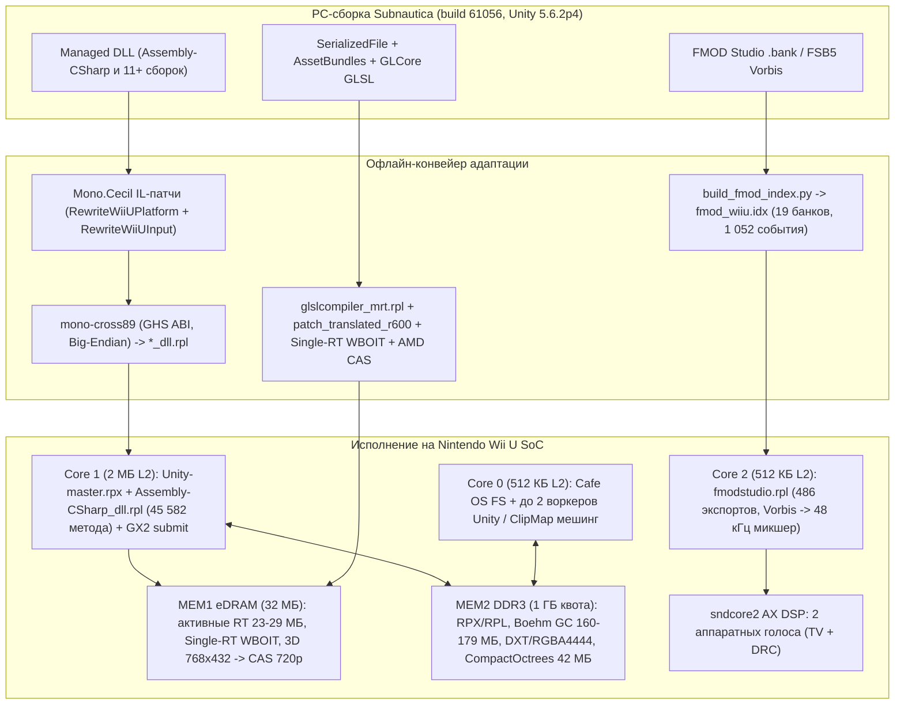

# Subnautica (Wii U R&D v18): Unity Full-AOT, Single-RT WBOIT и FMOD RPL

:::caution Статус R&D: в активной разработке, публичная сборка не выпускалась
Данный документ фиксирует инженерное состояние внутреннего R&D-порта **Subnautica** на Nintendo Wii U на вехе **v18** (с учётом диагностических данных по физическому железу из последующих итераций `v19–v22`). Порт запускается вплоть до живого геймплея в Cemu (`24–30 FPS`), однако на физической консоли Wii U производительность пока составляет порядка **`~10 FPS`** (`8–12 FPS`), а загрузка тяжёлых батчей мира упирается в суммарный потолок памяти MEM2 + code area (`~825 МБ`). Публичная сборка не выкладывается; ввиду размера WUP (`9,2 ГБ`) и правовых ограничений прорабатывается модель инструмента-адаптера поверх легальной PC-копии игры.
:::

## 1. Паспорт R&D и архитектура переноса

В отличие от статической рекомпиляции бинарников Switch, порт Subnautica построен на **замене нативного ядра Unity** официальным Wii U-рантаймом (`Unity-master.rpx` версии `5.6.5p4`), полной кросс-компиляции управляемого C#-кода в **Mono Full-AOT** под PowerPC Big-Endian, офлайн-трансляции всех шейдеров в формат GX2 R600 и замене отсутствующих нативных PC-библиотек (`FMOD`, `UnityUWE`) самописными Wii U `.rpl`.

| Параметр | Значение |
|---|---|
| **Веха документации** | R&D `v18` (публичный релиз не формировался; ведутся итерации оптимизации памяти `v19–v22`) |
| **Исходная сборка (PC)** | Subnautica PC build `61056` (кастомная ветка Unity `5.6.2p4UnknownWorlds`) |
| **Движок-донор Wii U** | Нативный `Unity-master.rpx` (`5.6.5p4`, собран Nintendo GHS под PowerPC Espresso) |
| **Wii U Title ID / код** | `0005000021000003` / `WUP-P-SUBN` |
| **AOT-покрытие `Assembly-CSharp`** | `45 582 / 45 582` методов (`100 %` Full-AOT, без JIT) |
| **Шейдеры GX2 (Latte)** | `5 600` валидированных блобов (`4 571` в `Data` + `1 029` в `AssetBundles`; `0` ошибок регистров) |
| **Рабочий профиль памяти** | `Alloc = 554–563 МБ`, `GC = 160–179 МБ`, `CompactOctrees = ~42 МБ`, `RT = 23–29 МБ` (в `32 МБ` MEM1) |
| **Размер WUP-сборки** | **`9,2 ГБ`** (снижено с `13,07 ГБ` после удаления неиспользуемого `resources.assets.resS` `3,8 ГБ`) |
| **Формат дистрибуции (исследование)** | Детерминированный патчер-адаптер поверх легальной PC-копии игры |

---

## 2. Full-AOT компиляция Unity `5.6.2 → 5.6.5p4` и память MEM2

### 2.1 Совместимость формата ассетов `5.6.2p4 ↔ 5.6.5p4`

Движок `Unity-master.rpx` (`5.6.5p4`) жёстко проверяет заголовок каждого `SerializedFile` на строку `"5.6.5p4"` и `targetPlatform == 36` (Wii U). Сравнение typetree показало, что из 77 классов игры между версиями изменились только три:
- `PlayerSettings` (`classID 129`, +4 поля в середине) и `GraphicsSettings` (`classID 30`, добавлено `enableLPPV` в `TierSettings`) — ре-сериализуются под схему `5.6.5p4`;
- `Font` (`classID 128`, +1 поле в конце) — безопасно дополняется нулевым хвостом (`+32 Б`) без переупаковки через UnityPy, что предотвращает дрейф смещений на 1 байт.

### 2.2 Mono Full-AOT (`corlib-89`), PowerPC ABI и системные патчи

На Wii U отсутствует JIT-компиляция Mono, поэтому весь управляемый код переводится в PowerPC-ассемблер кросс-компилятором `mono-cross89` (GHS ABI, Big-Endian) и упаковывается в нативные `.rpl` (`tools/mono89/run-aot.sh`, `tools/mono-pack/package.py`):

- **100 % AOT-покрытие**: в сборке `v18` скомпилировано **`45 582 / 45 582`** методов `Assembly-CSharp_dll.rpl` (`5,1 МБ`), а также сопутствующие сборки (`Assembly-CSharp-firstpass_dll.rpl` `2,8 МБ`, `Newtonsoft_Json_dll.rpl` `825 КБ` и др.). Для корректной загрузки все companion DLL в каталоге сборки обязаны совпадать по MVID с установленными `*_dll.rpl`.
- **Исправления PowerPC ABI и рантайма**:
  - в `mono-cross89` исправлены Big-Endian смещения слов `Int64` и зарезервированы слоты `NON_PLT_GOT = 2`, чтобы `init_plt` не перезаписывал `&mscorlib_got` в `got[1]`;
  - расширены таблицы трамплинов `mscorlib_dll.rpl` с `128` до `4 096`;
  - в `RewriteWiiUPlatform.cs` автоматически девиртуализированы `18` сайтов обобщённых интерфейсных вызовов (`3` в `Assembly-CSharp` и `15` в `Newtonsoft.Json`, включая `IAssetBundleWrapper.LoadAssetAsync` с типовым параметром) в прямые диспетчеры `Dispatch_*` для обхода отсутствующих IMT-трамплинов на PowerPC Full-AOT;
  - введены ограничения для IL-инжектора `CloneHelperType` (`WiiUInputHelper.cs` собирается без блоков `try/catch` и без перекрёстных вызовов между вспомогательными классами).
- **Big-Endian рельеф и физика PhysX 3.3**:
  - `UWE.Utils.LoadRawU16SquareGrid` переписан на потоковое чтение блоками по `128 КБ` с побайтовым переворотом `LE → BE`;
  - нативный `CompactOctree.RasterizeNative` переведён на Big-Endian-безопасный управляемый `CompactOctree.Rasterize`, а в `UnityUWE.rpl` (`9` экспортов) исправлен `SimplifyMesh` (`old2newVertIds[i] = i`), что восстановило 3D-рельеф Safe Shallows;
  - в донорском `Unity-master.rpx` пропатчен конструктор `physx::Sq::SceneQueryManager` (4 инструкции → `BucketPruner` `eNONE = 0` с пересчётом CRC32 `.text`), что устранило баг квантованного `SqAABBTree`, при котором спустя ~100 тиков все raycast возвращали `0` и `EscapePod` уходил под воду со скоростью `-48,76 м/с`.

### 2.3 Профиль памяти в пределах квоты 1 ГБ MEM2

В ранних сборках (`v11–v15`) пик загрузки батчей и полёты на глайдере через 2–3 биома приводили к вылетам OOM (`Alloc` доходил до `618 МБ`, `GC` до `234,8 МБ`, `RT` занимали `> 116 МБ`). В `v18` достигнут стабильный рабочий профиль в Cemu:

| Компонент памяти | Состояние до оптимизаций (`v11–v15`) | Профиль `v18` (Cemu, живой мир) | Применённые меры |
|---|---|---|---|
| **Общий `Alloc` (MEM2)** | Пики `618+ МБ` → OOM | **`554–563 МБ`** (стабильно) | Комплекс ограничений ниже |
| **Куча Boehm `GC`** | До `234,8 МБ` | **`160–179 МБ`** | Отключён прогрев `ArrayPool`, настроен `WiiUMemoryOptimizer` |
| **Активные `RenderTexture`** | `116 МБ` (сброс в MEM2) | **`23–29 МБ`** (целиком в MEM1) | 3D `768×432`, Single-RT WBOIT, `ARGBHalf` вода, без 12-pass Bloom |
| **`CompactOctrees` (воксели)** | `72,7 МБ` | **`~42,3 МБ`** | Ограничение колец `LargeWorldStreamer` + `streaming-low.json` (`budgetMBs = 16`) |
| **UI-текстуры и утечки** | `RGBA32`, утечка `17 МБ` в `MenuSceneFadeIn` | **`-47,6 МБ`** суммарной экономии | 35 UI-текстур в `DXT5`/`RGBA4444` (`-30,6 МБ`), фикс `MenuSceneFadeIn` (`-17 МБ`) |
| **Мировые текстуры и меши** | Исходные PC мипы + `.resS` | `~76 МБ` текстуры / `~63 МБ` меши | Инлайнинг `.resS`, `MAX_DIM=256`, `MAX_CUBE_DIM=64`, снятие лишнего `isReadable` |

Порог вызова `Resources.UnloadUnusedAssets()` в `WiiUMemoryOptimizer` поднят с `545 МБ` до **`590 МБ`** (с кулдауном `90 с`), а батчевый `GC.Collect()` срабатывает только при реальном росте кучи (`> 34 МБ` / `> 24 МБ`). Это устранило периодические фризы по `1,03–1,08 с` каждые ~40 секунд.

---

## 3. Графика GX2, валидация Latte и Single-RT WBOIT

### 3.1 Трансляция 5 600 шейдеров и отличия реального Latte от Cemu

Шейдеры Subnautica извлекаются из встроенного GLCore GLSL (platform 15), компилируются патченным `glslcompiler_mrt.rpl` (2-инструкционный патч `key.ps.nr_cbufs = 1 → 8` в `r600::FragmentShader`, восстановивший запись `SV_Target1..3` для Deferred PBR) и упаковываются в двухслойный формат Unity Wii U platform 17 (внешний envelope `0x0c044f32` + вложенный Cafe record `CA FE EF AC`).

При переносе на реальную консоль выявились критические расхождения между эмуляцией в Cemu и физическим GPU Latte:

| Аппаратная особенность Latte GX2 | Поведение в Cemu (Vulkan) | Поведение на реальной Wii U | Универсальное исправление |
|---|---|---|---|
| `cb_shader_control` на `1 900` MRT-шейдерах | Игнорирует маску, выводит все RT | Отбрасывает `RT2..RT4` → тёмно-синий логотип без освещения | Патч `0x7 / 0xF / 0x1F` в `patch_translated_r600_shaders.py` |
| `num_spi_vs_out_id` (`696` шейдеров) | Игнорирует `16..17 > 10` | Ошибка/искажение интерполяторов вершинного шейдера | Приведено `4 267` записей к `ceil(n_exports / 4) <= 10` |
| `num_spi_ps_input_cntl` (`40` шейдеров) | Игнорирует расхождение | Несогласованность с `spi_ps_in_control_0 & 0x3F` | Выравнивание счётчиков в `cafeglsl_to_cafe_record.py` |
| Билинейная фильтрация `ARGBFloat` / `RGFloat` | Эмулируется через Vulkan на ПК | Не поддерживается аппаратно → чёрный треугольник вместо океана | Перевод `WaterDisplacement` (`256×256 ARGBHalf`), `WaterNormals` (`256×256 RGHalf, aniso=1`), `ClipCamera` (`512×512 RGHalf`) |

Итоговый аудит всех **`5 600` GX2-блобов** (`4 571` в `Data` + `1 029` в `AssetBundles`) подтверждает **`bad_nout = 0, bad_nin = 0, bad_cb = 0`**. Дополнительно кубмапы `BC6H` конвертированы офлайн (`convert_bc6h_cubemaps.py`), а флаг `useMipMap` у `RenderTexture` отключён в 9 точках (`GenerateRenderSurfaceMips` является no-op на Wii U). Перевод водных буферов на 16-битный `Half` не только устранил чёрный треугольник на Latte, но и ускорил симуляцию волн в 4 раза при экономии `8,5 МБ` RT RAM.

### 3.2 Single-RT WBOIT: прозрачность океана, огонь и взрывы

В `Unity-master.rpx` при переходе к Forward-проходу прозрачных объектов после Deferred G-Buffer к конвейеру привязывается только `RT0`. В результате оригинальные WBOIT-шейдеры Subnautica, записывавшие накопление и вес в `SV_Target1` / `SV_Target2`, полностью отбрасывались — огонь в спасательной капсуле, дым и взрыв «Авроры» были невидимы.

Скрипт `tools/cemu-debug/convert_wboit_single_rt.py` выполнил универсальную перестройку на уровне R600-байткода и материалов:
- переписано **`560` WBOIT R600-блобов** (`23` шейдера, включая `UWE/Particles/UBER`, `MarmosetUBER`, `FX/WBOIT-fireball-Triplanar*`, `basegeneratorpieces`) на прямой вывод в `RT0` (`PIX1 → EXP_DONE PIX0`, `cb_shader_mask = 0xf`, `cb_shader_control = 0x1`);
- скорректированы `19` blend-проходов и `166` материалов (`_DstBlend: 1 → 10`);
- выставлен глобальный флаг `_WBOIT_WeightToggle = 0f` и отключены промежуточные буферы `WBOIT TexA / TexB`.

Помимо восстановления всех прозрачных и огненных эффектов, отказ от двухбуферного WBOIT сэкономил `6 МБ` памяти `RenderTexture` и `3` полноэкранных прохода GPU на каждом кадре.

### 3.3 3D-рендер `768×432`, AMD FidelityFX CAS и нативный 720p HUD

Для удержания всех буферов рендера внутри `32 МБ` MEM1 eDRAM и снижения fillrate-нагрузки на Latte:
- внутреннее разрешение 3D-сцены зафиксировано на **`768×432`** (кратно 64 по ширине под тайлинг GX2 без лишнего выравнивания шага строки; на `64 %` меньше пикселей относительно 720p и на `25 %` меньше полосы пропускания относительно `854×480`);
- масштабирование до `1280×720` выполняется за один проход шейдером `Hidden/WiiU/AMDCASUpscale` (**AMD FidelityFX CAS**, `sharp = 0.80`) с явным `Graphics.SetRenderTarget(null)` и `GL.Viewport(0, 0, Screen.width, Screen.height)` (обход ограничения `Graphics.Blit`, наследовавшего `Camera.pixelRect` и рисовавшего картинку в четверти экрана);
- весь интерфейс HUD/UI рендерится отдельной камерой поверх в нативном **`1280×720`**;
- отключены тяжёлые PC-постэффекты (AO, SSR, Motion Blur, AA, DOF, dithering, 12-проходный Bloom) и динамические тени (`shadowDistance = 0f`), при сохранении `ColorGrading`;
- введено динамическое сферическое отсечение слоёв под водой (`Camera.layerCullDistances`: `75 м` мелкие объекты, `85 м` прозрачные, `95 м` постройки, `135 м` рельеф; на поверхности сохраняется дальность `1 500 м`);
- частота шага физики снижена с 50 Гц до **30 Гц** (`Time.fixedDeltaTime = 0.0333333f`, около `-40 %` нагрузки PhysX на CPU).

---

## 4. Аудиоподсистема (`fmodstudio.rpl`) и управление

### 4.1 Нативный FMOD Studio → `sndcore2` AX DSP на Core 2

Поскольку нативной библиотеки FMOD Studio для Wii U в PC-дистрибутиве нет, разработана собственная реализация **`fmodstudio.rpl`** (`141 КБ`, **`486` экспортов** в сборке `v18`, собираемая через `devkitPPC -mcpu=750 -mhard-float -O2`) вместе с офлайн-индексатором банков `build_fmod_index.py`:

- **Индекс `fmod_wiiu.idx`** (`~115 КБ`, Big-Endian): индексирует `19` банков (включая `MainMenu.bank`, `Player.bank`, `Env.bank`, `Pod.bank`, `music.bank`, `EnvBackground1.bank`), `1 052` события и `2 479` FSB5 Vorbis-сэмплов с GUID, маршрутизацией шин, радиусами 3D-затухания и CRC32-проверенными кодовыми книгами Vorbis.
- **Изоляция на Core 2**: декодер `libvorbis` и 48 кГц LPCM16 микшер привязаны к ядру **Core 2** (`OS_THREAD_ATTRIB_AFFINITY_CPU2`), чтобы не вытеснять главный поток Unity из 2 МБ кэша L2 на Core 1. Вывод идёт через 2 аппаратных голоса AX DSP (TV + GamePad) с 64-байтным выравниванием и `DCFlushRange`.
- **Приоритеты и кроссфейды**: поддерживается до `10` потоков (`FMOD_MAX_STREAMS = 10`) с приоритетной маршрутизацией шин и авто-дакингом фона (`0.25f`), что устранило потерю озвучки во вступительной сцене, а также принудительный флаг `is_loop = False` для one-shot событий (`death_music`, `aurora_reveal`, `ship_explode*`):

| Шина FMOD (`bus`) | Назначение | Fade-in / Fade-out | Особенности на Wii U |
|---|---|---|---|
| `bus = 3` | Voice / Cinematic | Мгновенный старт | Высший приоритет, авто-дакинг фона до `0.25f` |
| `bus = 1` | Музыка биомов | `2,2 с` / `3,0 с` | Плавный 48 кГц кроссфейд через `STOP_ALLOWFADEOUT` |
| `bus = 4` | Эмбиент океана | `2,2 с` / `3,0 с` | Плавные переходы при смене глубины и биома |
| `bus = 2` | Игровые SFX | `0,30 с` (для лупов) | 3D-затухание по радиусам из `fmod_wiiu.idx` |

- **Телеметрия на физическом железе**: функция `WiiU_LogLine` в `fmod_wiiu_audio.c` явно монтирует SD-карту через `FSGetMountSource(FS_MOUNT_SOURCE_SD)` + `FSMount` и пишет структурированный лог `SD:/subnautica_wiiu.log` (с фоллбэком в `/vol/save/common/subnautica_wiiu.log`) с тегами `[WiiUCAS]`, `[WiiUFPS]`, `[WiiUMem]`, `[WiiUMem-RT]`, `[WiiUBatch]`, `[WiiUUnload]` и `[WiiU-Rend]`.

### 4.2 Ввод, сохранения и планы по Alterra PDA

Мост `WiiUInputBridge` (внедрённый в `Assembly-CSharp.dll`) объединяет ввод **Wii U GamePad** и **Wii U Pro Controller** с мёртвой зоной `0.08` и полным соответствием раскладки Subnautica (включая кнопку `Minus` для вызова КПК и `Plus` для паузы). Для корректных сохранений на реальной консоли `IngameMenu.CaptureSaveScreenshot()` (использовавший зависавший на GX2 `Texture2D.ReadPixels()`) заменён на быструю миниатюру `64×36`, а в `SaveLoadManager` обойдён фильтр по времени изменения файлов (`GetLastWriteTimeUtc`), отбрасывавший сохранения при системной дате `0001/1970` в `/$SAVE`.

В текущей сборке `v18` GamePad работает в режиме зеркала TV (`Core.gamePadSource = DisplayIndex.TV`). **Вынос интерфейса КПК Alterra PDA на сенсорный экран GamePad** остаётся в планах, но сознательно отложен до стабилизации базового бюджета памяти и частоты кадров на физическом железе, поскольку независимый DRC-рендер потребует дополнительных `RenderTexture` в MEM1 и раздельного UI-прохода.

---

## 5. Верифицированная телеметрия и открытые инженерные проблемы

Ключевой вывод R&D-этапа: **показатели Cemu не отражают производительность реальной Wii U**. Cemu исполняет рекомпилированный PowerPC-код и графику на хостовых CPU и GPU (x86 / Apple Silicon + Vulkan) без моделирования реальных задержек 1,24 ГГц Espresso, 550 МГц Latte и шины MEM2.

| Сцена / показатель | Cemu 2.6 (ПК / Apple Silicon) | Реальная Nintendo Wii U (`SD:/subnautica_wiiu.log`) | Статус / причина расхождения |
|---|---:|---:|---|
| **Главное меню (3D-логотип + океан)** | `56–60 FPS` | **`8–12 FPS`** (`~10 FPS`) | Реальные задержки CPU Core 1 + fillrate/шейдеры Latte 550 МГц |
| **Живой геймплей (Lifepod 5 / Safe Shallows)** | **`24–30 FPS`** (ранний MRT: `21,7–24,7 FPS`) | Зависание загрузки мира на `v18` до `#1` (см. лимит `~825 МБ` ниже) | В Cemu загрузка мира проходит полностью; на консоли упирается в потолок `Rsv + GC + max_codesize` |
| **Рабочий `Alloc` / `GC` в мире** | `554–563 МБ` / `160–179 МБ` | `Rsv ~500–510 МБ` + `GC 80–151 МБ` на загрузке батчей | На консоли Unity забирает весь MEM2 под свой аллокатор; `max_codesize` вычитается из общего лимита |
| **Активные `RenderTexture` (MEM1)** | `23–29 МБ` (`<= 32 МБ`) | `23–29 МБ` (`<= 32 МБ`) | Помещается в MEM1 eDRAM при `768×432` + Single-RT WBOIT |
| **Аудио FMOD → AX DSP** | Живой потоковый вывод (19 банков) | Подтверждено на консоли | Изолировано на Core 2; без влияния на L2 Core 1 |

### 5.1 Критические нерешённые проблемы и план следующих этапов

1. **Суммарный лимит памяти реальной Wii U (`~825 МБ` на `max_codesize + Rsv + GC`)**:
   Логи четырёх последовательных прогонов на физическом железе (`v18–v21`) зафиксировали воспроизводимый потолок, при котором каждый мегабайт, снятый с `cos.xml::max_codesize`, напрямую превращается в доступный бюджет загрузки батчей:

| Сборка R&D | `max_codesize` | `Rsv` (Unity) | `GC` (Mono) | Сумма | Точка зависания на Wii U |
|---|---:|---:|---:|---:|---|
| `v18` | `224 МБ` | `~500 МБ` | `80 МБ` | `~804 МБ` | До `[WiiUBatch] #1` |
| `v19` | `180 МБ` | `510 МБ` | `138 МБ` | `828 МБ` | После `#9` |
| `v20` | `172 МБ` | `506 МБ` | `149 МБ` | `827 МБ` | После `#17` |
| `v21` | `168 МБ` | `506 МБ` | `151 МБ` | `825 МБ` | После `#17` |

   Рост кучи `GC` (`~2 МБ` на батч) представляет собой живые объекты мира, а не мусор, поэтому частые вызовы `GC.Collect()` его не снижают. В экспериментальной ветке `v22` размер `max_codesize` снижен до `160 МБ` (`0x0a000000` при фактическом размере кода `152 МБ`), а тяжёлая сцена-префаб «Циклопа» (`level6` + `sharedassets6`: `~29 МБ` ассетов + `100 МБ` `resS`) исключена из `LightmappedPrefabs.autoloadScenes` с переходом на загрузку по требованию (`RequestScenePrefab`).

2. **Стриминг воксельных чанков океана и I/O-нагрузка**:
   В ранней сборке `v13` агрессивное урезание сеток приводило к швам в рельефе, пропаданию дна в Грибном лесу и почти полному исчезновению фауны (`Creatures = 0..2`). В `v18` параметры `clipmaps-low.json` и `streaming-low.json` (`maxFrameMs: 4`, `maxSubFrameMs: 4`, `maxInsideFrameMs: 3`, `budgetMBs: 16`) сбалансированы следующим образом:

| Уровень LOD (`clipmaps-low.json`) | Сетка чанков | `meshOverlap` | Существа / трава / меши |
|---|---|---:|---|
| `L0` (ближняя зона) | `4×4×4` | `0` | Трава ограничена `maxVerts: 4500`, `reduction: 0.65` |
| `L1` (средняя зона) | `5×4×4` | `1` | Устраняет швы и разрывы геометрии вблизи игрока |
| `L2` (дальняя зона) | `4×4×4` | — | `entities: true` (сохраняет спавн рыб и существ) |
| `L3` (горизонт) | `4×3×3` | — | `ignoreMeshes: true`, `entities: false` |

   Тем не менее даже при этих лимитах подсистема `ClipMap` / `CompactOctrees` создаёт высокую нагрузку на Core 0 и Core 1 при потоковом чтении с USB/SD и генерации мешей рельефа в managed-коде (`CompactOctree.Rasterize`). Перенос критических циклов воксельного мешинга в нативный `UnityUWE.rpl` на C с Paired Singles остаётся одним из главных резервов ускорения.

3. **Локализация CPU vs GPU-узких мест на физическом железе (`~10 FPS`)**:
   Чтобы не оптимизировать вслепую по показателям Cemu, в диагностический контур добавлена разбивка времени кадра главного потока `[WiiUFPS] ms U= R= W= max=` (`U` — игровые скрипты Update, `R` — отсечение и отправка 3D, `W` — UI, Present, ожидание GPU/VSync и физика) и аудит видимости рендереров `[WiiU-Rend]`. Следующие итерации будут опираться строго на профили `U/R/W` с реальной консоли, с последующей оценкой снижения внутреннего разрешения до `704×396` / `640×360`, упрощения океанской сетки и точечной разгрузки горячих C#-скриптов.

4. **Переход к формату адаптера поверх PC-копии**:
   После стабилизации загрузки мира и достижения приемлемой частоты кадров на физическом железе предполагается оформить сборочный пайплайн (`IL-патчи` + `AOT` + `GX2-шейдеры` + `fmod_wiiu.idx`) в виде воспроизводимого локального адаптера, не требующего распространения `9,2 ГБ` игровых ассетов.
