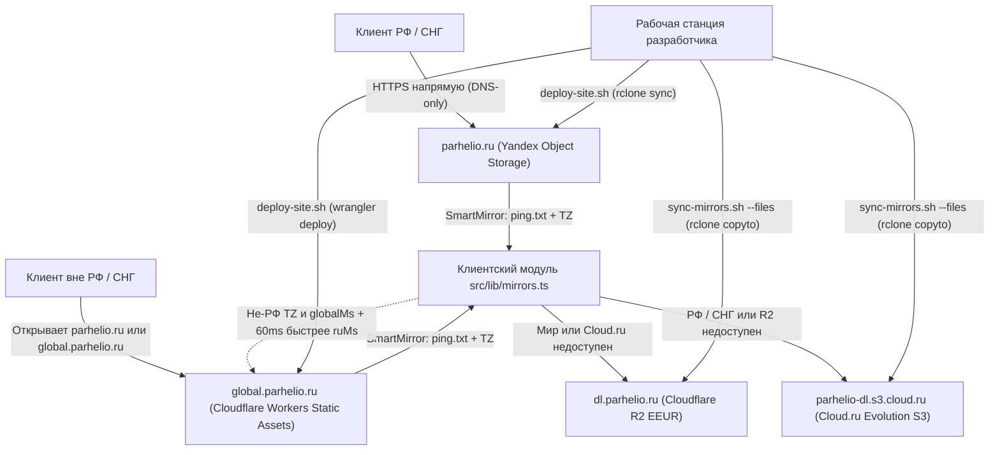

# Двухконтурная инфраструктура, SmartMirror и независимый деплой

Инфраструктура Parhelio спроектирована под три инженерных требования:

1. **Прямая доступность в РФ и СНГ без VPN** — статика и многогигабайтные релизы не должны зависеть от проксирования через Cloudflare, подверженного фильтрации ТСПУ.
2. **Минимальная задержка для глобальной аудитории** — раздача статики и бинарников с мировых Edge-узлов с нулевой тарификацией исходящего трафика (zero egress).
3. **Нулевая критическая зависимость от GitHub** — удаление репозитория, ограничения API или блокировка аккаунта на GitHub не должны прерывать работу сайта, вики, зеркал и процесса выкладки обновлений.

---

## 1. Топология двух независимых контуров

Веб-приложение (включая собранную документацию Docusaurus в `/docs/`) и все бинарные релизы реплицируются в два полностью независимых облачных контура:

| Контур | Веб-статика и вики | Файловое зеркало (`/releases/`) | Бюджет / Free Tier | Текущее занятие |
| :--- | :--- | :--- | :--- | :--- |
| **РФ / СНГ** | `https://parhelio.ru` — Yandex Object Storage (бакет `parhelio.ru`, `213.180.193.247`) | `https://parhelio-dl.s3.cloud.ru` — Cloud.ru Evolution (бакет `parhelio-ru-storage`, домен `parhelio-dl`) | Yandex: ~2–5 ₽/мес; Cloud.ru: `15 ГБ` хранения, `10 ТБ/мес` трафика | Статика `~15 МБ`, релизы `~5.47 ГБ` (`36%`) |
| **Мир (Global)** | `https://global.parhelio.ru` — Cloudflare Workers Static Assets (`parhelio`, `wrangler.jsonc`) | `https://dl.parhelio.ru` — Cloudflare R2 (бакет `parhelio-wstorage`, регион EEUR) | Workers: Free Plan (`100k` запросов/сутки); R2: `10 ГБ` хранения, безлимитный трафик (`0` за egress) | Статика `~15 МБ`, релизы `~5.47 ГБ` (`55%`) |

### Карта DNS и TLS зоны `parhelio.ru`

Зона `parhelio.ru` делегирована у регистратора Timeweb на NS-серверы Cloudflare (`keenan.ns.cloudflare.com`, `robin.ns.cloudflare.com`):

| DNS-запись | Тип | Целевое значение | Режим Cloudflare | Назначение |
| :--- | :--- | :--- | :--- | :--- |
| `parhelio.ru` | `CNAME` (auto-flatten) | `parhelio.ru.website.yandexcloud.net` | **DNS-only** | Прямой доступ к Yandex Object Storage в обход прокси Cloudflare |
| `_acme-challenge.parhelio.ru` | `CNAME` | `fpq2i73ia5gugfcfijo3.cm.yandexcloud.net` | **DNS-only** | Автоматическая DNS-01 валидация и автопродление Let's Encrypt в Yandex Certificate Manager |
| `global.parhelio.ru` | `AAAA` (Worker) | `100::` (Worker `parhelio`) | **Proxied** | Глобальное CDN-зеркало статики и документации |
| `*.global.parhelio.ru` | `AAAA` (Worker) | `100::` (Worker `parhelio`) | **Proxied** | Превью-версии Cloudflare Workers |
| `www.parhelio.ru` | `AAAA` (Worker) | `100::` (Worker `parhelio`) | **Proxied** | Запасная точка входа через Cloudflare |
| `dl.parhelio.ru` | `CNAME` (R2) | `public.r2.dev` (`parhelio-wstorage`) | **Proxied** | Глобальное файловое зеркало релизов |

Сетевые параметры TLS/HTTP зоны `parhelio.ru` в Cloudflare:
- `SSL/TLS`: `Full`, `Always Use HTTPS`: `on`, `Minimum TLS Version`: `1.2`, `TLS 1.3`: `on`, `HTTP/3`: `on`, `Brotli`: `on`.
- **`ECH (Encrypted Client Hello)`: `off`** — отключено намеренно, поскольку ТСПУ российских операторов часто сбрасывают TLS-сессии Cloudflare с активным расширением ECH.

### Диаграмма топологии и маршрутизации



---

## 2. Алгоритм клиентского выбора зеркала `SmartMirror`

Клиентская логика реализована в `src/lib/mirrors.ts` и предоставляется компонентам через React-хук `useSmartMirror()`.

### Зондирование и классификация клиента

1. При первом монтировании `startMirrorProbe()` запускает параллельный `Promise.all` к двум контрольным файлам `/ping.txt` (3 байта `ok\n`, `mode: 'cors'`, `cache: 'no-store'`):
   - РФ: `https://parhelio-dl.s3.cloud.ru/ping.txt`
   - Мир: `https://dl.parhelio.ru/ping.txt`
2. Таймаут пробы ограничен `1900 мс` через `AbortController`. Зеркало считается исправным только при статусе HTTP 2xx и тексте ответа, начинающемся с `ok`; фактическая задержка фиксируется через `performance.now()`.
3. Принадлежность к региону РФ/СНГ (`isLikelyRuCisClient`) определяется локально без внешних GeoIP-сервисов по набору из `43` часовых поясов IANA `RU_CIS_TIMEZONES` (`Intl.DateTimeFormat().resolvedOptions().timeZone`).

### Правила выбора активного зеркала (`auto`)

| Условие доступности | Выбранное зеркало (`detected`) |
| :--- | :--- |
| Доступно только `ru` (`ruOk && !globalOk`) | `ru` (прозрачный обход блокировки `dl.parhelio.ru`) |
| Доступно только `global` (`!ruOk && globalOk`) | `global` |
| Доступны оба, клиент открыл `global.parhelio.ru` | `global` |
| Доступны оба, `isLikelyRuCisClient() == true` и `ruMs` не превышает `globalMs + 120 мс` | `ru` |
| Доступны оба в остальных случаях | Зеркало с меньшим измеренным `RTT` (`ruMs` против `globalMs`) |

### Бесшовный редирект на глобальный контур

Если клиент **вне** `RU_CIS_TIMEZONES` открывает `parhelio.ru` или `www.parhelio.ru` в режиме `auto`, `globalOk == true` и либо `ru` недоступно, либо `globalMs + 60 мс` меньше `ruMs`, выполняется `window.location.replace` на `https://global.parhelio.ru` с сохранением `pathname`, `search` и `hash`. Автопереход отключается:
- URL-параметром `?stay=1` (запоминается в `sessionStorage` под ключом `parhelio_stay_host = "1"`);
- ручным переключением зеркала (`Авто / РФ / Мир`), сохраняемым в `localStorage` под ключом `parhelio_mirror_pref`.

Все ссылки на загрузку формируются единой функцией `buildReleaseUrl(mirror, fileName)` → `<base>/releases/<encodeURIComponent(fileName)>`.

---

## 3. Кеширование, CORS и упаковка WUP-архивов

### Заголовки `Cache-Control`

| Категория объектов | Заголовок `Cache-Control` | Дополнительно |
| :--- | :--- | :--- |
| Хешированные бандлы сайта (`dist/`, кроме `index.html`) | `public, max-age=31536000, immutable` | Синхронизация с `--exclude "index.html"` |
| Релизные файлы (`/releases/*`) | `public, max-age=31536000, immutable` | Имена версионированы по тегу / сборке |
| Входная страница `index.html` | `public, max-age=0, must-revalidate` | `Content-Type: text/html; charset=utf-8` |
| Маркер доступности `ping.txt` | `no-store` | `Content-Type: text/plain; charset=utf-8` |

### Политика CORS файловых бакетов

Оба бакета (`parhelio-ru-storage` в Cloud.ru и `parhelio-wstorage` в Cloudflare R2) имеют идентичную конфигурацию CORS:

```text
AllowedOrigins: https://parhelio.ru, https://www.parhelio.ru, https://global.parhelio.ru,
                https://parhelio.silent-echoes16.workers.dev, http://localhost:5173, http://127.0.0.1:5173
AllowedMethods: GET, HEAD
AllowedHeaders: *
ExposeHeaders:  Content-Length, Content-Range, ETag, Accept-Ranges
MaxAgeSeconds:  86400
```

Открытие заголовков `Content-Length`, `Content-Range` и `Accept-Ranges` критично для корректной работы клиентских проб и многопоточных Range-запросов.

### Правило упаковки WUP Installer (`zip -0 -r`)

Содержимое пакетов WUP Installer (`.app`, `.h3`, `title.cert`, `title.tik`, `title.tmd`) зашифровано Nintendo NUS с использованием AES-CBC. Зашифрованные данные обладают высокой энтропией и практически не сжимаются алгоритмом Deflate, при этом сжатие тратит процессорное время на сборке и замедляет последующую распаковку на SD-карту.

Скрипт `scripts/sync-mirrors.sh` упаковывает каталоги WUP строго в режиме **Store (без сжатия)** с сохранением корневой директории тайтла и исключением метафайлов macOS:

```bash
(cd "$parent_dir" && zip -0 -r -q "$out_zip" "$base_name" -x "*.DS_Store")
```

---

## 4. Независимый прямой деплой (без GitHub)

Все учётные данные S3 и опциональный `CLOUDFLARE_API_TOKEN` хранятся исключительно локально вне Git в файле `~/.parhelio-keys.env` (`chmod 600`).

### Настройка `rclone` (`scripts/setup-rclone.sh`)

Скрипт читает переменные из `~/.parhelio-keys.env` и генерирует три S3-профиля в `~/.config/rclone/rclone.conf` (`chmod 600`):
- `cloudru` — endpoint `https://s3.cloud.ru`, регион `ru-central-1`, `force_path_style = true`, `no_check_bucket = true`; при наличии `CLOUDRU_TENANT_ID` идентификатор ключа автоматически склеивается в требуемый Cloud.ru Evolution формат `<tenant_id>:<key_id>`.
- `yandex` — endpoint `https://storage.yandexcloud.net`, регион `ru-central1`, `no_check_bucket = true`.
- `r2` — endpoint `https://<account_id>.r2.cloudflarestorage.com`, провайдер `Cloudflare`, регион `auto`, `no_check_bucket = true`.

### Выкладка сайта и документации (`scripts/deploy-site.sh`)

Команда `npm run build` последовательно собирает основное приложение и вики Docusaurus (`tsc -b && vite build && npm --prefix wiki run build`) в каталог `dist/`. Конфигурация `wrangler.jsonc` задаёт отдачу `dist/` через Cloudflare Workers Static Assets с режимом `not_found_handling: "single-page-application"` и включённой `observability`.

```bash
# Полный прямой деплой на оба контура (Yandex + Cloudflare Workers)
./scripts/deploy-site.sh

# Точечное обновление одного контура
./scripts/deploy-site.sh --yandex
./scripts/deploy-site.sh --cf
```

Этапы скрипта:
1. Сборка `dist/` через `npm run build`.
2. `rclone sync dist yandex:parhelio.ru` (`--transfers 8 --fast-list`, исключая `index.html`, с `immutable`), затем `rclone copyto dist/index.html` с `max-age=0, must-revalidate`.
3. `npx --yes wrangler deploy` (использует `CLOUDFLARE_API_TOKEN` или сессию `npx wrangler login`).

### Синхронизация релизов (`scripts/sync-mirrors.sh`)

```bash
# Упаковать WUP-каталоги (store mode) и залить ping.txt + релизы на оба зеркала
./scripts/sync-mirrors.sh --files

# Выборочная синхронизация одного зеркала
./scripts/sync-mirrors.sh --files --r2
./scripts/sync-mirrors.sh --files --cloudru
```

Загрузка бинарников выполняется командой `rclone copyto` с параметрами `--s3-no-check-bucket --s3-chunk-size 16M --s3-upload-concurrency 4` и заголовком `Cache-Control: public, max-age=31536000, immutable`.

:::note Статус GitHub Actions
Workflow `.github/workflows/deploy-pages.yml` оставлен как вспомогательный зеркальный конвейер. При недоступности GitHub вся живая инфраструктура (`parhelio.ru`, `global.parhelio.ru`, `parhelio-dl.s3.cloud.ru`, `dl.parhelio.ru`) и прямой деплой через `deploy-site.sh` и `sync-mirrors.sh` сохраняют полную работоспособность.
:::

---

## 5. Реестр опубликованных релизов (`/releases/`)

Все перечисленные файлы реплицированы с идентичными именами на обоих зеркалах (`https://parhelio-dl.s3.cloud.ru/releases/<file>` и `https://dl.parhelio.ru/releases/<file>`).

### Порты для Nintendo Wii U

| Проект | Версия / Title ID | Файл в `/releases/` | Размер | Формат и назначение |
| :--- | :--- | :--- | :--- | :--- |
| **Minecraft: Wii U Edition** | `Update v688` · `00050000101D7500` | `Minecraft.WiiU.wuhb` | `1.41 ГБ` (`1 510 059 508 Б`) | Aroma `.wuhb` → `sd:/wiiu/apps/` |
| **Minecraft: Wii U Edition** | `Update v688` · `00050000101D7500` | `Minecraft_WiiU-WUP.zip` | `1.44 ГБ` (`1 541 515 992 Б`) | WUP Store `.zip` → `sd:/install/Minecraft_WiiU/` |
| **Buckshot Roulette** | `Build 116 / v44` · `000500001337B001` | `BuckshotRoulette.wuhb` | `303 МБ` (`318 047 300 Б`) | Aroma `.wuhb` → `sd:/wiiu/apps/` |
| **Buckshot Roulette** | `Build 116 / v44` · `000500001337B001` | `BuckshotRoulette_WiiU-WUP.zip` | `313 МБ` (`328 575 016 Б`) | WUP Store `.zip` → `sd:/install/BuckshotRoulette_WiiU/` |
| **Slime Rancher** | `v42 NoLog` · `0005000021000002` | `SlimeRancher_WiiU_NoLog-WUP.zip` | `902 МБ` (`946 189 864 Б`) | Только WUP Store `.zip` → `sd:/install/SlimeRancher_WiiU_NoLog/` |
| **Animal Crossing: NH** | `Wave 9` · `0005000021AC0001` | *(не опубликован)* | `3.6 ГБ` (внутр. WUP) | Активная оптимизация CPU и тестирование |
| **Subnautica** | `R&D v18` · `0005000021000003` | *(не опубликован)* | `9.2 ГБ` (внутр. WUP) | R&D, прорабатывается формат адаптера |

### Приложения для macOS (Apple Silicon)

| Приложение | Версия | Файл в `/releases/` | Размер | Формат |
| :--- | :--- | :--- | :--- | :--- |
| **Epidaurus** | `v0.2.0` | `Epidaurus-0.2.0.dmg` | `31 МБ` (`33 002 895 Б`) | Образ `.dmg` |
| **Kraken** | `v0.4.0` | `Kraken-0.4.0.pkg` | `9.9 МБ` (`10 414 255 Б`) | Установщик `.pkg` |
| **Real3D** | `v1.2.0` | `Real3D-1.2.0.dmg` | `857 МБ` (`898 500 428 Б`) | Образ `.dmg` |
| **Fovea** | `v1.0.0` | `Fovea-1.0.0.dmg` | `164 МБ` (`171 544 377 Б`) | Образ `.dmg` |

### Parhelio Launcher (`v1.0.0`)

| Платформа | Файл в `/releases/` | Размер | Формат и архитектура |
| :--- | :--- | :--- | :--- |
| **macOS** | `Parhelio-Launcher-1.0.0-macos-arm64.dmg` | `4.40 МБ` (`4 613 819 Б`) | `arm64` `.dmg` (ad-hoc `codesign --deep`) |
| **Windows** | `Parhelio-Launcher-1.0.0-windows-x64.exe` | `3.11 МБ` (`3 266 052 Б`) | `x86_64` NSIS Installer `.exe` |
| **Linux** | `Parhelio-Launcher-1.0.0-linux-x64.AppImage` | `84.1 МБ` (`88 185 336 Б`) | `x86_64` portable `.AppImage` |
