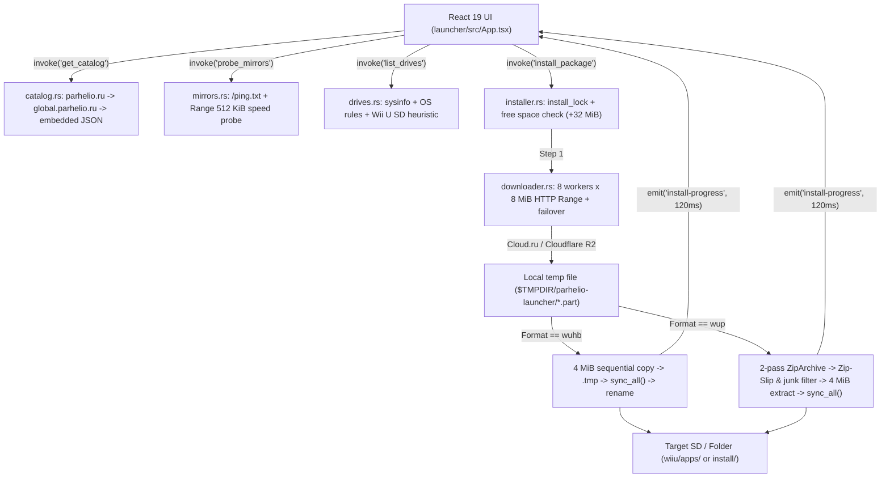

# Parhelio Launcher: нативное ядро Rust + Tauri v2, HTTP Range и запись на SD

**Parhelio Launcher** (`v1.0.0`, идентификатор пакета `ru.parhelio.launcher`) — нативное кроссплатформенное настольное приложение для автоматизированной загрузки портов Nintendo Wii U с зеркал Parhelio и их корректной раскладки на SD-карту или локальный каталог.

Лаунчер устраняет типовые ошибки ручной установки (выбор неверного каталога `wiiu/apps` vs `install`, двойную вложенность `install/install/`, недозаписанные кэши SD-карты, мусорные метафайлы macOS) и заменяет однопоточную загрузку браузера на 8-поточный HTTP Range клиент с автоматическим переключением зеркал.

---

## 1. Архитектура Rust + Tauri v2

Приложение разделено на тонкий пользовательский интерфейс на системном WebView и асинхронное системное ядро на Rust (`edition = "2021"`).

| Слой | Директория | Зависимости и параметры |
| :--- | :--- | :--- |
| **UI (WebView)** | `launcher/src/` | React `19.1`, TypeScript `5.8`, Vite `6.3`, `lucide-react`, `@tauri-apps/api` `2.5`, `@tauri-apps/plugin-dialog` `2.2`, `@tauri-apps/plugin-opener` `2.2` |
| **Ядро (Native)** | `launcher/src-tauri/` | Tauri `v2`, `tokio` (`full`), `reqwest` `0.12` (`rustls-tls`, `stream`, `gzip`, `json`), `zip` `2` (`deflate`), `sysinfo` `0.33`, `sha2` `0.10`, `serde` / `serde_json` |
| **Окно и бандл** | `launcher/src-tauri/tauri.conf.json` | `productName: "Parhelio Launcher"`, `identifier: "ru.parhelio.launcher"`, `1180×760` (`minWidth: 940`, `minHeight: 620`) |
| **Профиль сборки** | `launcher/src-tauri/Cargo.toml` | `[profile.release]`: `opt-level = 3`, `lto = "thin"`, `codegen-units = 1`, `strip = true` |

### Размеры релизных сборок (`v1.0.0`)

Использование системного WebView (WKWebView на macOS, WebView2 на Windows) вместо встроенного Chromium позволило удержать размер нативных установщиков в единицах мегабайт:

| Платформа | Архитектура и формат | Имя файла в `/releases/` | Точный размер | Примечание |
| :--- | :--- | :--- | :--- | :--- |
| **macOS** | `aarch64` `.dmg` (UDZO) | `Parhelio-Launcher-1.0.0-macos-arm64.dmg` | `4.40 МБ` (`4 613 819 Б`) | Системный WKWebView, ad-hoc `codesign --deep` |
| **Windows** | `x86_64` NSIS `.exe` | `Parhelio-Launcher-1.0.0-windows-x64.exe` | `3.11 МБ` (`3 266 052 Б`) | Системный WebView2 |
| **Linux** | `x86_64` `.AppImage` | `Parhelio-Launcher-1.0.0-linux-x64.AppImage` | `84.1 МБ` (`88 185 336 Б`) | Автономный контейнер со вложенными библиотеками WebKitGTK / GTK |

### Структура модулей и IPC-интерфейс

Состояние бэкенда (`AppState` в `launcher/src-tauri/src/lib.rs`) содержит атомарный флаг отмены `cancel_flag: Arc<AtomicBool>` и мьютекс `install_lock: Arc<Mutex<()>>`, исключающий параллельный запуск двух установок (`try_lock` немедленно возвращает ошибку при занятой блокировке).

| Модуль (`launcher/src-tauri/src/`) | Ответственность |
| :--- | :--- |
| `lib.rs` | Инициализация плагинов (`dialog`, `opener`), регистрация 9 IPC-команд, `AppState` |
| `catalog.rs` | Загрузка `launcher-catalog.json` по сети с цепочкой fallback на встроенный JSON |
| `mirrors.rs` | Параллельный пинг `/ping.txt`, 512 КиБ тест скорости и сортировка зеркал |
| `drives.rs` | Кроссплатформенный скан дисков (`sysinfo`), эвристика Wii U SD, расчёт свободного места и `eject` |
| `downloader.rs` | 8-поточный HTTP Range загрузчик, `PositionedFile`, failover и телеметрия прогресса |
| `installer.rs` | Pre-flight проверки, копирование `.wuhb`, потоковая распаковка WUP с защитой от Zip-Slip |

Зарегистрированные IPC-команды Tauri (`invoke`):

| Команда | Сигнатура и назначение |
| :--- | :--- |
| `get_catalog` / `fetch_catalog` | Возвращает актуальную структуру `Catalog` (алиасы одной реализации `catalog::fetch_catalog`) |
| `probe_mirrors` | Запускает параллельный замер доступности, RTT и скорости обоих зеркал (`Vec<MirrorStatus>`) |
| `list_drives` | Выполняет сканирование подключённых накопителей в `tokio::task::spawn_blocking` (`Vec<DriveInfo>`) |
| `eject_drive(mount_path)` | Безопасно размонтирует и извлекает носитель средствами ОС |
| `install_package(request)` | Захватывает `install_lock`, скачивает пакет во временный файл и устанавливает его на носитель |
| `cancel_install()` | Устанавливает `cancel_flag` (`Ordering::SeqCst`) для немедленной остановки потоков и очистки временных файлов |
| `check_installed(target_path, target_mode)` | Сканирует выбранный каталог на наличие уже установленных пакетов из каталога |
| `open_folder(path)` | Открывает каталог назначения в системном файловом менеджере (`open`, `explorer`, `xdg-open`) |

Прогресс передаётся во фронтенд через push-событие `install-progress` (`InstallProgress`) с интервалом `120 мс` и фазами `connecting`, `downloading`, `copying`, `extracting`, `verifying`, `done`, `cancelled`, `error`.

---

## 2. Архитектура и поток данных установки



---

## 3. 8-поточный HTTP Range загрузчик, live-бенчмарк и failover

Лаунчер загружает бинарники исключительно с двух облачных зеркал Parhelio (`https://parhelio-dl.s3.cloud.ru/releases/<fileName>` и `https://dl.parhelio.ru/releases/<fileName>`).

### Live-бенчмарк зеркал (`mirrors.rs`)

Функция `probe_all_mirrors()` параллельно (`join_all`) тестирует каждое зеркало в два шага:

1. **Проверка доступности и RTT:** запрос `GET /ping.txt` (`PING_TIMEOUT = 2500 мс`, `connect_timeout = 2000 мс`). Зеркало считается доступным только при HTTP 2xx и теле ответа, начинающемся с `ok`.
2. **Замер пропускной способности:** если пинг пройден, выполняется запрос с заголовком `Range: bytes=0-524287` (`512 КиБ`, `SPEED_PROBE_TIMEOUT = 3500 мс`) к одному из эталонных объектов (`/releases/Kraken-0.4.0.pkg` или `/releases/BuckshotRoulette.wuhb`). При получении не менее `16 384 Б` вычисляется `speed_mbps` с округлением до `0.1 Мбит/с`.

Рекомендуемое зеркало (`mark_recommended`) выбирается функцией `compare_mirror_quality`: приоритет имеет более высокая `speed_mbps`, а при равенстве или отсутствии замера скорости — меньшая задержка `latency_ms`. В режиме `auto` функция `resolve_mirror_order` строит упорядоченный список `[primary, fallback]`; при явном выборе `ru` или `global` выбранное зеркало ставится первым, а второе остаётся резервным.

### Многопоточная загрузка и позиционированная запись (`downloader.rs`)

Перед началом передачи `probe_remote_file` определяет размер и поддержку диапазонов байтов: сначала отправляется `HEAD` (таймаут `8 с`) с проверкой `Accept-Ranges: bytes` и `Content-Length`; если заголовок не отдан или `HEAD` заблокирован, выполняется пробный 1-байтовый `GET` с `Range: bytes=0-0` и разбором `Content-Range` (`bytes 0-0/<total>`).

| Параметр `downloader.rs` | Значение | Инженерное назначение |
| :--- | :--- | :--- |
| `NUM_STREAMS` | `8` | Количество параллельных async-воркеров (`tokio::spawn`) |
| `CHUNK_SIZE` | `8 МиБ` | Размер одного сегмента очереди `VecDeque<ChunkTask>` |
| `MIN_MULTISTREAM_SIZE` | `16 МиБ` | Порог включения 8-поточного режима (мелкие файлы качаются в 1 поток) |
| `WRITE_BUFFER_THRESHOLD` | `512 КиБ` | Размер буфера батч-записи в `spawn_blocking` для снижения числа переключений контекста |
| `MAX_RETRIES_PER_CHUNK` | `6` | Число попыток на один 8 МиБ сегмент с линейным backoff (`250 мс × attempt`) |
| `FAILOVER_AFTER_FAILURES` | `2` | Порог сбоев для переключения всех воркеров на резервное зеркало |
| `PROGRESS_INTERVAL` / `SPEED_WINDOW` | `120 мс` / `2500 мс` | Период событий прогресса и скользящее окно расчёта скорости и ETA |

В многопоточном режиме временный файл предварительно выделяется вызовом `file.set_len(total_bytes)`. Запись выполняется через обёртку `PositionedFile`:

- На **Unix (macOS / Linux)** используется `std::os::unix::fs::FileExt::write_all_at` (системный вызов `pwrite`), что позволяет всем 8 воркерам писать непересекающиеся диапазоны без пользовательского мьютекса.
- На **Windows** используется `Arc<std::sync::Mutex<File>>` с парой `seek` + `write_all`.

### Живой failover без потери прогресса

Если при скачивании сегмента на основном зеркале (`mirror_idx == 0`) происходит обрыв потока, таймаут чтения (`20 с`) или HTTP-ошибка, уже полученные байты в `write_buf` сбрасываются на диск, а счётчик `written_in_chunk` сохраняется. Когда число сбоев достигает `FAILOVER_AFTER_FAILURES = 2` (локально или суммарно по воркерам `primary_failures`), выполняется атомарное переключение:

```rust
let _ = active_mirror_idx.compare_exchange(
    0,
    1,
    Ordering::SeqCst,
    Ordering::Relaxed,
);
```

Последующий повторный запрос этого сегмента (и все новые сегменты у всех 8 воркеров) уходит на резервное зеркало с продолжением строго от `chunk.start + written_in_chunk`. Если сервер не поддерживает `Accept-Ranges`, загрузчик прозрачно переходит в `download_single_stream` с обходом всех зеркал по кругу.

---

## 4. Обнаружение SD/USB, режимы путей и потоковая распаковка

### Кроссплатформенное обнаружение накопителей (`drives.rs`)

Функция `list_drives()` опрашивает тома через `sysinfo::Disks` и фильтрует системные разделы по правилам целевой ОС:

| ОС | Включаемые тома | Исключаемые тома | Безопасное извлечение (`eject_drive`) |
| :--- | :--- | :--- | :--- |
| **macOS** | `/Volumes/*` и `sys_removable` | `/`, `/System/`, `/private/`, `/dev`, `TimeMachine`, `devfs`, `autofs` | `diskutil eject <mount_path>` |
| **Linux** | `/run/media/*`, `/media/*`, `/mnt/*` и `sys_removable` | `tmpfs`, `squashfs`, `overlay`, `proc`, `sysfs`, `devtmpfs`, `fuse.portal` | `findmnt -n -o SOURCE` → `udisksctl unmount -b` + `udisksctl power-off -b` (фолбэк `umount`) |
| **Windows** | Съёмные и несистемные буквы дисков | Несъёмный системный том `C:\` | PowerShell COM `Shell.Application`: `Namespace(17).ParseName('<X>:').InvokeVerb('Eject')` |

Для каждого найденного тома вычисляется эвристика `is_likely_wiiu_sd`: истинна при наличии каталога `wiiu/apps` (или `wiiu/`), каталога `install/` либо файловой системы семейства FAT (`fat`, `msdos`). Список сортируется так, чтобы вероятные SD-карты Wii U с существующими маркерами всегда отображались первыми.

### Проверка места и три режима пути (`installer.rs`)

Перед началом загрузки `install_package()` проверяет доступное место через `available_space_for_path()` одновременно на **целевом накопителе** и на **системном диске** (для временного файла в `$TMPDIR/parhelio-launcher/*.part`), требуя `size_bytes + 32 МиБ` (`SAFETY_SPACE_MARGIN_BYTES`). При обновлении существующего `.wuhb` его текущий размер вычитается из требуемого свободного места. Временный файл защищён RAII-гардом `TempFileGuard`, гарантирующим удаление при отмене или ошибке.

Режимы назначения (`resolve_destination`):

| Режим в UI (`TargetMode`) | Формат `.wuhb` | Формат `WUP (.zip)` |
| :--- | :--- | :--- |
| `sd_auto` («Авто SD») | `<root>/wiiu/apps/<fileName>` | Распаковка в `<root>/install/` |
| `custom_apps` (`wiiu/apps`) | `<folder>/<fileName>` | Распаковка в `<folder>` (переопределение) |
| `custom_install` (`install`) | `<folder>/<fileName>` (переопределение) | Распаковка в `<folder>` |

На уровне Rust также поддержаны строгие режимы `custom_wuhb_dir` и `custom_wup_dir`, возвращающие ошибку при несоответствии формата, а `validate_file_name` запрещает разделители пути, `..` и нулевые байты.

### Последовательная запись `.wuhb` и безопасная распаковка WUP

Поскольку SD-карты (особенно в FAT32) резко теряют скорость при параллельной случайной записи, загрузка идёт в локальный временный файл в 8 потоков, а запись на SD всегда выполняется **последовательно в 1 поток** буфером `4 МиБ` (`IO_BUFFER_SIZE`):

- **`.wuhb` (`copy_wuhb_to_destination`):** старая копия удаляется заранее (чтобы избежать переполнения почти полной SD-карты), файл записывается во временное имя `*.wuhb.parhelio.tmp`, затем вызывается `writer.sync_all()` для сброса буферов ОС на флеш-память и выполняется атомарный `fs::rename`.
- **WUP `.zip` (`extract_wup_zip_to_destination`):** выполняется в два прохода. На первом проходе каждый элемент `ZipArchive` проверяется функцией `sanitize_zip_entry_path`:
  - **Защита от Zip-Slip:** отклоняются абсолютные пути (начинающиеся с `/`), префиксы букв дисков Windows (`C:`), переходы `..`, нулевые байты `\0` и любые компоненты пути, отличные от `Component::Normal`.
  - **Фильтрация служебного мусора:** игнорируются записи внутри `__MACOSX/`, а также `.DS_Store`, `Thumbs.db` и AppleDouble-файлы `._*`.
  - **Защита от двойного `install/install/`:** если целевая папка оканчивается на `install`, а внутри архива пути начинаются с `install/<Title>/...`, ведущий сегмент `install` автоматически отбрасывается.
  - **Оборачивание «голых» файлов:** если архив содержит файлы WUP прямо в корне без папки тайтла, они автоматически помещаются в подпапку `wup_folder_name` из каталога.
  - На втором проходе файлы извлекаются буфером `4 МиБ`, и после каждого файла вызывается `out_file.sync_all()`.

---

## 5. Динамический каталог и цепочка fallback

Каталог игр и зеркал вынесен в JSON-файл `public/launcher-catalog.json` (`schemaVersion: 1`), публикуемый вместе со статическим сайтом. Это позволяет добавлять новые порты и обновлять версии без пересборки лаунчера.

Цепочка разрешения каталога в `catalog::fetch_catalog()`:

1. `GET https://parhelio.ru/launcher-catalog.json` (`connect_timeout: 2 с`, `timeout: 3 с`).
2. При недоступности или невалидном JSON — `GET https://global.parhelio.ru/launcher-catalog.json`.
3. Валидация ответа: оба массива `games` и `mirrors` должны быть непустыми.
4. При полном отсутствии сети — локальный встроенный каталог `include_str!("../../../public/launcher-catalog.json")`, скомпилированный внутрь бинарника Rust (в веб-режиме предпросмотра UI используется эквивалентный `FALLBACK_CATALOG` из `launcher/src/types.ts`).

---

## 6. CI-матрица и особенности подписи macOS

Сборочный конвейер описан в `.github/workflows/build-launcher.yml` (триггеры: `push` в `main` по маске `launcher/**` и ручной `workflow_dispatch`).

| Раннер GitHub Actions | Таргет Rust | Бандл Tauri | Нормализованный артефакт |
| :--- | :--- | :--- | :--- |
| `macos-latest` | `aarch64-apple-darwin` | `app` → `hdiutil create -format UDZO` | `Parhelio-Launcher-1.0.0-macos-arm64.dmg` + `.sha256` |
| `windows-latest` | `x86_64-pc-windows-msvc` | `nsis` | `Parhelio-Launcher-1.0.0-windows-x64.exe` + `.sha256` |
| `ubuntu-latest` | `x86_64-unknown-linux-gnu` | `appimage` (`APPIMAGE_EXTRACT_AND_RUN=1`, `NO_STRIP=true`) | `Parhelio-Launcher-1.0.0-linux-x64.AppImage` + `.sha256` |

:::info Роль GitHub Actions
GitHub Actions используется **только как сборочная ферма** (артефакты хранятся 30 дней для разработчика). После сборки установщики загружаются на облачные зеркала Cloud.ru и Cloudflare R2 через `rclone`; ссылки на скачивание на сайте ведут исключительно на зеркала Parhelio.
:::

### Подпись macOS и снятие карантина Gatekeeper

У проекта отсутствует платный сертификат Apple Developer ID и нотаризация (Notarization). На Apple Silicon линкерная подпись одиночного бинарника недостаточна для целостности бандла `.app`, поэтому шаг нормализации в CI переподписывает бандл целиком глубокой ad-hoc подписью с привязкой `Info.plist` и `CodeResources`:

```bash
xattr -cr "$APP_BUNDLE"
codesign --force --deep --sign - --identifier "ru.parhelio.launcher" "$APP_BUNDLE"
codesign --verify --deep --strict --verbose=2 "$APP_BUNDLE"
```

При загрузке `.dmg` через браузер macOS добавляет на приложение расширенный атрибут `com.apple.quarantine`, из-за чего Gatekeeper блокирует ненотаризованный ad-hoc бандл. После переноса приложения в `/Applications` карантин снимается одной командой:

```bash
xattr -cr "/Applications/Parhelio Launcher.app"
```
