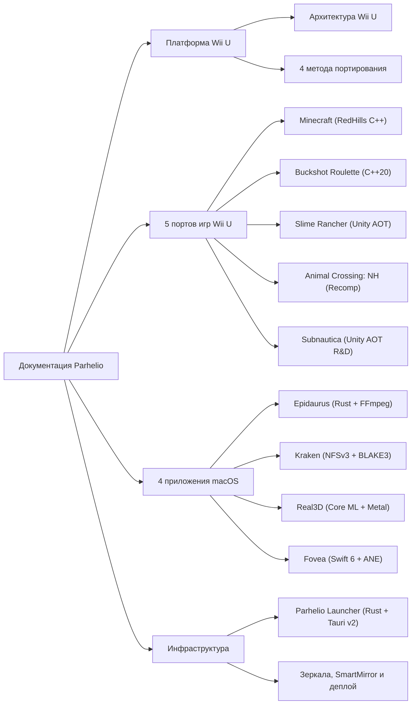

# Инженерная документация Parhelio

Настоящий раздел представляет собой центральную техническую базу знаний проектов **Parhelio**. Документация охватывает четыре взаимосвязанных направления: аппаратную архитектуру и методы переноса игр на **Nintendo Wii U** (Cafe OS / PowerPC Espresso / Latte GX2), разбор всех пяти портов Wii U, архитектуру четырёх нативных приложений для **macOS (Apple Silicon)**, а также клиентскую и серверную инфраструктуру доставки релизов (**Parhelio Launcher** и двухконтурные зеркала).

---

## Назначение и редакционные принципы

Документация ведётся в формате формального инженерного справочника и подчиняется четырём обязательным правилам:

1. **Привязка к исходному коду и артефактам сборки.** Все указанные имена модулей, флаги компилятора, IPC-команды, конфигурации DNS/CORS и размеры бинарников верифицированы напрямую по репозиториям, `Cargo.toml`, скриптам развёртывания и манифесту `public/launcher-catalog.json`.
2. **Отсутствие маркетинговых формулировок.** Вместо оценочных характеристик приводятся измеримые параметры: целевое и внутреннее разрешение рендера, бюджеты eDRAM MEM1 (`32 МБ`) и игровой MEM2 (`1 ГБ`), число AOT-методов и шейдеров, задержки проходов GPU/ANE и реальные показатели кадровой частоты.
3. **Разделение замеров Cemu и физической Wii U.** Для проектов в стадии R&D (`Animal Crossing: New Horizons`, `Subnautica`) показатели на эмуляторе Cemu и на физическом оборудовании Wii U фиксируются отдельно с явным описанием текущих узких мест.
4. **Независимая доставка бинарников.** Все пользовательские установочные пакеты распространяются исключительно через облачные зеркала Parhelio (`parhelio-dl.s3.cloud.ru` для РФ/СНГ и `dl.parhelio.ru` для остального мира) с клиентским выбором маршрута `SmartMirror`. Ссылки на загрузку через GitHub Releases не используются.

---

## Карта разделов базы знаний

---

## Платформа Nintendo Wii U

Перед переходом к разборам конкретных игр рекомендуется изучить аппаратный профиль консоли и сравнительный анализ четырёх применяемых пайплайнов переноса:

| Документ | Ключевые темы |
| :--- | :--- |
| [Архитектура Wii U](/wiiu/hardware-architecture/) | Устройство CPU Espresso (3 ядра PowerPC 750CL `1.24 ГГц`, асимметричный L2 `512 КБ / 2 МБ / 512 КБ`, Paired Singles SIMD), GPU Latte GX2 (R600/R700, `32 МБ` eDRAM MEM1), `1 ГБ` игровой MEM2, аудиопроцессор AX DSP `120 МГц`, подсистема GamePad DRC (`854×480`) и исполняемая модель Cafe OS (`.rpx` / `.rpl`). |
| [Методы портирования](/wiiu/porting-methodologies/) | Инженерное сопоставление C++-реконструкции под ABI Green Hills, трансляции GDScript в C++20-корутины, Full-AOT переноса Unity `5.6.5p4` и статической рекомпиляции Switch AArch64 → PPC32 с матрицей компромиссов и схемой выбора. |

---

## Сводная матрица портов Wii U

| Проект | Метод портирования | Стек и ключевые показатели | Title ID | Формат поставки | Статус |
| :--- | :--- | :--- | :--- | :--- | :--- |
| [Minecraft](/games/minecraft/) | C++-реконструкция под оригинальный ABI | RedHills (Clang 19 / Green Hills ABI), LLVM 22, WUT; `3 753` `.cpp`, `Minecraft.Client.rpx` (`9.38 МБ`), TV `720p→1080p` AMD CAS + DRC `480p`, 2P аудио Miles/AX на Core 2 | `00050000101D7500` | `.wuhb` (`1.41 ГБ`), WUP `.zip` (`1.44 ГБ`) | Релиз (`Update v688`) |
| [Buckshot Roulette](/games/buckshot-roulette/) | Трансляция скриптов в нативный C++20-рантайм | `gd_to_cpp_transpiler.py` (`co_task.h`), `.blayout` / `OBPK`, `game.rpx` (`4.17 МБ`), `28` шейдеров GX2 (`CafeGLSL`), `720p→1080p` AMD CAS, `AXAudioEngine` + 4-bit IMA-ADPCM, локальный 1v1 | `000500001337B001` | `.wuhb` (`303 МБ`), WUP `.zip` (`313 МБ`) | Релиз (`Build 116 / v44`) |
| [Slime Rancher](/games/slime-rancher/) | Full-AOT Unity `5.6.5p4` + нативный SIMD `.rpl` | `Unity-master.rpx`, 100% Full-AOT (`50 719` методов в 12 `.rpl`), `slime_wiiu_nolog.rpl` (Paired Singles на Core 2), `3 786` шейдеров GX2, `Dual-Volume WPVS`, GCADPCM, GamePad `MapUI` | `0005000021000002` | Только WUP `.zip` (`902 МБ`) | Релиз WUP (`v42 NoLog`) |
| [Animal Crossing: NH](/games/animal-crossing/) | Статическая рекомпиляция AArch64 → C → PPC32 | Собственный рекомпилятор Switch v1.0.0 → PPC32 BE + WUT `1.9.1`; `149 716` функций (`acnh.rpx` + 12 `.rpl`), `62` C HLE (`0 ULP`), `NVN → GX2` (`4 299` шейдеров), `WLZ4` RomFS | `0005000021AC0001` | Внутренний WUP (`3.6 ГБ`) | Разработка (`Wave 9`) |
| [Subnautica](/games/subnautica/) | Full-AOT Unity `5.6.5p4` + нативный `.rpl` | `Unity-master.rpx`, 100% Full-AOT (`45 582` метода), `5 600` шейдеров GX2, Single-RT WBOIT, `432p→720p` AMD CAS, `fmodstudio.rpl` на Core 2 | `0005000021000003` | Внутренний WUP (`9.2 ГБ`) | R&D (`v18`) |

:::note О форматах установки на Wii U
Одномодульные порты на базе WUT (`Minecraft`, `Buckshot Roulette`) публикуются в двух форматах: `.wuhb` для среды Aroma (`sd:/wiiu/apps/`) и шифрованный пакет WUP Installer (`sd:/install/<Title>/`). Многомодульные порты на базе `Unity-master.rpx` и статической рекомпиляции требуют системного загрузчика динамических `.rpl` и устанавливаются исключительно через WUP Installer GX2 или NUSspli (требуется CFW с sigpatches).
:::

---

## Сводная матрица приложений macOS (Apple Silicon)

Все приложения собираются под `arm64` macOS с прямым использованием системных подсистем (VideoToolbox, Metal, Core ML ANE, ScreenCaptureKit, NFSv3 loopback) без встраивания тяжёлых кроссплатформенных сред исполнения.

| Приложение | Версия и ОС | Стек | Ключевые подсистемы и метрики | Дистрибутив |
| :--- | :--- | :--- | :--- | :--- |
| [Epidaurus](/mac/epidaurus/) | `v0.2.0` · macOS 15+ | Rust + FFmpeg 9 + C ABI + SwiftUI / AppKit | Многопоточный декодер VVdeC H.266 (`302 FPS` NEON на 4K10), HDR10 / Dolby Vision в EDR, 16-канальный объектный Dolby Atmos TrueHD → Apple HRTF, HTDemucs 6-stem 3D upmix, прямой торрент-стриминг `libtorrent 2.1.2` | `Epidaurus-0.2.0.dmg` (`31 МБ`) |
| [Kraken](/mac/kraken/) | `v0.4.0` · macOS arm64 | Пользовательский демон хранения + NFSv3 loopback (+ опция kext) + SwiftUI | Прозрачное сжатие (`2.1×–4.09×`) и BLAKE3-дедупликация без отключения SIP, чтение до `14–20 ГБ/с` за счёт распаковки в ОЗУ, побайтовая проверка целостности, Sunburst-карта тома и миграция «Free Up Space» | `Kraken-0.4.0.pkg` (`9.9 МБ`) |
| [Real3D](/mac/real3d/) | `v1.2.0` · macOS 14+ | Swift + ScreenCaptureKit + Core ML (GPU ∥ ANE) + Metal | Zero-copy захват `IOSurface`, расщеплённый инференс Depth Anything V2/V3 (`60.0 FPS`), Metal DIBR (`~1.9 мс/кадр`), вывод Full SBS `3840×1080` и метрическое ортостерео «Real Scale» для XREAL | `Real3D-1.2.0.dmg` (`857 МБ`) |
| [Fovea](/mac/fovea/) | `v1.0.0` · macOS 14+ | Swift 6 + Core ML ANE + Metal GPU | 3D eye tracking по обычной веб-камере (`60–120 Гц` ProMotion), 6DoF EPnP/ESKF, масштаб по радужке `11.7 мм`, Zero-Calibration через `LidAngleSensor`, MobileOne-S0 / UniGaze-B16, курсор MAGIC / Absolute / Dwell и 4-слойный фильтр жестов веками | `Fovea-1.0.0.dmg` (`164 МБ`) |

---

## Инфраструктура, доставка релизов и лаунчер

| Документ | Охват и ключевые компоненты |
| :--- | :--- |
| [Parhelio Launcher](/infrastructure/parhelio-launcher/) | Нативное настольное приложение на **Rust + Tauri v2** (`v1.0.0`): IPC-команды, 8-поточный HTTP Range загрузчик с живым failover между зеркалами, кроссплатформенный детектор SD/USB, потоковая распаковка WUP с защитой от Zip-Slip и `install/install/`, `sync_all()`, ad-hoc подпись macOS и матрица сборок CI. |
| [Зеркала и деплой](/infrastructure/mirrors-and-deploy/) | Топология двух независимых контуров (`parhelio.ru` на Yandex Object Storage + Cloud.ru `parhelio-dl.s3.cloud.ru` против `global.parhelio.ru` на Cloudflare Workers + R2 `dl.parhelio.ru`), алгоритм `SmartMirror`, политика `Cache-Control` и CORS, упаковка WUP в режиме Store (`zip -0 -r`) и прямой деплой без зависимости от GitHub. |

:::tip Поиск по техническим терминам
В шапке документации встроен локальный полнотекстовый индекс (`@easyops-cn/docusaurus-search-local`), поддерживающий русский и английский языки: можно искать напрямую по Title ID, именам `.rpl`, заголовкам HTTP, IPC-командам и флагам компиляции.
:::
