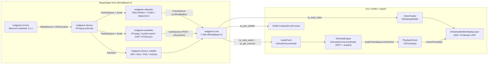

# Epidaurus: архитектура медиаядра

## Паспорт проекта и разделение слоёв

| Параметр | Значение |
|---|---|
| Версия | `0.2.0` |
| Целевая платформа | macOS 15.0+ (`arm64-apple-macosx15.0`), Apple Silicon |
| Лицензия | `GPL-3.0-or-later` |
| Исходный код | `github.com/Nikita56792/epidaurus` |
| Медиаядро | Rust (edition 2021, `librealplayer.a`, `opt-level = 3`, `lto = "thin"`) + FFmpeg 9 |
| Хост-приложение | Swift 5 (`SwiftUI` / `AppKit`), AVFoundation, CoreMedia, Metal |
| Граница модулей | C ABI (`ffi/realplayer.h`, непрозрачный дескриптор `rp_player`) |

Архитектура Epidaurus жёстко разделяет **производителя декодированных данных** (ядро на Rust) и **потребителя, владеющего часами и выводом** (хост на Swift). Внутри процесса ядро компилируется в статическую библиотеку `librealplayer.a` (крейт `realgame-core`) и подключается к Swift через bridging header поверх `ffi/realplayer.h`.

Ключевые инварианты интерфейса C ABI:

- `rp_open(url, options, err, err_len)` выполняет зондирование контейнера и сетевые операции — функция блокирующая и вызывается вне главного потока. Для прерывания зависшего открытия предусмотрен токен отмены (`rp_cancel_token`, `rp_cancel`, `rp_cancel_release`), передаваемый в строке опций `cancel=<token>`.
- Хост-приложение полностью владеет часами воспроизведения. Ядро лишь поддерживает наполненность очередей декодированных кадров и аудиочанок; вызовы `rp_read_video` и `rp_read_audio` гарантированно неблокирующие.
- `rp_read_audio` вызывается напрямую из realtime-потока рендеринга CoreAudio (`AVAudioSourceNode`), копируя планарные float32-буферы под коротким неконкурентным мьютексом.
- События ядра (`RP_EVENT_ERROR`, `RP_EVENT_SEEK_DONE`, `RP_EVENT_AUDIO_FORMAT`, `RP_EVENT_TRACKS`, `RP_EVENT_VIDEO_DECODER`) доставляются асинхронно из рабочих потоков через `rp_event_cb`.

Ключевой фрагмент контракта `ffi/realplayer.h` (владение `+1` `CVPixelBufferRef` и неблокирующий обмен кадрами/аудио):

```c
typedef struct rp_video_frame {
    CVPixelBufferRef pixel_buffer; /* +1, освобождается через rp_video_frame_release */
    double pts;
    double duration;
    int32_t width, height;
    int32_t sar_num, sar_den;
    int32_t hdr;                   /* RP_HDR_SDR .. RP_HDR_DOLBY_VISION */
    uint64_t serial;
} rp_video_frame;

/* 1 = кадр получен, 0 = очередь пуста, -1 = конец потока */
int32_t rp_read_video(rp_player *p, uint64_t serial, rp_video_frame *out);
void    rp_video_frame_release(rp_video_frame *f);

/* Realtime-safe чтение планарного PCM; *pts — время первого сэмпла */
int32_t rp_read_audio(rp_player *p, uint64_t serial, float *const *planes,
                      int32_t channels, int32_t frames, double *pts, int32_t *eos);

typedef struct rp_source {
    float x, y, z;                 /* куб комнаты: x -1..+1, y -1..+1, z 0..1 */
    float size;
    int32_t is_lfe, is_bed, active;
} rp_source;
int32_t rp_get_sources(rp_player *p, rp_source *out, int32_t max);

uint64_t rp_seek(rp_player *p, double seconds, int32_t exact);
void     rp_set_upmix(rp_player *p, const char *mode, float width,
                      const char *model_path, double position);
```



---

## Структура Rust-крейтов и синхронизация A/V

Рабочее пространство `Cargo.toml` состоит из семи внутренних крейтов:

| Крейт | Назначение и основные зависимости |
|---|---|
| `realgame-types` | Общие структуры `VideoFrame`, `AudioChunk`, `HdrKind`, `Speaker`, `LAYOUT_7_1_4`, `SourcePos`, `ObjectSnapshot`, `MediaError` |
| `realgame-ffmpeg` | Привязки FFI к системному FFmpeg 9 (`libavformat`, `libavcodec`, `libavutil`, `libswscale`, `libswresample`) |
| `realgame-demux` | Обёртка над `AVFormatContext`, классификация потоков, декодер субтитров и кастомный `AVIOContext` (`src/io.rs`) |
| `realgame-videodec` | VideoToolbox zero-copy (`cvutil.rs`), Fraunhofer VVdeC (`vvdec.rs`), Metal-решейпинг Dolby Vision Profile 5 (`dovi.rs`, `metal/dovi_metal.mm`) |
| `realgame-audiodec` | Декодирование через FFmpeg (`ffdec.rs`), вендорный крейт `truehd` + `oamd 0.1.0` (`truehd_obj.rs`, `render.rs`), 3D DSP (`upmix_dsp.rs`), ONNX Runtime HTDemucs (`upmix_ai.rs`, `ort/rp_ort.cpp`) |
| `realgame-torrent` | C++-мост `lt/rp_lt.cpp` к статически собранному `libtorrent-rasterbar 2.1.2`, приоритизация кусков и `fastresume` |
| `realgame-core` | Оркестратор потоков (`engine.rs`), серийные очереди (`queues.rs`), хранение субтитров (`subs.rs`), экспорт C ABI |

### Очереди с серийными номерами перемоток

Между потоком демуксинга, потоками декодеров и хостом расположены три типа очередей (`crates/core/src/queues.rs`): `PacketQueue` (с общим ограничением `MAX_QUEUE_BYTES = 256 МиБ`), `FrameQueue` и `AudioQueue`. Глубина декодированного буфера аудио составляет `AUDIO_AHEAD = 1.0 с`, но при активации блочного нейросетевого апмикса HTDemucs автоматически расширяется до `AUDIO_AHEAD_AI = 8.0 с`, чтобы сгладить задержку сегментного инференса.

Каждый пакет и декодированный кадр несёт монотонно растущий `serial: u64`. При вызове `rp_seek(p, seconds, exact)`:

1. Глобальный атомарный `Shared.serial` увеличивается, а очереди очищаются синхронно — хост немедленно перестаёт видеть кадры прежнего поколения, даже если рабочие потоки ещё завершают предыдущий вызов декодера.
2. Поток демуксинга отправляет в пакетные очереди элемент `PktItem::Flush(Flush { floor, reconfigure })`. При `exact = 1` декодер проходит от предшествующего ключевого кадра до метки `floor`, отбрасывая промежуточные видеокадры и подрезая первый аудиочанк с точностью до сэмпла.
3. Смена аудиодорожки (`rp_select_track`), режима Atmos (`rp_set_atmos_mode`), параметров DRC (`rp_set_drc`) или режима 3D-апмикса (`rp_set_upmix`) выполняется как refresh-перемотка на текущую позицию, без разрыва графа вывода.

### Синхронизация часов и preroll

Ведущими часами выступает `PlaybackClock` (`app/Sources/Player/VideoOutput.swift`) — обёртка над `CMTimebase`, привязанная к системным монотонным часам `CMClockGetHostTimeClock()` и назначенная в `displayLayer.controlTimebase`.

- В каждом цикле рендеринга CoreAudio объект `AudioFeed` (`app/Sources/Audio/AudioOutput.swift`) фиксирует в структуре `AudioTiming` (под `OSAllocatedUnfairLock`) медиавремя первого сэмпла `pts` и системную метку вывода `AudioTimeStamp.mHostTime`.
- Контроллер привязывает `CMTimebase` методом `anchor(media:hostTicks:rate:)`, учитывая фактическую латентность аудиовыхода (`AudioOutput.latency`), включая задержку Bluetooth-кодека и опциональную компенсацию `extraLatency`.
- После открытия файла или перемотки атомарный шлюз `AudioFeed.gate` закрыт: аудио отдаёт тишину до тех пор, пока `VideoFeeder` не поставит в `AVSampleBufferDisplayLayer` первый декодированный кадр (`onFirstFrame`), после чего звук и видео стартуют одновременно.

---

## Видеоподсистема: VideoToolbox, VVdeC, VRR и HDR/EDR

### Аппаратное декодирование и автоматический fallback

В `crates/videodec/src/lib.rs` перед созданием контекста FFmpeg проверяется поддержка кодека через `hw_decode_supported(fourcc)` (VideoToolbox):

- Аппаратно (zero-copy `CVPixelBufferRef` через `AV_HWDEVICE_TYPE_VIDEOTOOLBOX`) декодируются H.264 (`avc1`), HEVC 8/10 бит (`hvc1`), AV1 (`av01`), VP9 (`vp09`), ProRes (`apcn`), MPEG-2 (`mp2v`), MPEG-4 (`mp4v`) и H.263 (`h263`).
- Для AV1 выполняется явный выбор декодера: FFmpeg регистрирует `libdav1d` выше встроенного `av1`, однако аппаратный VideoToolbox работает только через нативный декодер `av1`, поэтому при `hw_possible == true` запрашивается `av1`, а для программного пути — `libdav1d`.
- Колбэк `get_format` выбирает `AV_PIX_FMT_VIDEOTOOLBOX` при включённом `hwdec`. Если VideoToolbox отклоняет поток в процессе декодирования (например, нестандартный профиль или глубина цвета), ядро прозрачно переходит на многопоточный программный декодер FFmpeg, выполняя refresh-перемотку и уведомляя хост событием `RP_EVENT_VIDEO_DECODER`.

### VVC / H.266 на Fraunhofer VVdeC (ARM64 NEON)

Аппаратного блока декодирования VVC/H.266 в кристаллах Apple Silicon нет. Для потоков `AV_CODEC_ID_VVC` формата 4:2:0 (`YUV420P`, `YUV420P10LE`) Epidaurus обходит программный декодер FFmpeg и использует библиотеку Fraunhofer VVdeC (`crates/videodec/src/vvdec.rs`), задействующую SIMD-инструкции NEON, межкадровый и строчный (CTU wavefront) параллелизм:

- **Нормализация битового потока:** контейнеры MP4 и MKV хранят запись `vvcC` и NAL-блоки с префиксом длины; `VvcDecoder` автоматически переводит их в Annex B через битстрим-фильтр `AVBSFContext`, тогда как сырые `.266` и MPEG-TS подаются напрямую.
- **Метки времени:** тики проходят через VVdeC со смещением `CTS_BIAS = 1 << 40`. Если контейнер хранит PTS в порядке декодирования (частый случай после ремукса сырого `.266`), детектор обратных скачков автоматически переключается на сортировку через бинарную мин-кучу `pts_heap`. Для сырых потоков без PTS частота берётся из параметров HRD.
- **Копирование в CoreVideo и память:** перенос плоскостей из буферов VVdeC в `CVPixelBuffer` (4:2:0 8/10 бит) распараллелен на 4 потока — на разрешении 8K один кадр занимает порядка 150 МБ. Глубина конвейера VVdeC до 4K выбирается автоматически, а начиная с 6K ограничивается 4 кадрами (меньше пиковой памяти без потери скорости).
- **Fallback:** если библиотека `libvvdec` не слинкована, поток закодирован в 4:2:2/4:4:4 или задана переменная среды `RP_VVC_DECODER=ffmpeg`, управление передаётся встроенному декодеру FFmpeg `vvc`.

Замеры сквозного конвейера (демукс + декодирование + конвертация в `CVPixelBuffer`, утилита `vbench`) на Apple M4 Max (16 ядер):

| Тестовый поток (10 бит, HDR10) | Fraunhofer VVdeC (NEON) | FFmpeg `vvc` | Ускорение |
|---|---:|---:|---:|
| 4K, 8 Мбит/с | 302 кадра/с (первый кадр 68 мс) | 62 кадра/с (первый кадр 334 мс) | 4.87× |
| 4K60, 104 Мбит/с | 167 кадров/с | 58 кадров/с | 2.88× |
| 8K, 6 Мбит/с | 101 кадр/с (RAM 4.9 ГБ) | 16 кадров/с | 6.31× |

При реальном воспроизведении в приложении поток 4K60 VVC нагружает около 4 ядер из 16, а 8K24 — от 5 до 9 ядер без пропусков кадров.

### Вывод кадров, ProMotion VRR и HDR/Dolby Vision в EDR

`VideoFeeder` работает на выделенной очереди `rp.video.feed` (`qos: .userInteractive`) с таймером 4 мс и окном предзагрузки `lookahead = 0.25 с` для кадров шириной от 3000 пикселей (0.4 с для меньших разрешений). При отставании от часов кадр отбрасывается только в том случае, если `rp_peek_video` подтверждает наличие более свежего готового кадра.

На дисплеях с переменной частотой обновления (ProMotion и внешние Adaptive-Sync мониторы) класс `RefreshMatcher` вычисляет диапазон `[minHz, maxHz]` экрана по `minimumRefreshInterval` / `maximumRefreshInterval`, подбирает наибольшее целое кратное `target = fps * k` в границах диапазона (например, `23.976 к/с → 119.88 Гц`, `25 к/с → 100 Гц`) и закрепляет его через `CADisplayLink` с `CAFrameRateRange(minimum: target, maximum: target, preferred: target)`. Каждый кадр удерживается строго одинаковое число циклов развёртки.

Обработка HDR и передача в macOS Extended Dynamic Range (EDR):

- **HDR10, HDR10+, HLG и Dolby Vision профилей 7 / 8.x:** каждый `CVPixelBuffer` размечается полным набором цветовых тегов (primaries, transfer function, YCbCr matrix, chroma location), а также метаданными `MasteringDisplayColorVolume` и `ContentLightLevelInfo` (MaxCLL/MaxFALL), извлекаемыми из контейнера, VUI или SEI. Профили 7 и 8.x декодируются через обратно совместимый базовый слой HDR10/HLG; тонмаппинг и адаптацию к пиковой яркости дисплея выполняет композитор macOS.
- **Dolby Vision Profile 5 (IPTPQc2):** не имеет совместимого базового слоя BT.2020. Модуль `crates/videodec/src/dovi.rs` разбирает покадровые метаданные `AVDOVIMetadata` (полиномиальные и MMR-кривые решейпинга `RpDoviCurve` размером 1056 байт на компоненту, упакованные в `RpDoviParams` размером 3312 байт вместе со смещениями и матрицами `ycc_to_rgb_matrix` и `rgb_to_lms_matrix`), перемножает матрицу снятия перекрёстных помех с чистой матрицей Hunt–Pointer–Estevez (`HPE_LMS_TO_BT2020`, выведенной из первичных цветов BT.2020 D65) и вызывает Metal compute shader (`rp_dovi_mtl_process` в `crates/videodec/metal/dovi_metal.mm`). Шейдер в реальном времени преобразует 10-битный IPTPQc2 в нативный `CVPixelBuffer` формата BT.2020 PQ (`x420`), а 12-битные значения яркости RPU (L6) переводятся функцией `pq12_to_nits` в кд/м² для тегирования mastering display.

---

## Аудиоподсистема: TrueHD Atmos, 3D-апмикс и AutoEQ

### Декодирование Dolby TrueHD Atmos (OAMD)

Для потоков Dolby TrueHD с метаданными Atmos модуль `crates/audiodec/src/truehd_obj.rs` использует вендорный Rust-крейт `truehd` и парсер `oamd 0.1.0`. Вместо даунмикса к 7.1 декодер явно запрашивает четвёртую (объектную) презентацию `OBJECT_PRESENTATION = [false, false, false, true]` (до 16 независимых аудиоэлементов: bed-каналы + динамические объекты).

Для каждого Access Unit (40 сэмплов TrueHD) извлекаются структуры `ObjectAudioMetadataPayload` (OAMD). В `ObjectRenderer` (`crates/audiodec/src/render.rs`) координаты объектов в нормализованном кубе комнаты (`x` от −1 слева до +1 справа, `y` от −1 сзади до +1 спереди, `z` от 0 на уровне ушей до 1 на потолке) и их усиление интерполируются (рампируются) с точностью до сэмпла. Реализованы два режима вывода:

1. **Наушники (`RenderMode::Objects`, чанки по 480 сэмплов / ~10 мс):** каждый из активных элементов остаётся отдельным моноканалом и передаётся в собственный `AVAudioSourceNode` внутри `AVAudioEnvironmentNode` (Apple HRTF HQ) с актуальными 3D-координатами `rp_get_sources`, минуя промежуточную сетку виртуальных колонок. В тракт включена измеренная коррекция диффузного поля Apple HRTF HQ (`hrtfCompensation`: пик +1.2 дБ на 1.25 кГц Q 1.4, пик +2.0 дБ на 10 кГц Q 2.5, high-shelf +1.0 дБ на 13 кГц) и регулируемая модель ранних отражений («комната»).
2. **Многоканальные колонки (`RenderMode::Speakers714`, чанки по 1024 сэмпла):** функция `pan(x, y, z)` выполняет энергосохраняющее тригонометрическое панорамирование (`cos`/`sin`) между горизонтальными рядами (L/C/R, LS/RS, LB/RB) и потолочной плоскостью (LTF/RTF, LTR/RTR) в 12-канальный макет `LAYOUT_7_1_4`.

:::note Ограничение проприетарных объектных форматов
Для E-AC-3 JOC (стриминговый Atmos) и DTS:X открытых объектных декодеров не существует, поэтому Epidaurus воспроизводит их канальную основу (5.1/7.1) через тот же HRTF-рендерер или прямой многоканальный вывод.
:::

### Пространственный апмикс «Стерео → 3D» (DSP и HTDemucs)

Любой стереопоток может преобразовываться в набор 3D-объектов (или 7.1.4) без перезапуска вывода при изменении ширины сцены: параметр «Погружение» хранится в `LiveWidth(Arc<AtomicU32>)` и считывается атомарно в процессе обработки.

| Режим | Конвейер обработки | Выход | Задержка и ресурсы |
|---|---|---|---|
| **3D DSP** (`upmix_dsp.rs`) | STFT Direct/Diffuse разделение по межканальной когерентности (ICC) + плавный трекинг азимута + кроссовер `Lr4Split` (Linkwitz–Riley 24 дБ/окт, LFE ниже 100 Гц) + 6 ортогональных декорреляторов Interleaved Velvet Noise (выше 220 Гц) | 12 3D-объектов или 7.1.4 | ~40 мс, менее 1 % CPU, чистый Rust без внешних весов |
| **AI Кино / AI Музыка** (`upmix_ai.rs`, `rp_ort.cpp`) | `libswresample` (44.1 кГц) → ONNX Runtime HTDemucs 6 стемов (`htdemucs_6s_fp16weights.onnx`, ~130 МБ, MIT: вокал, ударные, бас, гитара, пиано, окружение) → остаток `Mix − Σ Stems` для строгого сохранения энергии + LFE LR4 + Velvet Noise | 14 3D-объектов (~92 Гц обновления координат, чанки по 480 сэмплов) | ~7× быстрее реального времени на Apple Silicon NEON/AMX |

Инженерная особенность `upmix_ai.rs`: инференс HTDemucs по умолчанию запускается на CPU Execution Provider (NEON/AMX), а не на CoreML EP. Профилирование показало, что CoreML EP фрагментирует операции STFT и Transformer-блоки модели на десятки подграфов с постоянным копированием тензоров, работая примерно в 35 раз медленнее CPU EP. Переключение на CoreML оставлено только как отладочная опция `RP_ORT_COREML=1`. Если ONNX Runtime не скомпилирован или файл весов отсутствует в `~/Library/Application Support/Epidaurus/Models/`, декодер автоматически откатывается к `DspUpmixDecoder`.

### Параметрическая коррекция наушников (AutoEQ Harman)

В `app/Sources/Audio/Profiles.swift` встроены 10-полосные профили коррекции АЧХ для Sony WH-1000XM6 на базе замеров Super Review (целевая кривая Harman over-ear):

- `xm6-bt` (Bluetooth) — выбирается автоматически при совпадении имени аудиоустройства (`OutputDevice.transport == .bluetooth`).
- `xm6-aux` (проводное подключение 3.5 мм с включённым питанием) — выбирается один раз для аналогового выхода и запоминается за ним.

Поскольку `AVAudioUnitEQ` принимает ширину полосы в октавах по определению цифровых фильтров RBJ, добротность `Q` из нотации AutoEQ пересчитывается с поправкой частотного варпинга `warp = sin(w0) / w0`:

```text
bandwidth_octaves = (2 * asinh(1 / (2 * Q)) / ln(2)) * (sin(w0) / w0)
```

Без поправки `sin(w0) / w0` широкие полосы вблизи частоты Найквиста отклонялись бы до 2 дБ; с ней расхождение с расчётной кривой AutoEQ не превышает 0.3 дБ до 16 кГц. Вместо статического снижения усиления (`preamp`: −4.6 дБ для BT и −6.7 дБ для кабеля) применяется `loudnessMakeup` по полосе 200 Гц – 5 кГц (сохраняет воспринимаемую громкость равной режиму без EQ, пики выше 0 dBFS ограничивает выходной лимитер) и басовая полка по умолчанию `+4 дБ` на 105 Гц (промежуточное значение между замерами Super Review и Kuulokenurkka).

| Профиль (`Profiles.swift`) | Идентификатор | Выбор устройства | Особенности тракта |
|---|---|---|---|
| Sony WH-1000XM6 · Bluetooth | `xm6-bt` | Автоматически по имени и транспорту BT | 10 полос AutoEQ + `defaultBass: +4 дБ` + HRTF HQ + `hrtfCompensation` |
| Sony WH-1000XM6 · кабель (AUX) | `xm6-aux` | Запоминается за 3.5 мм выходом | 10 полос AutoEQ (analog cable, питание вкл.) + `defaultBass: +4 дБ` + HRTF HQ |
| Наушники (общий) | `headphones` | Встроенный 3.5 мм, Bluetooth/USB стерео | HRTF HQ + `hrtfCompensation` без коррекции модели |
| Динамики Mac | `builtin` | Встроенные динамики MacBook | Пространственный рендерер встроенных динамиков Apple |
| Колонки / ресивер | `speakers` | Многоканальные выходы, HDMI / DisplayPort | Каналы без HRTF; TrueHD Atmos рендерится в 7.1.4 |

---

## Потоковое чтение торрентов поверх кастомного AVIOContext

Вместо запуска локального HTTP-сервера Epidaurus передаёт данные из BitTorrent напрямую в демуксер FFmpeg:

1. Крейт `realgame-torrent` (`crates/torrent/src/lib.rs` + `lt/rp_lt.cpp`) оборачивает статически собранный `libtorrent-rasterbar 2.1.2` (MSE/PE, TCP + uTP, DHT, PEX, LSD, UPnP/NAT-PMP, WebTorrent/WebRTC, веб-сиды BEP 19). Карта загруженных кусков и пиры сохраняются в `~/Library/Caches/Epidaurus/resume` (`fastresume`).
2. Открытие файла в раздаче выполняется по внутреннему URI вида `torrent://<id>/<file_index>/<name>`.
3. В `crates/demux/src/io.rs` создаётся собственный `AVIOContext` с буфером `BUF_SIZE = 1 МиБ`, подключённый к трейту `MediaSource` через колбэки `read_cb` и `seek_cb`.

Стратегия планирования кусков для потокового воспроизведения и мгновенной перемотки:

- Выбранный файл загружается последовательно. Непосредственно после текущей позиции чтения поддерживается скользящее окно `WINDOW_BYTES = 32 МиБ`, кускам которого назначаются жёсткие сроки доставки `set_piece_deadline` (`rplt_deadline`) — `libtorrent` запрашивает их у быстрейших пиров и перезапрашивает при задержке.
- В момент открытия файла критичный приоритет дополнительно выставляется на последние `TAIL_BYTES = 4 МиБ`, где контейнеры размещают индекс перемотки (`moov` в MP4, `idx1` в AVI, `Cues` в MKV).
- При вызове `rp_seek()` ядро поднимает атомарный флаг `Shared.skip`. Блокирующее ожидание недостающего куска внутри `read_cb` проверяет `stop || skip` и немедленно завершается возвратом `AVERROR_EXIT`, снимая старые дедлайны (`rplt_clear_deadlines`) и переводя фокус (`rplt_focus`) на новое байтовое смещение.

---

## Ограничения, диагностика и сборка

### Известные ограничения

- **Сырой VVC (`.266`):** поток без контейнерного индекса не поддерживает перемотку со стороны FFmpeg (внутри MKV и MP4 перемотка работает штатно). Масштабируемые (scalable) и multiview-профили VVC не тестировались.
- **Субтитры ASS/SSA:** разметка приводится к курсиву, полужирному начертанию и базовому выравниванию (numpad alignment); позиционирование, встроенные шрифты и анимации `libass` не рендерятся.
- **Торренты:** magnet-ссылки требуют пиров с поддержкой обмена метаданными (веб-сиды их не отдают — в таких случаях нужен файл `.torrent`); внешние дорожки озвучки внутри раздачи (`.mka`/`.ac3`) пока не подключаются автоматически; при отсутствии проброса порта за NAT/VPN загрузка идёт только по исходящим соединениям.

### Сборка и отладочные инструменты

Зависимости устанавливаются через Homebrew (`vvdec` и `onnxruntime` опциональны — без них отключаются только VVdeC и нейросетевой апмикс, при этом 3D DSP продолжает работать). Для компиляции макросов SwiftUI требуется полный Xcode, а не только Command Line Tools.

```bash
brew install ffmpeg vvdec onnxruntime cmake ninja boost openssl@4

# Обычная сборка и запуск (app/build/Epidaurus.app)
app/build.sh --run

# Переносимый бандл: перепаковывает dylib FFmpeg, OpenSSL, VVdeC и ORT в Contents/Frameworks
app/build.sh --bundle
```

Для профилирования и автоматизированных регрессионных прогонов без UI и в составе приложения доступны стенды и переменные среды:

```bash
cargo test --release
cargo run --release -p realgame-core --example vbench -- <файл>
cargo run --release -p realgame-core --example harness -- <файл_или_magnet> 3 100,2000
cargo run --release -p realgame-audiodec --example atmos_render -- <файл> 1500 60 out.wav
RP_DEBUG=1 RP_MUTE=1 RP_TEST="5:seek=1500;10:quit" app/build/Epidaurus.app/Contents/MacOS/Epidaurus <файл>
```

`RP_DEBUG=1` ежесекундно выводит состояние часов, выходную задержку, дрейф A/V и заполнение очередей; `RP_TORRENT_DEBUG=1` трассирует ожидание кусков, перемотки потока и проброс портов.
