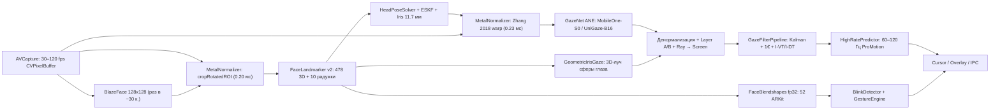

# Fovea: нативный 3D eye tracking на Swift 6, Core ML ANE и Metal GPU

**Fovea** (`github.com/Nikita56792/fovea`) — локальная система отслеживания взгляда для macOS, определяющая 3D-луч взгляда и точку фиксации на плоскости дисплея по видеопотоку обычной RGB-камеры без инфракрасной подсветки, калибровочного реквизита и фиксации головы. Архитектура ориентирована на инвариантность к свободному движению головы через явную 3D-геометрию в миллиметрах, а не через 2D-регрессию пикселей на экран.

---

## 1. Паспорт и системные ограничения

| Параметр | Значение |
|---|---|
| Целевая платформа | macOS 14+ (Apple Silicon), верифицировано на `Mac16,5` (M4 Max, 12P+4E, 48 ГБ), macOS 27.2.1 (`26B131`) |
| Язык и сборка | Чистый Swift 6 (`swift-tools-version: 6.0`, проверено на Swift 6.4), 10 библиотечных модулей SwiftPM без внешних зависимостей |
| Рантайм-зависимости | `AVFoundation`, `CoreML` (`MLProgram`, `CPU_AND_NE`), `Metal`, `IOKit.hid`, `CoreGraphics`, `ApplicationServices`, `Network.framework` |
| Python в рантайме | Отсутствует (`tools/fovea_tools/` используется только офлайн для прямой конверсии `.tflite`/PyTorch в `.mlpackage`) |
| Источник видео | Встроенная RGB-камера (`1760×1328 @ 30 fps`) или Continuity Camera / внешние UVC-камеры (`60–120 fps`), без ИК |
| Приватность | 100% локальная обработка на устройстве; видео не покидает хост и по умолчанию не пишется на диск |
| Модули SwiftPM | `FoveaCore`, `FoveaGeometry`, `FoveaCapture`, `FoveaVision`, `FoveaCalibration`, `FoveaFilter`, `FoveaControl`, `FoveaIPC`, `FoveaEngine`, `FoveaTestKit`, CLI `foveacli`, приложение `FoveaApp` |

### Аппаратные и API-ограничения macOS

Проектирование `FoveaCapture` и `FoveaGeometry` напрямую продиктовано ограничениями стека видеозахвата macOS (верифицировано на `Mac16,5`):

1. **Отсутствие интринсик камеры.** `AVCaptureConnection.isCameraIntrinsicMatrixDeliverySupported` и `AVCaptureDevice.Format.videoFieldOfView` недоступны на macOS на уровне компиляции, а аттачмент `kCMSampleBufferAttachmentKey_CameraIntrinsicMatrix` в кадрах отсутствует. Матрица `K` и априор дисторсии задаются каталогом `DeviceOpticsCatalog` по `hw.model` либо калибруются структурированным светом (`foveacli calibrate-optics`).
2. **Невозможность блокировки экспозиции, фокуса и ББ.** Для встроенной камеры `isExposureModeSupported(.locked)`, `isFocusModeSupported(.locked)` и `isWhiteBalanceModeSupported(.locked)` возвращают `false`. Скачки автоэкспозиции при изменении яркости экрана компенсируются на GPU внутри `MetalNormalizer`.
3. **Приоритет пресета над `activeFormat`.** Пресет `.inputPriority` недоступен на macOS, а `sessionPreset` по умолчанию перезаписывает `device.activeFormat` в момент `commitConfiguration` (подменяя `1760×1328` на `1920×1080`). `CaptureController` выставляет `activeFormat` строго **после** `session.startRunning()` и проверяет геометрию каждого пришедшего `CVPixelBuffer`.
4. **Падение частоты вдвое при фиксации только минимума длительности кадра.** Задание одного `activeVideoMinFrameDuration` при комнатном свете позволяет автоэкспозиции ронять частоту с `30.0 fps` до `16.6 fps` (`60.2 мс`). Фиксация **обеих** границ (`activeVideoMinFrameDuration == activeVideoMaxFrameDuration == 1 / targetFps`) стабилизирует поток на медиане `33.34 мс` (`29.99 Гц`).
5. **Системные видеоэффекты.** `Center Stage` динамически кропает и панорамирует кадр, ломая оптическую ось; он программно подавляется через `centerStageControlMode = .app` и `isCenterStageEnabled = false`. Эффекты `Portrait`, `Studio Light`, `Reactions` и `Background Replacement` отслеживаются через KVO в `VideoEffectsMonitor` и выводят предупреждение пользователю.

:::note Конвенция координат и зеркальности
`AVCaptureVideoDataOutput` отдаёт незеркалённый кадр. Внутренние расчёты ведутся в миллиметрах в правосторонней системе OpenCV **CCS** (`+X` вправо на кадре, `+Y` вниз, `+Z` от камеры к лицу). Для глаз используется анатомическая терминология субъекта (`CanonicalFaceMesh.swift`): правый глаз субъекта (`right`, `x < 0` в HCS) — углы `33`/`133` и радужка `468…472`; левый (`left`, `x > 0`) — углы `362`/`263` и радужка `473…477`.
:::

---

## 2. Сквозной конвейер обработки кадра

Вся обработка кадра изолирована по правилам строгой конкурентности Swift 6 с политикой **drop-late-frames**: при задержке старый кадр сбрасывается ради минимизации сквозной латентности.



### Основные стадии пайплайна

1. **Захват (`FoveaCapture`).** `FormatSelector` выбирает `1760×1328 @ 30 fps` (4:3, полное вертикальное поле сенсора) на встроенной камере MacBook и автоматически переключается на `60–120 fps` на Continuity Camera (iPhone) или внешних UVC-камерах. Временная метка берётся по `PTS` экспозиции (`CLOCK_MONOTONIC_RAW`).
2. **Детекция лица и трекинг ROI (`BlazeFaceRunner`, `FaceLandmarkerRunner`).** Полная детекция (`FaceDetector.mlpackage`, 896 якорей по сеткам `16×16×2` и `8×8×6`, 6 ключевых точек) запускается периодически и при потере трека. В промежутках `FaceROITracker` формирует сглаженный повёрнутый квадратный ROI из лендмарков прошлого кадра, исключая джиттер ограничивающей рамки. `FaceLandmarker.mlpackage` выдаёт 468 точек лица + 10 точек радужки (центры `468`/`473` и 4 точки лимба на глаз), а `FaceBlendshapes.mlpackage` (намеренно в `float32`, чтобы квадраты координат `1760×1328` не переполняли порог `fp16 = 65504`) вычисляет 52 ARKit-блендшейпа по 146 точкам.
3. **6DoF поза головы и метрический масштаб (`HeadPoseSolver`, `IrisScaleEstimator`).** Все 2D-лендмарки предварительно раздисторсиваются обращением модели Brown–Conrady (`CameraIntrinsics.undistort`). Поза `(R_h, t_h)` в миллиметрах решается по строго жёсткому 24-точечному подмножеству (`CanonicalFaceMesh.rigidPnPIndices`: 4 угла глаз, 7 точек носа, 6 точек инфраорбитального гребня, 7 черепных опор лба и висков — губы, челюсть и брови полностью исключены) на базе канонического 468-вершинного меша из `geometry_pipeline_metadata_landmarks.binarypb`. В коде `HeadPoseSolver` объединяет итеративный взвешенный **POSIT** (или тёплый старт с прошлого кадра, выполняя роль инициализатора EPnP-класса без планарного вырождения) и нелинейное уточнение **Левенберга–Марквардта** на многообразии `SO(3)` с потерей Хьюбера (`delta = 2.0 px`) и аналитическим якобианом. Далее `HeadPoseESKF` сглаживает 6DoF позу и скорости в двух блочно-диагональных ковариациях `6×6` (`[δp, δv]` и `[δθ, δω]`) с анизотропным шумом (`σ_XY = 1.5 мм`, `σ_Z = 6.0 мм`), адаптивным раздуванием ковариации при высокой инновации (`NIS > 9.0`) и обновлением Джозефа. Независимо `IrisScaleEstimator` подгоняет эллипс лимба (`IrisEllipse.fitMediaPipe` через собственные значения матрицы сопряжённых полудиаметров `M = v_h v_hᵀ + v_v v_vᵀ` с отсечкой перекрытия верхнего века при `r_top < 0.72 · r_bottom`), получая инвариантную к ракурсу большую ось `2a` и дистанцию по антропометрическому диаметру радужки `11.7 мм` (`σ ≈ 0.5 мм`).
4. **GPU-нормализация и фотометрия (`MetalNormalizer`).** Compute-шейдеры на MSL компилируются в рантайме (`device.makeLibrary(source:options:)`) и привязывают `IOSurface`-буферы без копирования через `CVMetalTextureCache`:
   - `cropRotatedROI` (`1760×1328 → 256×256`): **0.20 мс** на M4 Max;
   - `sampleWarpedLuminance` (разреженная сетка `16×16` в одной threadgroup из 256 потоков, Rec.709, целевая яркость `0.48`, усиление в пределах `[0.55, 1.85]`) + `warpPerspectiveNormalize` (`1760×1328 → 224×224`): **0.23 мс** суммарно.

```metal
// Фрагмент встроенного ядра warpPerspectiveNormalize (FoveaVision/MetalNormalizer.swift)
float3 h = u.col0.xyz * float(gid.x) + u.col1.xyz * float(gid.y) + u.col2.xyz;
if (abs(h.z) > 1e-7f) {
    float sx = h.x / h.z, sy = h.y / h.z;
    constexpr sampler s(coord::pixel, filter::linear, address::clamp_to_zero);
    float3 rgb = srcTex.sample(s, float2(sx + 0.5f, sy + 0.5f)).rgb;
    if (u.enablePhotometric != 0) rgb = clamp(rgb * stats->gain + stats->bias, 0.0f, 1.0f);
    dstTex.write(float4(rgb, 1.0f), gid);
}
```
5. **Оценка взгляда, пересечение с экраном и слияние.** Нормализованный кроп поступает в нейросеть взгляда на ANE (и/или строится 3D-луч радужки), вектор денормализуется в CCS, корректируется персональной моделью (`PersonalCalibrator`) и пересекается с плоскостями дисплеев в `ScreenResolver` (допуск кромки `15 мм`). `BinocularFusion` объединяет правый и левый лучи по обратной пространственной дисперсии `w_i = (visibility_i · opennessFactor_i) / σ_spatial,i²` с плавным ослаблением дальнего глаза при повороте головы (`|yaw| > 15°`, до `0.25` на `45°`) и флагом расхождения `hasHighDisparity` при диспаратности более `2°`.
6. **Фильтрация и ProMotion-предиктор (`FoveaFilter`).** `GazeFilterPipeline` последовательно применяет `BlinkDetector`, классификатор движений `EyeEventClassifier` (I-VT + I-DT: `fixation`, `saccade`, `pursuit`, `blink`), `AdaptiveKalmanFilter2D` с режимно-зависимым шумом процесса и изотропный `OneEuroFilter2D`. Поверх него `HighRatePredictor` выдаёт C¹-гладкий поток `60–120 Гц`:
   - в `.fixation` — экспоненциальная сходимость к целевой точке (`τ = 24 мс`);
   - в `.pursuit` — кинематическое упреждение с экспоненциальным затуханием скорости, ограниченное горизонтом `≤ 40 мс`;
   - в `.saccade` — аналитическая критически-демпфированная пружина (`ω = 65 рад/с`, ноль перерегулирования);
   - защитный предел экстраполяции `maxExtrapolation = 120 мс` (при простое потока переводит состояние в `.lowConfidence`) и прямой pass-through при частоте входной камеры `≥ 55 Гц` (`dt ≤ 18 мс`).

---

## 3. Нормализация перспективы (Zhang 2018) и 3D-инвариантность к позе головы

2D-трекеры класса WebGazer строят полиномиальную регрессию из координат глаз/зрачка на кадре в координаты экрана. Такая аппроксимация неявно кодирует позу головы из калибровки: при повороте головы на ±30° смещается и проекция глаз в кадре, и ракурс радужки, что разрушает отображение «пиксель → экран».

В Fovea эта зависимость разделяется геометрически в `GazeNormalizer.swift` по ревизии **Zhang–Sugano–Bulling (ETRA 2018)**:

1. Для 3D-центра нормализации `e` в CCS (канонический `ethXGazeFaceCenterHCS` для полного лица или центр глазного яблока для отдельного глаза) строится ортонормированный базис виртуальной камеры **NCS**, обнуляющий крен (`roll`) головы:
   ```text
   ẑ = e / ‖e‖
   ŷ = (ẑ × x_h) / ‖ẑ × x_h‖      (x_h — первый столбец R_h)
   x̂ = ŷ × ẑ
   R_n = [ x̂ᵀ ; ŷᵀ ; ẑᵀ ]
   ```
2. Масштабная матрица дистанции `S = diag(1, 1, d_n / ‖e‖)` приводит виртуальное расстояние до лица к `d_n = 600 мм` и входит **только** в гомографию варпа изображения:
   ```text
   W   = K_n · S · R_n · K⁻¹
   W⁻¹ = K · R_nᵀ · S⁻¹ · K_n⁻¹
   ```
   Спецификации `NormalizationSpec`: `.uniGazeFace` (`224×224`, `f_n = 480`, `d_n = 600 мм` — эквивалент ETH-XGaze `448×448, f_n = 960` с масштабом `0.5×`), `.ethXGaze448` (`448×448`, `f_n = 960`, `d_n = 600 мм`) и `.singleEye` (`128×96`, `f_n = 1600`, `d_n = 600 мм`).
3. **Поправка ревизии 2018:** вектор взгляда преобразуется **чистым ортогональным поворотом без `S`**:
   ```text
   g_n = R_n · g_c     (CCS → NCS)
   g_c = R_nᵀ · g_n    (NCS → CCS, денормализация)
   ```
   Исключение `S` из преобразования луча устраняет нелинейное угловое искажение при `‖e‖ ≠ d_n`. Юнит-тесты `GeometryTests` проверяют round-trip `normalize → (pitch, yaw) → denormalize` с допуском менее `1e-12` рад.

### Измеренная инвариантность на детерминированном 3D-стенде

Верификация геометрии и персональной калибровки выполнена на синтетическом 3D-стенде `SyntheticFaceRig` + `EvaluationHarness` (модель `Mac16,5`, конфигурация шумов `landmarkNoisePx = 0.55`, `gazeNoiseDeg = 0.35`, `poseModelBiasDeg = 1.20`, отчёт `reports/evaluation_report.html`):

| Протокол / конфигурация | Медиана ошибки | Сдвиг `max − min` по позе | Примечание |
|---|---|---|---|
| Протокол 3.1: сетка 5×5 (25 целей × 3 повтора) | **0.31°** (`3.2 мм` / `16 pt`) | — | `P95 = 0.64°`, Precision SD в фиксации **0.06°** |
| Протокол 3.2: Fovea 3D (Layer A + B) | **0.33°** | **0.20°** (yaw −30°…+30°) | Снижение медианной ошибки в **26.7×** vs 2D baseline |
| Протокол 3.2: Fovea 3D (Zero-Calibration prior) | 1.50° | — | Без персональной калибровки каппа |
| Протокол 3.2: 2D WebGazer полиномиальный baseline | 8.85° | **32.91°** (yaw −30°…+30°) | Систематический срыв при повороте головы |
| Разбивка 4 осей Fovea 3D (протокол 3.2) | — | Yaw `0.20°` · Pitch `0.12°` · Смещение `0.31°` · Дистанция `0.33°` | Диапазоны: pitch ±20°, сдвиг ±150/100 мм, дистанция 400–800 мм |

:::warning Разграничение синтетического стенда и живых сессий
Приведённые числа (`0.31°` медиана, `0.20°` сдвиг по yaw) получены на синтетической 3D-сцене с известной истиной для отделения ошибок геометрии, фильтра и калибровки от шума реальной камеры. На живом человеке физический потолок точности для RGB-камеры MacBook оценивается RSS-бюджетом в `0.8–1.2°` (цели `EVALUATION.md`: T1 `≤ 1.0°`, сдвиг по yaw `≤ 0.6°`).
:::

---

## 4. Трёхдвижковая оценка направления взгляда

`GazeNetRunner.swift` реализует переключаемую и гибридную архитектуру (`GazeModelKind`: `.mobileOneS0`, `.uniGazeB16`, `.geometricIrisOnly`, `.hybridFusion`). Все модели конвертированы напрямую из TFLite/PyTorch в Core ML `MLProgram` без хрупкой связки `tf2onnx`, с вшитой ImageNet-нормализацией и проверкой SHA-256 по `models/manifest.json`.

| Движок (`ModelSlot` / тип) | Вход | Выход и оценка `σ` | Точность / вес | Лицензия | Медиана ANE M4 Max |
|---|---|---|---|---|---|
| **`MobileOne-S0 Gaze`** (`GazeNetFast`, `MobileOneGazeRunner`) | `448×448` RGB | `yaw_logits [1,90]`, `pitch_logits [1,90]`; softmax → `μ`, гетероскедастическая `σ` и энтропия | `fp16` / `2.4 МБ` | **MIT** (коммерческий) | **0.863 мс** (`p95 0.988 мс`, `1159 FPS`) |
| **`UniGaze-B16`** (`GazeNetAccurate`, `UniGazeRunner`) | `224×224` RGB (Zhang 2018) | `gaze_pitch_yaw [1,2]` (рад); `σ` масштабируется по резкости Лапласиана и уверенности лица | `fp16` / `164 МБ` (ViT-B/16 ANE-4D) | `MG-NC-RAI-2.0` (research-only) | **4.274 мс** (`p95 4.600 мс`, `234 FPS`) |
| **`GeometricIrisGaze`** (3D-луч радужки) | 478+10 лендмарков | Бинокулярные `GazeRay` пересечением обратного луча со сферой глаза | `fp64` / `0` весов | **Apache-2.0** | **Более 300 FPS** (CPU `simd`) |

### Декодирование распределения в `MobileOneGazeRunner`

Репараметризованная архитектура Apple MobileOne-S0 сворачивает многоветвевые блоки обучения в единые `Conv2d + ReLU`, оптимальные для ANE. Вместо точечной регрессии сеть предсказывает 90-биновое дискретное распределение с шагом `4°` и смещением `−180°` (`θ_i = 4·i − 180`). Метод `decodeBinDistribution` извлекает одновременно математическое ожидание и **истинную гетероскедастическую неопределённость**:

```swift
// MobileOneGazeRunner.decodeBinDistribution (FoveaVision/GazeNetRunner.swift)
// μ = Σ p_i · θ_i,   σ = max(sqrt(Σ p_i · (θ_i − μ)²), 0.5°),   H_norm = −Σ p_i ln(p_i) / ln(90)
```

При окклюзии глаза, бликах на очках или смазе распределение по бинам расширяется автоматически — `σ` растёт, что плавно снижает вес кадра в `BinocularFusion` и `AdaptiveKalmanFilter2D`.

### Геометрический 3D-луч (`GeometricIrisGaze`)

Для каждого глаза центр вращения глазного яблока `c_eye^h` в HCS смещён на `+12.5 мм` вглубь головы (`+Z`) от середины отрезка между углами глаза, радиус сферы `R_eye = 12.0 мм`. Обратный луч через раздисторсированный центр радужки `d_cam = normalize(K⁻¹ · p_iris)` пересекается со сферой в CCS:

```text
t_near = (d_cam · c_eye^c) − √( (d_cam · c_eye^c)² − (‖c_eye^c‖² − R_eye²) )
g_geom = normalize( t_near · d_cam − c_eye^c )
```

При касательном промахе в пределах `1.15 · R_eye` (шум лендмарка на крайнем взгляде) точка проецируется на границу сферы с повышением `σ` в `2.5×`. В режиме `.hybridFusion` геометрический и нейросетевой лучи объединяются по весам `1/σ²`.

---

## 5. Режим Zero-Calibration, `LidAngleSensor` и персональная калибровка

### Уровень 0: Zero-Calibration и жёсткая геометрия MacBook

Запуск трекинга не требует обязательной калибровки. Автоматическая геометрия строится из четырёх источников:

- **`DeviceOpticsCatalog`** считывает `sysctlbyname("hw.model")` (`Mac16,5`, `Mac15,*`, `Mac14,*`, `MacBookPro18,*`, `iMac`, `Studio Display` и фоллбэки по соотношению сторон) и подбирает заводской априор интринсик (для 12 Мп Center Stage на `Mac16,5` в `1760×1328`: `FOV_h = 74°`, `dist = (−0.04, +0.01, 0, 0, 0)`).
- **Жёсткое тело крышки и вырез (`ScreenExtrinsics.builtInDisplay`).** На MacBook камера встроена за тем же стеклом, что и матрица, поэтому при наклоне крышки они вращаются совместно (`R_cs ≈ I` с заводским допуском ±1°). На моделях с вырезом (`NSScreen.safeAreaInsets.top > 0`, измерено `32.0 pt = 6.375 мм` при масштабе `5.0197 pt/mm` на `Mac16,5`) объектив расположен по центру выреза, следовательно верхняя кромка активной области `NSScreen.frame` находится **выше** камеры: `t_y = −notchHeight / 2 ≈ −3.19 мм`. На рамочных MacBook, iMac и Studio Display применяется положительный отступ `+7.0…+12.0 мм`.
- **Метрический масштаб `11.7 мм`** (`IrisScaleEstimator`) задаёт глубину `Z` до глаз без предварительной калибровки.

### Аппаратный датчик угла крышки (`LidAngleSensor`)

`LidAngleSensor.swift` напрямую опрашивает встроенный сенсор раскрытия крышки MacBook через IOKit HID **без прав `sudo` и без TCC-разрешений**:

| Параметр IOKit HID | Верифицированное значение (`Mac16,5`) |
|---|---|
| Драйвер / устройство | `AppleSPUHIDDevice` (`"las"` — Lid Angle Sensor) |
| Идентификаторы | `VendorID = 0x05AC`, `ProductID = 0x8104` |
| HID Usage | `PrimaryUsagePage = 0x0020` (Sensors), `PrimaryUsage = 0x008A` (Orientation) |
| Чтение отчёта | `IOHIDDeviceGetReport(dev, kIOHIDReportTypeFeature, 1, &buf, &len)` |
| Декодирование | `angle_deg = (UInt16(buf[2]) << 8) \| UInt16(buf[1])` (вживую `130.0°`) |

Показание датчика задаёт не относительный угол «камера ↔ экран», а **единичный вектор гравитации в CCS** (`tilt = angle − 90°`, `g_gravity^c = (0, cos(tilt), −sin(tilt))ᵀ`), используемый для гравитационно-привязанной оценки осанки, жестов наклона головы и геометрии внешних мониторов. На настольных Mac класс безопасно возвращает `nil`, а после сна автоматически переоткрывает HID-дескриптор.

### Персональная калибровка и онлайн-адаптация (`PersonalCalibrator`)

Из-за индивидуального физиологического угла каппа (`2–6°` по горизонтали, `1–3°` по вертикали) Zero-Calibration даёт постоянный сдвиг порядка `1.5–3.0°`. Его снимает бесреквизитная калибровка по трём пресетам (`CalibrationPreset`):

| Пресет | Время | Состав фаз | Назначение |
|---|---|---|---|
| `Quick` | **~18 с** | Якорь (5 точек, 10 с) + Лиссажу (8 с) | Быстрая коррекция угла каппа |
| `Standard` | **~45 с** | Якорь (9 точек, 15 с) + Лиссажу (16 с) + Поза головы (6 шагов, 14 с) | Повседневная работа с инвариантностью к поворотам головы |
| `Precision` | **~70 с** | Якорь (9 точек, 14 с) + Лиссажу (22 с) + Поза (18 с) + Дистанция (4 шага `430–680 мм`, 16 с) | Уточнение `faceScale` и максимальная точность по глубине |

Ключевые инженерные механизмы `PersonalCalibrator`:
- **Settling-окно `350 мс`** отбрасывает переходную саккаду после каждого скачка цели; во время сбора обновляется 4D-карта покрытия `CoverageMap` (`5×3` экран × 5 бинов yaw × 3 pitch × 3 дистанции).
- **Слой A (физиологический, в HCS):** Левенберг–Марквардт с потерей Хьюбера (`δ = 15 мм`) совместно оценивает бинокулярную каппу `(κ_yaw^L, κ_pitch^L, κ_yaw^R, κ_pitch^R)` строго в **HCS** (применение в CCS вызывает дрейф при повороте головы), малые заводские поправки `(Δpitch_scr, Δyaw_scr)` с Тихоновской регуляризацией и `faceScale` (если разброс дистанций `≥ 60 мм`), контролируя число обусловленности `JᵀWJ` (предупреждение при вырождении выше `500`).
- **Слой B (остатки по позе):** полиномиальная Ridge-регрессия 2-й степени от 8 стандартизованных признаков (`gaze_pitch_n, gaze_yaw_n, head_yaw, head_pitch, head_roll, e_x, e_y, e_z` → `45` признаков, клиппинг `z ∈ [−5, 5]`, предел выхода `±12°`). Выбор `λ ∈ {0.01, 0.1, 1.0, 5.0, 20.0, 100.0}` ведётся через **Leave-One-Target-Out CV (LOTO-CV)** по `targetGroupID`; слой включается **только** при улучшении LOTO-CV минимум на `0.02°`.
- **Честная валидация:** перед финальной подгонкой 20% пространственно разнесённых целевых групп (farthest-point sampling с защитой углов в train) откладываются в hold-out для `CalibrationValidationReport`. Время применения слоёв A+B в рантайме составляет менее `0.05 мс`.
- **`ImplicitBiasAdapter`:** фоновая Huber-EMA коррекция медленного сессионного дрейфа в HCS по парам «взгляд ↔ клик мышью» (`α = 0.03`, `δ_Huber = 1.5°`, отсечка выбросов свыше `5.0°`, жёсткий предел `±2.0°`, не перезаписывает слои A и B).

---

## 6. Управление ОС, жесты веками, безопасность и IPC

На встроенном дисплее `Mac16,5` при дистанции 55 см `1°` соответствует `9.6 мм` (`48 pt`), что сопоставимо с размером системной кнопки (`20–30 pt`). Поэтому `FoveaControl` разделяет грубое наведение взглядом и точное подтверждение действия.

### Режимы курсора и механизмы безопасности (`CursorController`)

- **`off` (по умолчанию при старте):** поток идёт только в оверлей и IPC, курсор не перехватывается.
- **`magic` (MAGIC pointing):** курсор не следует за взглядом постоянно, а телепортируется в зону взгляда только в момент начала движения мыши/трекпада (при дистанции выше порога, например `120 pt`), оставляя финальную доводку руке.
- **`absolute` и `hybrid`:** непрерывное следование за взглядом с притягиванием к интерактивным элементам (`AXUIElement` через `MacAccessibilityProvider`: 17 интерактивных ролей от `AXButton` до `AXToolbarButton` + проверка `kAXPressAction` с 4-точечным кольцевым зондированием и подъёмом до 3 предков), **`DwellClickEngine`** (таймер `400–1200 мс` привязан к стабильному ID `AXUIElement`, а не к пикселю, что защищает от сброса микросаккадами) и **`PrecisionZoomController`** (`×4` лупа в click-through оверлее `GazeOverlayWindow`, доводящая эффективную точность до `~0.2°`).
- **Аварийные контуры:** глобальный kill-switch **`⌃⌥⌘G`** мгновенно отключает управление курсором и жестами; любое физическое движение мыши/трекпада немедленно возвращает контроль пользователю; встроенный watchdog отключает управление при зависании потока, а ограничитель скорости отсекает выбросы.

### 4-слойный анти-ложный движок жестов (`GestureEngine`) и Music Control Mode

`GestureEngine` обрабатывает 52 блендшейпа + 6DoF позу головы и поддерживает 10 жестов (`leftWink`, `rightWink`, `deliberateLongBlink`, `doubleBlink`, `tripleBlink`, `eyebrowRaiseHold`, `headTiltLeft/Right`, `headNod`, `headShake`) в режимах `.off`, `.standard`, `.music`, `.accessibility` и уровнях строгости `.balanced`, `.strict` (по умолчанию), `.armedOnly` (требует предварительного поднятия бровей на `450 мс` для открытия `3.0 с` окна намерения).

Защита от ложных срабатываний («Midas touch») построена в четыре эшелона:

1. **Адаптивный EMA-baseline:** базовая линия каждого канала обновляется только в спокойные нейтральные кадры (`gazeValid`, `blink < 0.22`, `brow < 0.28`, `jawOpen < 0.15`, `mouthSmile < 0.20`, скорость головы ниже `25°/с`).
2. **Фильтр физиологических морганий (`60–240 мс`):** естественные симметричные моргания отбрасываются; для `leftWink`/`rightWink` в `.strict` требуется закрытие активного века `≥ 0.72`, противоположного `≤ 0.24`, асимметрия `≥ 0.48` и удержание `260–750 мс`; для `deliberateLongBlink` — оба века `≥ 0.78`, асимметрия `≤ 0.20`, удержание `450–1050 мс`; для `doubleBlink`/`tripleBlink` проверяются выраженные долины открытия (`< 0.22`, `60–340 мс`) и пауза дисамбигуации `320 мс`.
3. **Перекрёстное подавление (Cross-Inhibition Guards):** немедленный сброс армирования при разговоре/зевоте (`jawOpen > 0.25` + `150 мс` hangover), улыбке/смехе (`max(mouthSmile) > 0.35` + `150 мс`), быстром повороте головы (`> 65°/с`) или потере трекинга дольше `300 мс`.
4. **Конечный автомат + sleep-cap:** цикл `idle → arming (HUD-кольцо 0…100%) → confirmed → fired (на отпускании век) → refractory (650–900 мс)`. При удержании закрытых век дольше **`1.2 с`** (отдых глаз, сон) жест принудительно отбраковывается и при открытии глаз не срабатывает.

В 1-часовом детерминированном стресс-тесте `GestureStressSimulator` (`foveacli gestures-sim`: спонтанные моргания каждые 2.5–5.5 с, эпизоды разговора, зевоты, улыбки, отдыха глаз длиннее `1.6 с` и поворотов головы) зафиксировано **`0.00` ложных срабатываний/ч** при **`100.0%`** полноте распознавания намеренных жестов.

**Music Control Mode (`.music`):** активируется осознанным тройным морганием `tripleBlink` или хоткеем; `deliberateLongBlink` управляет Play/Pause, `leftWink`/`rightWink` и `headTiltLeft`/`headTiltRight` переключают треки, `headNod`/`headShake` регулируют громкость. `SystemMediaKeySender` (`MediaKeySender.swift`) отправляет команды воспроизведения напрямую в `mediaremoted` через `MediaRemote.framework` (`MRMediaRemoteSendCommand`) и регулирует системную громкость шагами `1/16` (`0.0625`) напрямую через `CoreAudio` (`VirtualMainVolume` / `Mute`) — оба пути работают без прав Accessibility, с автоматическим fallback на `CGEvent` (`NX_SUBTYPE_AUX_CONTROL_BUTTONS`, `NX_KEYTYPE_*`).

### IPC и 128-байтный бинарный протокол `FVG1` (`FoveaIPC`)

`FoveaServer` построен на `Network.framework` без внешних библиотек:
- **WebSocket** (`ws://127.0.0.1:8420`, строго loopback по умолчанию; внешние подключения требуют явного разрешения и Bearer-токена с разделением прав `read` / `control`);
- **Unix domain socket** (`~/Library/Application Support/Fovea/fovead.sock`) для локальных клиентов с минимальным оверхедом;
- поканальный downsampling (`rate`), backpressure с политикой **drop-oldest O(1)** и компактный **128-байтный бинарный кадр `FVG1`** (`BinaryFrame.swift`, little-endian, magic `0x31475646`):

| Смещение | Размер (Б) | Поле (`BinaryFrame`) |
|---|---|---|
| `0` / `4` / `6` | `4` / `2` / `2` | `magic` (`'FVG1'`), `version` (`1`), `flags` (биты `0..3` — `TrackingState`, `4..9` — валидность/калибровка) |
| `8` / `16` / `20` | `8` / `4` / `4` | `t` (`float64`, monotonic sec), `seq` (`uint32`), `displayID` (`uint32`) |
| `24` / `32` | `8` / `4` | `por` (`x_pt`, `y_pt`, `float32 × 2`), `sigma_pt` (`float32`) |
| `36` / `48` / `60` | `12` / `12` / `4` | 3D `gazeOrigin` (`float32 × 3`), `gazeDirection` (`float32 × 3`), `sigma_deg` (`float32`) |
| `64` / `80` / `92` | `16` / `12` / `4` | `headQuaternionWXYZ` (`float32 × 4`), `headTranslation` (`float32 × 3`), `confidence` (`float32`) |
| `96` / `100` | `4` / `28` | `event` (биты `28..31` — `EyeMovementType`, `0..27` — `eventID`), `reserved` (нули) |

---

## 7. Профилирование задержек и физические ограничения RGB eye tracking

### Замеры времени стадий на Apple M4 Max (`Mac16,5`, macOS 27.2.1)

Бенчмарки Core ML сняты в режиме `CPU_AND_NE` (50 прогревочных + 100 рабочих итераций, зафиксированы в `models/manifest.json` и `docs/HARDWARE_FINDINGS.md`):

| Стадия / модель | Тип / точность | Вход | Медиана (мс) | p95 (мс) | Пропускная способность | Паритет vs эталон |
|---|---|---|---|---|---|---|
| `FaceDetector.mlpackage` (BlazeFace) | ANE `fp16` (`276 КБ`) | `128×128` RGB | **0.228** | 0.465 | `4,382 FPS` (раз в ~30 к.) | `0.027 px` |
| `MetalNormalizer.cropRotatedROI` | Metal GPU zero-copy | `1760×1328 → 256×256` | **0.20** | — | `5,000 FPS` | — |
| `FaceLandmarker.mlpackage` (FaceMesh v2) | ANE `fp16` (`2.5 МБ`) | `256×256` RGB | **0.559** | 0.778 | `1,790 FPS` | `0.031 px` (`0.072 px` радужка) |
| `FaceBlendshapes.mlpackage` (52 ARKit) | ANE `fp32` (`1.8 МБ`) | `1×146×2` px | **0.158** | 0.220 | `6,320 FPS` | `1.6e-6` |
| `MetalNormalizer.warpPerspectiveNormalize` | Metal GPU + 16×16 Rec.709 | `1760×1328 → 224×224` | **0.23** | — | `4,347 FPS` | — |
| `MobileOneGaze.mlpackage` (MIT) | ANE `fp16` (`2.4 МБ`) | `448×448` RGB | **0.863** | 0.988 | `1,159 FPS` | `0.20°` мед. |
| `UniGazeB16.mlpackage` (research) | ANE `fp16` (`164 МБ`) | `224×224` RGB | **4.274** | 4.600 | `234 FPS` | `0.040°` мед. |
| **Полный быстрый цикл** (Landmarker + Blendshapes + Metal + MobileOne) | ANE + GPU | 1 кадр | **~2.01** | ~2.45 | **~497 FPS** | Запас `×8` к 60 Гц |
| **Полный точный цикл** (Landmarker + Blendshapes + Metal + UniGaze) | ANE + GPU | 1 кадр | **~5.42** | ~6.05 | **~184 FPS** | Запас `×3` к 60 Гц |

При вычислениях порядка `2–5.4 мс/кадр` главным ограничителем отзывчивости на встроенной камере является **аппаратный транспортный лаг** (экспозиция + ISP + доставка в callback): измеренная медиана разницы между `PTS` и приходом кадра составляет **`67 мс`** при периоде `33.3 мс`. Использование внешней камеры `60–120 fps` сокращает период экспозиции и транспорта в 2–4 раза, а `HighRatePredictor` компенсирует дискретность вывода на 120-Гц дисплее ProMotion.

Воспроизведение диагностики, бенчмарков и стресс-тестов через `foveacli`:

```bash
foveacli probe          # камера, видеоэффекты, дисплей/вырез, LidAngleSensor, SHA-256 моделей
foveacli capture --seconds 6
foveacli bench          # замер стадий ANE + MetalNormalizer в release-режиме
foveacli gestures-sim   # 1-часовой детерминированный стресс-тест GestureEngine
```

### Физические ограничения RGB eye tracking

Даже при идеальной математике геометрический предел точности обычной RGB-вебкамеры определяется квадратичной суммой неустранимых источников погрешности (`EVALUATION.md §5`):

- **Пространственное разрешение радужки:** при лице ~450 px и радужке ~45 px джиттер центра `0.3 px` даёт `0.2–0.3°`, джиттер лендмарков — `0.2–0.4°`, остаточная ошибка gaze-сети после персонализации — `0.5–0.9°`, физиологические микросаккады и тремор глаза — `0.1–0.3°`. Суммарный RSS-бюджет лежит в диапазоне **`0.8–1.2°`** (`~38–58 pt` на 55 см).
- **Рабочая зона:** оптимальная дистанция `40–80 см`, поворот головы `yaw ±30°` (при `±30–45°` нарастает окклюзия дальнего глаза переносицей; свыше `45°` выставляется `.lowConfidence`), наклон `pitch ±20°`, крен `roll ±20°` (компенсируется нормализацией полностью).
- **Освещённость и оптика:** штатный диапазон `50–2000 лк` при фронтальном или боковом свете; сильный контровой свет снижает контраст лимба, несмотря на фотометрическую коррекцию `MetalNormalizer`. Прозрачные очки и контактные линзы поддерживаются, однако интенсивные зеркальные блики экрана на линзах очков и затемнённые солнцезащитные очки деградируют локализацию радужки.
