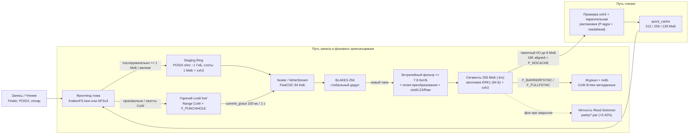

# Kraken (KrakenFS): архитектура сжатого и дедуплицированного хранилища

## Паспорт проекта и постановка задачи

| Параметр | Значение |
|---|---|
| Версия | `0.4.0` |
| Целевая платформа | macOS (Apple Silicon; стенд замеров: M4 Max 12P+4E, 48 ГБ RAM, SSD AP1024Z 1 ТБ, macOS 26.6.2 / 27.0) |
| Исходный код | `github.com/Nikita56792/kraken` |
| Ядро хранилища | `kraken-core` (Rust, edition 2024: `redb 4.2`, `blake3 1.8`, `fastcdc 5.0`, `zstd 0.14`, `lz4_flex 0.14`, `reed-solomon-simd 3.1`, `quick_cache 0.7`, `jpegxl-sys`) |
| Фронтенды виртуального тома | `nfs/kraken-nfs` (NFSv3 loopback и протокол KrakenFS), `kext/` (`com.kraken.filesystems.krakenfs`, arm64e), `fuse/kraken_fuse` (read-only резерв) |
| Интерфейс пользователя | `app/Kraken.app` (меню-бар, Statistics, Disk Map, Free Up Space) и CLI `kraken` |

Инженерная задача Kraken — радикально сократить объём, занимаемый приложениями, ассетами, датасетами и исходным кодом на внутреннем SSD Mac, не требуя обязательного отключения System Integrity Protection (SIP) и сохраняя полную прозрачность для операционной системы и программ: корректную работу Finder, отображение файлов в память (`mmap`), запуск исполняемых файлов (`exec`, `dlopen`), верификацию подписей (`codesign --verify --deep --strict`), а также семантику имён APFS (регистронезависимый поиск с сохранением написания и нормализацией Unicode через таблицу `FOLDED`).

Выбор транспортного слоя в macOS жёстко ограничен платформой, что подтверждено прямыми экспериментами:

- **FSKit (macOS 26/27):** требует платный entitlement `com.apple.developer.fskit.fsmodule`; каждое чтение и метаданные идут через XPC (~100 мкс на операцию метаданных); kernel-offloaded I/O несовместим со сжатыми данными; FSKit-бэкенд macFUSE 5.3.3/5.4.0 возвращает `EIO` на чтения крупнее 64 КиБ и зависает в ядре при падении демона.
- **macFUSE kext (5.0.5–5.4.0):** ограничен запросами по 64 КиБ (~2.5 ГБ/с на поток); включение `blocksize=1M` поднимает чтение через `read(2)` до 4.8 ГБ/с, но в самом kext macFUSE содержит дефект `pagein`: все mmap-страницы запрашиваются с `offset=0`, что портит память и приводит к немедленному снятию бинарников проверкой подписи.
- **Пользовательский кодек в APFS `decmpfs`:** функция `register_decmpfs_decompressor` экспортируется только в приватный KPI `com.apple.kpi.private`, недоступный не-Apple kext.

Отсюда вытекает трёхуровневая архитектура, где каждый класс данных и пользовательских ограничений обслуживается оптимальным механизмом.

---

## Трёхуровневая архитектура хранения (Tier 1–3)

| Параметр | Tier 1 (`apfs-optimize` / `service`) | Tier 2 / 3 совместимости (NFSv3 loopback) | Tier 3 ядра (`KrakenFS` kext) |
|---|---|---|---|
| Среда работы | Обычный том APFS (`decmpfs` + `clonefile`) | Виртуальный том `~/Kraken Disk` (`127.0.0.1` NFSv3) | Локальный том `krakenfs` (`/dev/krakenfs0…63`) |
| Требования к SIP | Полный SIP включён | Полный SIP включён | Снижен частично (`csrutil enable --without kext`) |
| Где распаковывается | В ядре macOS (LZFSE / LZBITMAP) | В демоне `kraken-nfs` поверх `kraken-core` | В демоне `kraken-nfs --frontend kfs` |
| Дедупликация | Целые файлы (`clonefile`) | Фрагменты FastCDC 64 КиБ + BLAKE3 | Фрагменты FastCDC 64 КиБ + BLAKE3 |
| Расширенные атрибуты | Нативно APFS | Файлы-спутники AppleDouble (`._*`) | Нативно (`native_xattr`, resource fork) |
| `clonefile` / `renamex_np` | Нативно APFS | Нет | Да (начиная с kext build 10) |
| Холодное чтение (большие сжимаемые) | 4.4 ГБ/с (1 поток), **14.0 ГБ/с** (4 потока) | 3.7–6.5 ГБ/с (readahead 32–128) | **6.4–6.7 ГБ/с** (1 поток), **9.7 ГБ/с** (3 потока) |
| Запись (большие сжимаемые) | При записи файл распаковывается ядром | 1.0–1.3 ГБ/с (с реальным сжатием) | До **8.9 ГБ/с** асинхронно; **2.35 ГБ/с** длительно с `fsync` |
| Мелкие файлы (запись) | Нативно APFS | В 8.5–21× медленнее APFS (20–37 RPC/файл) | В ~3× медленнее APFS (переходы ядро ↔ демон 20–30 мкс) |

### Tier 1: нативный оптимизатор APFS (`decmpfs` + `clonefile`)

Использует встроенное в ядро macOS сжатие `decmpfs` и клонирование целых файлов `clonefile`. Политика по умолчанию `--dc-codec auto` выбирает **LZBITMAP** (типы 13/14) для файлов от 1 МиБ и **LZFSE** (типы 11/12) для меньших файлов; мелкие файлы хранятся прямо внутри записи inode (0 блоков данных на диске). Поскольку распаковку выполняет ядро macOS, `exec`, `mmap` и `codesign` работают с нулевыми накладными расходами пользовательского моста.

Ограничение Tier 1 заложено в самом APFS: любая запись в сжатый `decmpfs`-файл полностью его распаковывает, а дедупликация работает только на уровне идентичных целых файлов. Поэтому Tier 1 предназначен для приложений (`/Applications`), SDK и редко модифицируемых деревьев; фоновая служба `kraken service` (LaunchAgent с QoS `background` и инкрементальным кэшем `(dev, ino, size, mtime, ctime)`) обрабатывает их в простое и только от сети.

### Tier 2: движок `kraken-core` и виртуальный том через NFSv3 loopback

Хранилище располагается в обычном каталоге на APFS (по умолчанию `~/Library/Kraken/Disk`) и не требует переразметки диска:

```text
~/Library/Kraken/Disk/
├── kraken.redb              # метаданные CoW B-tree (redb 4.2, F_FULLFSYNC)
├── segments/NNNNNNNN.krs    # append-only сегменты ~256 МиБ (записи KRK1 + payload)
├── parity/NNNNNNNN.par      # сайдкары чётности Reed-Solomon (K=256, P=1..4)
├── hot/                     # горячий слой (неупорядоченные записи и CoW-хвосты)
└── space-reserve            # зарезервированный файл 256 МиБ для гарантированного unlink/compact
```

В `kraken.redb` поддерживаются таблицы `chunks` (BLAKE3-id → смещение в сегменте и `refcount`), `inodes`, `dirents` (`(parent, name) → inode`), `FOLDED` (индекс нормализованных имён без учёта регистра — формат 4/6, обеспечивающий O(1) поиск и переименование), `extents` (`(inode, offset) → chunk_id`), `inline` (файлы до 4 КиБ и цели симлинков), `xattrs` и `super`.

При включённом SIP том «Kraken Disk» монтируется локально через встроенный NFSv3-сервер `nfs/kraken-nfs` на `127.0.0.1` командой `mount_nfs` с параметрами `vers=3,tcp,nolocks,soft,rsize=1048576,readahead=32,rdirplus,noatime`. Кэш страниц, `mmap` и `exec` обслуживает штатный NFS-клиент ядра macOS. В вендорной библиотеке `nfsserve` исправлены две критичные проблемы: сохранение бита `ACCESS3_EXECUTE` (без него ядро запрещало `exec`) и деградация O(n²) при очистке таблицы ретрансмиссий на каждом RPC. Опция `noatime` устраняет лавину `SETATTR(atime)` при запусках приложений.

### Tier 3: опциональный kext `KrakenFS`

При частично сниженном SIP (`csrutil enable --without kext`) установщик подключает собственный kext `com.kraken.filesystems.krakenfs` — порт открытого `osxfuse 3.8.3` под `arm64e`, в котором все обращения к закрытым структурам ядра заменены публичными KPI, исправлена ошибка `pagein` при блоках крупнее страницы и подняты запросы до 16 МиБ (по умолчанию 8 МиБ).

Вся логика сжатия, дедупликации и метаданных намеренно оставлена в пользовательском демоне `kraken-nfs --frontend kfs`: ядро выступает только стабильным транспортом с кэшем страниц, что позволяет обновлять логику хранилища без перезагрузок и снижает риск паники ядра. Сборка kext build 10 добавляет асинхронную запись (`kfs_async_writes`, до 8 записей в полёте, возврат ошибок отложенной записи в `fsync`/`close`), нативные xattr (при первом переключении с NFS `._*`-файлы мигрируют в атрибуты — на реальном диске перенесено 947 263 файла без ошибок), мгновенные `clonefile` и атомарные `renamex_np` (`RENAME_SWAP`/`RENAME_EXCL`). Формат хранилища полностью идентичен NFS-режиму: если kext не загрузился (например, после обновления macOS), супервизор `kraken disk` автоматически поднимает тот же том через NFS.

---

## Конвейер данных: кольцо записи, CDC, BLAKE3 и кодеки



### Сжатие до записи на SSD и горячий слой

В версии 0.4.0 (`core/src/store/ring.rs`) последовательные записи и мелкие файлы минуют запись сырых байтов на SSD: они копируются в кольцевой буфер в разделяемой памяти POSIX (`shm_open`, `/krk-<hash>`, 1 ГиБ, слоты по 1 МиБ с заголовком `{ino, off, len, seq, xxh3}` и переходами `FREE → FILLING → VALID`). Поскольку сегмент `shm` переживает аварийное завершение демона (`kill -9`), но не сбрасывается ядром на диск, физическая запись на SSD при копировании 10 × 1 ГиБ уникальных данных падает с 15.4 ГБ до 4.7 ГБ (в 3.3 раза).

Неупорядоченные записи, mmap-выгрузка и неполные хвосты (короче границы FastCDC) обрабатываются через горячий слой `hot/` с диапазонным copy-on-write (Range CoW + `F_PUNCHHOLE`): 10 случайных записей по 4 КиБ в запечатанный файл размером 2 ГиБ выполняются за 0.012 с и создают лишь 0.8 МиБ оверлея вместо копирования всего файла.

### Нарезка, дедупликация, кодеки и профили

- **FastCDC 64 КиБ** (диапазон чанков 16–256 КиБ): обеспечивает устойчивость дедупликации к сдвигам байтов (на tar-архиве со сдвигом фиксированные блоки дают 1.01×, а CDC — 2.04×; на пакете Office CDC-64K + zstd-3 даёт 4.41× против 4.21× у фиксированных блоков при вчетверо меньшем объёме метаданных, чем у CDC-16K).
- **BLAKE3-256 и `xxh3`:** криптостойкий BLAKE3 (2.3–2.5 ГБ/с на ядро, ~28 ГБ/с на CPU) выступает идентификатором чанка для дедупликации, исключая риск коллизий. Каждая запись в сегменте имеет 64-байтовый заголовок `KRK1` с полями кодека, длин, полного BLAKE3-id и двумя суммами `xxh3` (~45 ГБ/с) — на заголовок и полезную нагрузку. Сегменты полностью самоописывающие: при повреждении БД индекс восстанавливается командой `kraken rebuild-index`.
- **Энтропийный фильтр и кодеки:** блоки с энтропией от 7.8 бит/байт или выгодой ниже 3 % (для медиа — ниже 1 %) сохраняются в Raw без деградации чтения. Мелкие файлы (до 4 КиБ) хранятся inline в `redb` со словарями zstd (обучаются автоматически при накоплении от 2000 мелких файлов, до −28 % места).
- **Контентно-зависимые побитово обратимые преобразования:** ARM64 BCJ-фильтр для секции `__TEXT` Mach-O (+13–17 % на коде), разделение байтовых плоскостей FP16/BF16 для весов моделей, 2-битный нуклеотидный кодек `Codec::Nuc` для FASTA (геном T2T-CHM13 сжимается в **7.47×** при zstd-3 против 3.6× у `zip`), аудиокодек класса FLAC для WAV/AIFF (55 % экономии, распаковка ~0.5 ГБ/с на ядро) и опциональное перекодирование JPEG → JPEG XL (`libjxl --lossless_jpeg=1`, −20.4 % с побайтным восстановлением).

Профили ресурсов управляют только числом потоков, QoS и лимитом `quick_cache`, но не форматом хранения (каждый чанк самодостаточно тегирован кодеком):

| Профиль | Потоки | QoS | Кэш чанков (`quick_cache`) | Кодек записи |
|---|---|---|---|---|
| `max` | Все 16 ядер | `user-initiated` | до 512 МиБ | `zstd-3` |
| `balanced` | Половина P-ядер | `user-initiated` | до 256 МиБ | `zstd-1` |
| `eco` | 4 E-ядра | `utility` | до 128 МиБ | `zstd-1` |
| `auto` | По спросу: `max` при активности, через 30 с тишины `balanced` (сеть) или `eco` (батарея/перегрев) | Адаптивно | По активному профилю; сброс всех кэшей и слотов кольца через 90 с простоя | По активному профилю |

---

## Физика производительности: почему чтение обгоняет SSD

Эффективная скорость чтения сжатых данных описывается моделью:

```text
T = min(S × R, D × N, C)
```

где `S` — пропускная способность физического SSD (на стенде M4 Max: 5.5 ГБ/с последовательно блоками 8 МиБ, 6.3 ГБ/с параллельно, 3.5 ГБ/с случайными блоками 64 КиБ), `R` — коэффициент сжатия (2.1×–5.6×), `D × N` — суммарная скорость распаковки на `N` производительных ядрах (LZ4 / LZBITMAP: 40–84 ГБ/с на 12 P-ядрах; zstd: 11–28 ГБ/с), `C` — потолок стека ФС/VFS и `memcpy` (~74 ГБ/с).

Поскольку `D × N` на порядок превосходит `S × R`, узким местом является не процессор, а размер операций ввода-вывода и стоимость переходов через VFS. В движке это решено двумя механизмами: чанки одного файла укладываются в сегменты непрерывными группами и читаются пакетами до 8 МиБ с 16K-выравниванием и `F_NOCACHE` (исключая засорение кэша ядра сжатыми страницами), а распаковка выполняется параллельным пулом с адаптивным readahead. На файле ONI 1.78 ГБ переход от поблочного чтения к пакетному 8 МиБ + параллельный readahead поднял `read_at` с 1.18 ГБ/с до 9.94 ГБ/с.

:::info Почему GPU и Neural Engine не задействуются
В эксперименте `bench/gpu_lz4.m` был реализован Metal-декодер LZ4 с кооперативными SIMD-группами (32 lane на блок, аналогично nvCOMP) и побайтной проверкой. На 1 ГБ игровых данных (блоки 64 КиБ) GPU показал **61.3 ГБ/с** (70 ГБ/с на 16 КиБ) против **84.0 ГБ/с на 12 P-ядрах CPU**, при этом задержка отправки командного буфера на GPU составила **0.3–1.9 мс** против **~12 мкс** на CPU. Neural Engine работает только с графами CoreML без побитово точного целочисленного контракта. Полный отказ от GPU гарантирует отсутствие конкуренции за графические ресурсы с играми и ML-нагрузками.
:::

### Производительность кодеков на Apple M4 Max (`bench/codecs.c`)

Замер на независимых блоках 64 КиБ (выборка 1 ГБ реальных данных из `/Applications`; блоки с выгодой менее 3 % сохраняются Raw). Колонки `C` — сжатие на 1 ядро (МБ/с), `D1` и `D12` — распаковка в 1 и 12 потоков (МБ/с):

| Кодек | Office: сжатие | Office: `C` | Office: `D1` | Office: `D12` | ONI: сжатие | ONI: `D1` | VS Code: сжатие |
|---|---:|---:|---:|---:|---:|---:|---:|
| `lz4` | 1.63× | 796 | 5 099 | 41 001 | 2.13× | 9 474 | 1.99× |
| `zstd-1` | 1.97× | 609 | 1 467 | 15 528 | 2.35× | 2 874 | 2.49× |
| `zstd-3` | 2.05× | 410 | 1 426 | 14 589 | 2.37× | 2 763 | 2.61× |
| `zstd-19` | 2.26× | 6 | 1 104 | 10 650 | 2.48× | 2 394 | 2.97× |
| Apple `LZBITMAP` | 1.91× | 319 | 5 153 | 50 117 | 2.30× | 7 548 | 2.39× |
| Apple `LZFSE` | 2.08× | 128 | 1 568 | 14 685 | 2.37× | 3 146 | 2.66× |

Из таблицы следует практический принцип выбора кодеков в Kraken: скорость распаковки `zstd` почти не зависит от уровня сжатия (уровень 19 распаковывается лишь на ~20 % медленнее уровня 3), поэтому оперативная запись использует `zstd-1`/`zstd-3`, а фоновое пережатие холодных сегментов выгодно переводить на более высокие уровни.

### Сводка верифицированных замеров (холодные данные, M4 Max)

Все холодные замеры выполнены с вытеснением страниц (`msync(MS_INVALIDATE)` и проверкой 0.0 % через `mincore`, либо чтением свежего APFS-клона):

| Сценарий и уровень | APFS (несжатый) | Kraken | Коэффициент сжатия |
|---|---:|---:|---:|
| **Tier 1 `apfs-optimize`:** Office + VS Code (115 833 файла, 8.96 ГБ) | 8.96 ГБ | 2.29 ГБ (statfs +6.28 ГБ) | **3.92×** |
| **Tier 1 `auto` (LZBITMAP):** 4 ассета ONI параллельно (холодно) | 6.33 ГБ/с | **14.04 ГБ/с** | 5.40× |
| **Tier 1 `auto` (LZBITMAP):** `mmap` с обходом страниц 16 КиБ | 0.95 ГБ/с | **3.16 ГБ/с** | 5.40× |
| **Tier 2 движок:** Office (Word + Excel + PowerPoint, 7.09 ГБ) | 7.09 ГБ | 1.73 ГБ | **4.09×** |
| **Tier 2 движок:** ассет ONI 1.78 ГБ (`R = 5.64`), `read_at` / пакетно | 5.48 ГБ/с | **9.94 / 20.43 ГБ/с** (LZ4: 23.1) | 5.64× |
| **Tier 2 движок:** Office + ONI (114 тыс. файлов, 10.6 ГБ) | 2.08 ГБ/с | **5.6–7.4 ГБ/с** | 3.31× |
| **Tier 2 движок:** геном T2T-CHM13 (17.98 ГБ, `Codec::Nuc` + zstd-3) | 4.72 ГБ (`zip`) | 2.41 ГБ | **7.47×** |
| **Tier 3 KrakenFS kext:** уникальные 1 ГБ (`R = 2.2×`), 1 / 3 потока | 5.0–5.75 / 6.6 ГБ/с | **6.4–6.7 / 9.7 ГБ/с** | 2.20× |
| **Tier 3 KrakenFS kext:** запись 1 ГиБ асинхр. / 10 ГиБ с `fsync` | 6–8 / 1.52 ГБ/с | **8.9 / 2.35 ГБ/с** | 2.2–2.8× |
| **Tier 3 NFS loopback:** VS Code (1.54 ГБ, 2 784 файла) / чтение холодно | 1.54 ГБ / 6.3 ГБ/с | 529 МБ / 3.7–6.5 ГБ/с | **2.91×** |
| **Рабочий том пользователя (KrakenFS):** смешанные проекты и программы | 204 ГБ | 87 ГБ | **2.38×** |

Сравнение повседневной работы с приложением на примере **VS Code 1.137** (1.52 ГБ, 2 784 файла, сжатие 2.89×) в режиме совместимости NFSv3 (`noatime`, профиль `max`) против нативного APFS:

| Операция | APFS | Kraken Disk (NFSv3) | Причина разницы |
|---|---|---|---|
| `ditto` с тома на APFS (холодно / тепло) | 2.2–2.5 с / 1.1–1.2 с | 3.7–4.5 с (сеть) / 1.8–2.1 с | Метаданные NFS и `._*`-файлы |
| Появление окна VS Code (холодно / тепло) | 0.67–0.75 с / 0.37–0.44 с | 3.3–3.6 с / **0.38 с** | Первый запуск на новом монтировании: проверка Gatekeeper (+2.5–3 с) |
| `Code cli.js --version` (холодно / тепло) | 0.30 с / 0.07 с | 2.9–3.0 с / **0.06 с** | Перезапуск демона без перемонтирования даёт 0.40 с |
| `codesign --verify --deep --strict` (холодно / тепло) | 1.33 с / 1.17 с | 2.8 с / 1.4 с | Сотни тысяч проверок метаданных и подписей |

---

## Гарантии целостности, «Free Up Space» и механизм rollback

### Инварианты надёжности и самовосстановление Reed–Solomon

1. **Порядок записи (I1–I8, W1–W5):** метаданные в `redb` и записи `Op::Append` в журнале намерений никогда не ссылаются на данные, не дошедшие до сегмента; перед коммитом выполняется `F_BARRIERFSYNC` / `F_FULLFSYNC`. `F_PUNCHHOLE` горячего файла происходит строго после синхронизации контрольной точки.
2. **Контрольные суммы на каждом чтении:** каждая считанная запись проверяется по `xxh3` заголовка, `xxh3` тела и совпадению `BLAKE3-id`. Повреждённый блок не может быть выдан приложению.
3. **Чётность Reed–Solomon (`parity/*.par`):** библиотека `reed-solomon-simd 3.1.0` (поле GF(2¹⁶), ARM64 NEON, кодирование **23.2 ГБ/с**). По умолчанию добавляется `P = 1` полоса чётности на группу из `K = 256` полос по 64 КиБ (+0.42 % объёма), позволяющая восстановить любую повреждённую полосу 64 КиБ в группе 16 МиБ. При чтении битого блока данные чинятся в памяти на лету; `kraken scrub --repair` проверяет восстановленную полосу по `xxh3` и каждую затронутую запись по `BLAKE3` перед записью на диск.
4. **Защита от исчерпания SSD и `kill -9`:** при остатке менее ~1.75 ГБ запись на том получает `ENOSPC`; в хранилище удерживается файл `space-reserve` (256 МиБ), освобождаемый, если SSD заполнил сторонний процесс, чтобы удаление файлов и уплотнение сегментов (`kraken compact`) работали всегда. При `kill -9` демона супервизор перезапускает сервер (~0.28 с для NFS без перемонтирования, ~0.5–1 с для KrakenFS) и воспроизводит журнал без потери подтверждённых через `fsync` данных (проверено тестами `bench/kfs_kill9.sh`, `bench/kfs_async.sh`, `bench/kfs_full.sh`, 191 тестом `core` и 27 тестами `nfs`).

### «Free Up Space» и безопасный перенос со ссылками

Инструмент `Free Up Space` (`kraken scan` и `kraken move`, тесты `core/tests/relocate.rs`) сканирует локальные и внешние каталоги (объекты от 300 МБ по реально выделенным блокам, корректно учитывая разреженные файлы вроде `Docker.raw`), оценивает сжимаемость по выборке 96–320 МиБ тем же конвейером FastCDC + `compress_smart` (калибровка на VS Code: прогноз 2.66× при факте 2.89×) и классифицирует объекты на безопасные, требующие осторожности (App Store, VM, активные данные приложений) и запрещённые к переносу (кэши, медиатеки Фото/Музыки, уже сжатые архивы).

Алгоритм переноса спроектирован для безопасного прерывания в любой точке:

1. Проверка свободного места: на SSD всегда остаётся не менее 5 ГБ; крупная папка дробится на подкаталоги. Занятые открытыми дескрипторами объекты отклоняются с выводом имени процесса.
2. Копирование части через `ditto` (сохранение прав, ACL, xattr и симлинков) → побайтная верификация каждого файла → удаление оригинала → создание абсолютной символической ссылки на исходном месте.
3. Прерывание (`Stop` / `SIGINT`) удаляет незавершённую копию, не затрагивая оригинал; повторный запуск продолжает с оставшихся подкаталогов.

### Механизмы безопасного rollback

- **Tier 1 (`apfs-optimize`):** каждый файл собирается во временном файле, читается обратно через ядро с проверкой BLAKE3 и только затем подменяет оригинал атомарным `rename(2)` после перепроверки `(ino, size, mtime, ctime)`. По умолчанию работает режим `--dry-run`. Полный откат выполняется командой `kraken apfs-decompress DIR --apply`.
- **Kraken Disk и ссылки Free Up Space:** для возврата объекта достаточно удалить символическую ссылку (в Finder или `rm ИМЯ` без завершающего `/`) и перенести каталог обратно на APFS. Скрипт `/Applications/Kraken.app/Contents/Resources/uninstall.sh` снимает приложение и LaunchAgent, сохраняя каталог хранилища (`--delete-data` требуется явно).
- **Возврат с Tier 3 к полному SIP:** удаление `/Library/Extensions/Kraken.kext`, `kmutil rebuild` и `csrutil enable` в Recovery возвращают полную защиту SIP; том Kraken Disk при этом автоматически продолжает открываться в режиме NFSv3 поверх того же хранилища.

Основные команды CLI для диагностики, обслуживания и ручного отката:

```bash
# Tier 1: оценка (по умолчанию dry-run), применение и полный откат
kraken apfs-optimize ~/Games/SomeGame.app
kraken apfs-optimize ~/Games/SomeGame.app --apply
kraken apfs-decompress ~/Games/SomeGame.app --apply

# Tier 2: инициализация, импорт, побайтовая проверка, ремонт по чётности и уплотнение
kraken init ~/KrakenStore
kraken --profile max import ~/KrakenStore ~/Datasets/sample --name sample
kraken check ~/KrakenStore ~/Datasets/sample --name sample
kraken fsck ~/KrakenStore && kraken scrub --repair ~/KrakenStore
kraken compact ~/KrakenStore && kraken rebuild-index ~/KrakenStore
```

---

## Известные ограничения и риски

:::warning Цена режима ядра (Tier 3) на Apple Silicon
Частичное снижение SIP (`csrutil enable --without kext`) переводит Mac в политику **Permissive Security**, что отключает Apple Pay и запуск iOS/iPadOS-приложений из App Store. Каждое обновление kext или крупное обновление macOS требует повторного одобрения в настройках безопасности и перезагрузки; кроме того, Apple официально объявила сторонние kext устаревшими. Для пользователей, которым важен полный SIP, штатным остаётся режим NFSv3 loopback.
:::

- **Несжимаемые форматы:** видео H.264/HEVC/AV1, аудио AAC/Opus, фото HEIC и игровые архивы с энтропийным сжатием (например, архивы Oodle в Cyberpunk 2077: 1.00–1.08×) не уменьшаются никаким lossless-методом. Их хранение на виртуальном томе не даёт экономии (кроме дедупликации дубликатов) и снижает чтение до потолка моста (3–4.7 ГБ/с против 6.3 ГБ/с на APFS).
- **Накладные расходы на мелкие файлы и метаданные:** в режиме NFSv3 macOS отправляет 20–37 RPC на каждый записываемый файл и создаёт `._*`-спутники для расширенных атрибутов, из-за чего копирование деревьев вроде `VS Code` или `Excel.app` в 8.5–21 раз медленнее APFS (для массового наполнения предпочтительны `tar xf` или прямой `kraken import`). Кроме того, после каждого нового NFS-монтирования Gatekeeper заново проверяет подпись исполняемых файлов (+2.5–3 с на первый запуск), а новые приложения запрашивают разрешение TCC «Сетевые тома». В режиме KrakenFS эти эффекты устранены, но переходы ядро ↔ демон всё равно оставляют мелкие файлы примерно в 3 раза медленнее нативного APFS.
- **Системные интеграции и семантика ссылок:** том монтируется с `nosuid` и не индексируется Spotlight; Time Machine не копирует смонтированный том, однако резервирует сам каталог хранилища `~/Library/Kraken/Disk`. При работе с символическими ссылками Free Up Space команда `rm -rf ИМЯ/` с завершающим слешем удалит содержимое оригинала на томе, а атомарная перезапись файла через `rename` поверх ссылки на отдельный файл создаст локальную копию вместо обновления файла на диске.
