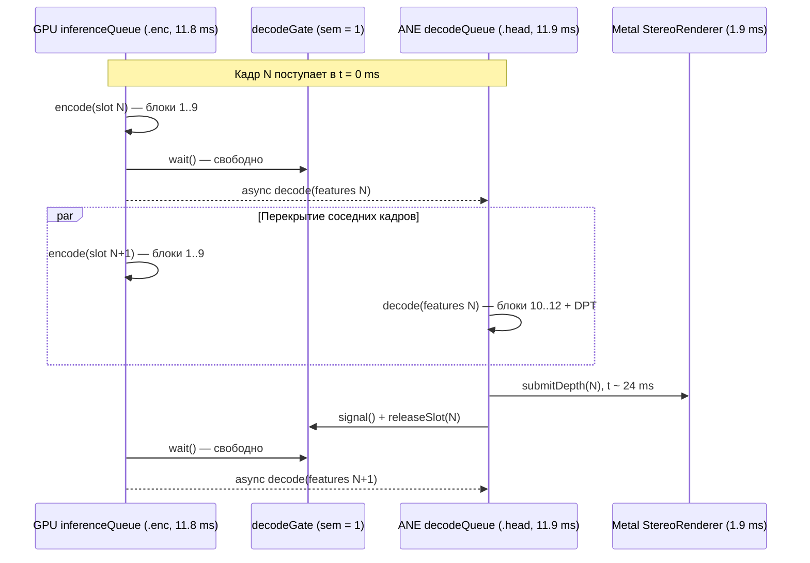

# Real3D: архитектура реалтайм-синтеза стерео 3D

**Real3D** (исходный код: `github.com/Nikita56792/real3d`, актуальная ветка **v1.2.0**) — нативное приложение для macOS 14+ (Apple Silicon), преобразующее произвольный дисплей или окно в стереопару в реальном времени без Python в рантайме. Стек состоит исключительно из Swift 5.9 (`Real3DCore` собран с `-Ounchecked` в release), `ScreenCaptureKit`, `Core ML` и вычислительных шейдеров `Metal` (сборка выполняется через Command Line Tools без Xcode; шейдеры компилируются в рантайме из встроенного `ShaderSource.metal`).

## 1. Паспорт системы и постановка задачи

Целевой сценарий — вывод стереоскопического сигнала на AR-очки **XREAL One / One Pro / Air 2**, подключаемые к Mac по USB-C как внешний дисплей в 3D-режиме (`3840×1080` для **Full SBS** или `1920×1080` для **Half SBS**). При частоте обновления `60 Гц` жёсткий бюджет одного кадра составляет `16.67 мс`.

| Параметр | Значение / конфигурация |
|---|---|
| Минимальная ОС и архитектура | macOS 14.0+, Apple Silicon (`LSRequiresNativeExecution = true`) |
| Референс-платформа профилирования | MacBook Pro M4 Max (40 GPU-ядер), 48 ГБ unified memory |
| Целевые форматы вывода | Full SBS `3840×1080` (`2×1920×1080`), Half SBS `1920×1080`, также `720p` / `1440p` на глаз |
| Частота и синхронизация | `60.0 FPS`, `CVDisplayLink` привязан к `CGDirectDisplayID` дисплея очков |
| Полный Metal-пайплайн (DIBR) | **~1.9 мс GPU/кадр** при источнике `3456×2234` (Retina) |
| Инференс глубины (дефолт / максимум) | `DAv2-Small-Balanced-644x364`: `14.7 мс` GPU; `DAv2-Small-Quality-812x462` (split): `60.0 FPS` (`11.8 мс` GPU ∥ `11.9 мс` ANE) |

Окно вывода (`OutputWindowController` + `MetalLayerView`) разворачивается безрамочно поверх меню-бара (`CGWindowLevelForKey(.mainMenuWindow) + 1`, `.canJoinAllSpaces`, `.fullScreenAuxiliary`) и рендерится напрямую в `CAMetalLayer` (`.bgra8Unorm`, `framebufferOnly = true`, `maximumDrawableCount = 3`). Одновременно в том же проходе `StereoRenderer.renderFrame(layers:)` обслуживает превью-слои главного окна (анаглиф, карта диспаратности, отдельный левый/правый ракурс).

```mermaid
flowchart LR
    SCK["ScreenCaptureKit (SCStream BGRA IOSurface)"] -->|"CVMetalTextureCache (zero-copy)"| Crop["cropResample / MetalFX Spatial"]
    Crop -->|"monoTex (1920x1080 BGRA)"| Slot["ModelInputSlot[0..4] (IOSurface)"]
    Slot -->|"Stage A: GPU (11.8 ms)"| Enc["DAv2-Quality .enc (DINOv2 blocks 1..9)"]
    Enc -->|"feat1..3 + tokens (fp16)"| Head["DAv2-Quality .head (blocks 10..12 + DPT, ANE 11.9 ms)"]
    Head -->|"L00h IOSurface (zero-copy)"| DProc["depthProcess (normalize / metric + EMA)"]
    Slot -.->|"2..4 Hz (vImage)"| Calib["DA3-Metric-Large (ANE 134 ms) -> MAD OLS"]
    Calib -.->|"1/Z = a*r + b"| DProc
    DProc -->|"depthNormA/B (r16Float)"| JBU["depthUpsample (Joint Bilateral -> dispTex)"]
    Crop --> JBU
    JBU -->|"dispTex (r16Float)"| DIBR["stereoSynth (Scanline DIBR -> sbsTex 3840x1080)"]
    Crop --> DIBR
    DIBR --> Present["presentVertex / presentFragment -> CAMetalLayer"]
```



---

## 2. Zero-copy конвейер захвата и препроцессинга

### Захват через ScreenCaptureKit

Класс `ScreenCapture` (`Sources/Real3DCore/ScreenCapture.swift`) перечисляет дисплеи и окна через `SCShareableContent.excludingDesktopWindows(true, onScreenWindowsOnly: false)` — флаг `onScreenWindowsOnly: false` позволяет обнаруживать полноэкранные приложения в других Spaces. При захвате дисплея собственный процесс исключается через `SCContentFilter(display:excludingApplications:exceptingWindows:)`, для одиночного окна используется `SCContentFilter(desktopIndependentWindow:)`.

Параметры `SCStreamConfiguration` минимизируют работу композитора и исключают лишние преобразования формата:
- `pixelFormat = kCVPixelFormatType_32BGRA`, `colorSpaceName = CGColorSpace.sRGB`;
- `queueDepth = 5`, `minimumFrameInterval = CMTime(value: 1, timescale: 60)`, `scalesToFit = false`, `capturesAudio = false`;
- `shouldBeOpaque = true`, `ignoreShadowsSingleWindow = true`, `ignoreGlobalClipSingleWindow = true`, `includeChildWindows = true` (macOS 14.2+);
- ширина и высота принудительно выравниваются до чётных (`w &= ~1; h &= ~1`), так как отдельные пути BGRA `IOSurface` в `ScreenCaptureKit` требуют чётных размеров.

В коллбэке `stream(_:didOutputSampleBuffer:of:)` (очередь `real3d.capture`, `.userInteractive`) отбрасываются неполные кадры (`SCFrameStatus` отличный от `.complete` и `.idle`), а реальная область контента внутри буфера вычисляется из `SCStreamFrameInfo.contentRect` с учётом `scaleFactor` — это критично для окон с letterbox-полями.

### Zero-copy передача и кольцевой буфер слотов

На всём пути основного рендер-конвейера пиксели изображения не копируются через CPU:

1. Входящий `CVPixelBuffer` из `CMSampleBufferGetImageBuffer` является `IOSurface`-буфером в unified memory. `StereoRenderer.metalTexture(for:format:)` оборачивает его в `MTLTexture` (`.bgra8Unorm`) через `CVMetalTextureCacheCreateTextureFromImage` с нулевым копированием.
2. Подготовленный кадр для нейросети записывается GPU-ядром `cropResample` в один из **5 слотов** `ModelInputSlot` (каждый слот — `IOSurface`-backed `CVPixelBuffer` с `kCVPixelBufferMetalCompatibilityKey: true` и привязанной `MTLTexture`). Пять слотов покрывают одновременное нахождение в работе: Stage A (GPU), Stage B (ANE), `pendingSlot` (буфер последнего кадра политики latest-wins), слот под текущую запись GPU и резерв.
3. По завершении command buffer (`cb.addCompletedHandler`) слот передаётся в `Pipeline.enqueue(_:)`. Если инференс занят, новый слот заменяет `pendingSlot`, а устаревший немедленно освобождается (`releaseSlot`), исключая накопление латентности.
4. Когда готова карта глубины (`DepthResult`), её поле `tag` указывает индекс исходного `ModelInputSlot`. `StereoRenderer` копирует текстуру этого слота через `MTLBlitCommandEncoder` в `guideTex`, гарантируя, что цветовое руководство для Joint Bilateral Upsampling соответствует именно тому кадру, по которому вычислена глубина.

### Кроп, MetalFX Spatial и обработка не-16:9 (letterbox / pillarbox)

`StereoRenderer.renderFrame` поддерживает два режима кадрирования: фиксированный `16:9` (пресеты ширины `1920 / 2560 / 3840` px) и свободный (`cropFree`).

- **Даунскейл** (например, с Retina `3456×2234` до `1920×1080`): ядро `cropResample` выполняет box-filtered bilinear supersampling с сеткой `n × n`, где `n = clamp(ceil(effPxW / outputWidth), 1, 4)`.
- **Апскейл** (если выделенное окно или кроп меньше `outputWidth × outputHeight`, но не меньше `64×36` px): `cropResample` вырезает нативный кроп в `cropNativeTex` (`supersample = 1`), после чего вызывается аппаратный `MTLFXSpatialScaler` (`colorProcessingMode = .perceptual`) напрямую в `monoTex`.
- **Вписывание не-16:9**: если отклонение соотношения сторон превышает `0.5%`, кроп центрируется в кадре `16:9` с чёрными полями. В шейдеры передаются границы `validMin/validMax` (для `cropResample`) и `contentMin/contentMax` (для `depthUpsample`), а в `DepthEngine.robustRange` и `Pipeline.fitAffine` — нормализованный `contentRect`. В результате чёрные поля полностью исключаются из расчёта перцентилей глубины, МНК-калибровки и JBU-окна (не «протекают» на края картинки), а на выходе `depthUpsample` им присваивается `disp = 0.0f` — поля неподвижно лежат на плоскости экрана («окно»).

---

## 3. Split-инференс глубины на Apple Silicon (GPU ∥ ANE)

### Контракт Core ML и выбор вычислительного блока

`DepthEngine` (`Sources/Real3DCore/DepthEngine.swift`) запускает любую Core ML модель с image-входом и 2D-выходом. Для всех встроенных 16:9-моделей (`models/bundled/`) используется единый zero-copy контракт:
- **Вход `image`**: `32BGRA` (`W×H`, значения `0..255`). Нормализация ImageNet `(x - 255·mean) · (1 / (255·std))` и перестановка каналов BGR→RGB вшиты в веса первого свёрточного слоя `patch_embed` (`nn.Conv2d(..., kernel_size=14, stride=14)` с перестановкой входных каналов `[2, 1, 0]`) на этапе конвертации (`convert/ane_dav2.py`, `convert/dav2_split.py`, `convert/convert_da3.py`).
- **Выход `depth`**: `GRAYSCALE_FLOAT16` (`kCVPixelFormatType_OneComponent16Half`, FourCC `L00h`). В `MLPredictionOptions.outputBackings` передаётся буфер из кольцевого пула `outputPool` (4 `IOSurface`-буфера), который затем напрямую читается Metal как `.r16Float`.

:::warning Поведение MLComputeUnits.all на длинных ViT-последовательностях
В Core ML режим `.all` систематически маршрутизирует ViT-модели с большим числом токенов на Apple Neural Engine, даже когда Metal GPU вдвое быстрее. На M4 Max для монолитной `DAv2Small_644x364` ANE тратит `29.42 мс` против `15.08 мс` на GPU; для `DAv2Small_812x462` — `62.10 мс` против `26.66 мс`; для `DA3Small_644x364` — `38.89 мс` против `11.57 мс`. Поэтому опция **Auto (fastest)** в `AppModel.fastestUnits(for:)` приостанавливает пайплайн, один раз измеряет медиану 7 прогонов (`DepthEngine.measureLatency`) отдельно на `.cpuAndGPU` и `.cpuAndNeuralEngine` и кэширует результат в `UserDefaults` (`real3d.fastestUnits.v1`) по ключу имени и `mtime` файла модели.
:::

### Разделение DAv2-Small-Quality-812x462 между GPU и ANE

Монолитная модель `DAv2-Small-Quality-812x462` (сетка патчей `58×33`, длина последовательности `S = 1 + 58·33 = 1915` токенов, скрытая размерность `C = 384`) на GPU работает за `26.66 мс` (`37.5 FPS`), что недостаточно для `60 Гц`. В версии v1.2.0 граф модели разрезан скриптом `convert/dav2_split.py` по точке `cut = 9` (из 12 трансформерных блоков DINOv2-S) на два пакета, оптимизированных под разные ускорители:

1. **Stage A — `DAv2-Small-Quality-812x462.enc.mlpackage` (34.0 МБ, `.cpuAndGPU`)**:
   - Выполняет `Embed` и блоки DINOv2 `1..9` в GPU-раскладке `LayerSDPA`: тензор `[1, S, C]`, стандартные `nn.Linear`, внимание через `F.scaled_dot_product_attention` (без явного `scale=`, чтобы `coremltools` понизил его в свёрнутую MIL-операцию), а коэффициенты `layer_scale` (`lambda1`, `lambda2`) свёрнуты в веса выходных проекций `o` и `fc2`.
   - Выходы (все `float16`): `feat1`, `feat2`, `feat3` формы `[1, 384, 33, 58]` (выходы блоков 3, 6, 9 после `final_norm`, без CLS-токена, в NCHW для DPT neck) и `tokens` формы `[1, 384, 1, 1915]` (residual stream после блока 9 без нормализации, CLS в индексе 0).
   - Медиана исполнения на M4 Max: **`11.8 мс`**.
2. **Stage B — `DAv2-Small-Quality-812x462.head.mlpackage` (16.1 МБ, `.cpuAndNeuralEngine`)**:
   - Выполняет оставшиеся блоки `10..12` в ANE-раскладке `LayerANE` (паттерн `ml-ane-transformers`): тензоры `[1, 384, 1, 1915]`, все линейные слои заменены на `1×1 Conv2d`, `LayerNormANE` сформулирован для слияния в единую MIL-операцию `layer_norm(axes=[1])`, масштаб внимания `1 / sqrt(64) = 0.125` (точный в `fp16`) вшит в Q-проекцию.
   - Внимание реализовано через `AttentionANEChunked` с разбиением оси запросов на **4 части** (`--ane-qchunks 4`): так как `softmax` берётся по оси ключей, разбиение математически тождественно, но сокращает пиковый размер промежуточных тензоров `[B, S, 1, S/4]` в локальной памяти ANE.
   - Далее отрабатывает DPT neck/head (`reassemble_stage` → `fusion_stage` → `head`) с выходом `depth` (`GRAYSCALE_FLOAT16`, `812×462`).
   - Медиана исполнения на M4 Max: **`11.9 мс`**.

Выход цепочки `enc (GPU) → head (ANE)` численно совпадает с эталонным PyTorch-графом Hugging Face (`corr = 1.00000`).

### Перекрытие стадий в рантайме

В `Pipeline.runInference(_:)` стадия A выполняется на `inferenceQueue`, а стадия B — на отдельной `decodeQueue` (обе `.userInteractive`), синхронизируясь бинарным семафором `decodeGate = DispatchSemaphore(value: 1)`:



Семафор допускает ровно один `decode` в полёте: порядок кадров строго сохраняется, при этом обе стадии полностью перекрываются по времени. Темп выдачи карт глубины определяется максимумом стадий `max(11.8, 11.9) ≈ 11.9 мс` (запас ~`4.7 мс` до бюджета `16.67 мс`), что обеспечивает стабильные **`60.0 FPS`** при сквозной задержке от входа кадра до карты глубины **`~24 мс`**.

---

## 4. Синтез стереопары на Metal (DIBR)

Все вычислительные и графические ядра сосредоточены в `Sources/Real3DCore/Shaders.metal` (277 строк) и компилируются с `MTLCompileOptions.mathMode = .fast`. За один тик `CVDisplayLink` `StereoRenderer.renderFrame` кодирует все активные проходы в единый `MTLCommandBuffer`.

| Проход (`Shaders.metal`) | Вход → Выход | Стоимость (M4 Max) | Назначение |
|---|---|---|---|
| `cropResample` (+ `MTLFXSpatialScaler`) | `srcTex` → `monoTex`, `slot.texture` | `~0.3 мс` | Кроп 16:9 / Free, суперсэмплинг `1..4` или MetalFX апскейл |
| `depthProcess` | `rawTex`, `prev` → `depthNormA/B` | `~0.05 мс` | Инверсия (`1/v`), нормализация или `1/Z = a·v + b`, EMA |
| `depthUpsample` | `depthNorm`, `guideTex`, `monoTex` → `dispTex` | `~0.5 мс` | Joint Bilateral Upsampling (`6×6` при `radius=2`) → диспаратность в px |
| `stereoSynth` | `monoTex`, `dispTex` → `sbsTex` (`3840×1080`) | `~1.0 мс` | Scanline DIBR, z-тест «ближний побеждает», заполнение дырок |
| `presentVertex` / `presentFragment` | `sbsTex` / `dispTex` → `CAMetalLayer` | `~0.1 мс` | Вывод Full/Half SBS, анаглиф, тепловая карта, aspect-fit |

### Нормализация и временное сглаживание (`depthProcess`)

Перед запуском `depthProcess` на CPU-стороне в `DepthEngine.robustRange(of:loPct:hiPct:invert:rect:)` по равномерной подвыборке (~`16 000` пикселей внутри `contentRect`) строится 512-корзинная гистограмма для вычисления устойчивых **2% / 98% перцентилей** (`lo`, `hi`). В `StereoRenderer` сами границы `depthLo`/`depthHi` сглаживаются по времени (`temporalAlpha`, по умолчанию `0.5`), предотвращая «дыхание» глубины при резких выбросах.

В ядре `depthProcess`:
- при `P.invert != 0` (DA3 и метрические модели, где большее значение соответствует большей дальности) выполняется переход к обратной глубине `v = 1.0f / max(v, 1e-4f)`;
- в режиме **Artistic** значение нормируется в `[0, 1]`: `n = saturate((v - P.lo) / max(P.hi - P.lo, 1e-6f))`; в режиме **Real scale** вычисляется физическая обратная глубина `n = max(P.calibA * v + P.calibB, 0.0f)` в `1/м`;
- далее применяется пиксельное EMA-сглаживание `mix(prev.read(gid).r, n, P.alpha)` по ping-pong текстурам `depthNormA`/`depthNormB` (`.r16Float`).

### Joint Bilateral Upsampling (`depthUpsample`)

Карта глубины имеет разрешение модели (`644×364` или `812×462`), а стереосинтез идёт в `1920×1080` на глаз. Обычная билинейная интерполяция размывает скачки глубины на контурах объектов, порождая «ореолы». Ядро `depthUpsample` (`mode == 1`, по умолчанию `radius = 2`, т.е. окно `6×6` опорных узлов `[-radius .. radius+1]`) взвешивает каждый узел `q` низкой карты по пространственной близости и разнице яркостей (`luma` в BT.601):

```metal
float2 dq = float2(q) - c;
float iq = luma(guideLow.sample(nearestClamp, quv));
float di = ip - iq;
float w = exp(-dot(dq, dq) * invS - di * di * invR);
```

Здесь `ip` — яркость пикселя полноразмерного `colorHi` (`monoTex`), `iq` — яркость соответствующего узла из `guideLow` (`guideTex`, копия входного слота модели), `sigmaSpatial = 1.0`, `sigmaRange = 0.08`. Если суммарный вес `wsum` мал (тёмные или шумные однородные области), результат плавно смешивается с билинейной выборкой: `d = mix(bil, d, saturate(wsum * 4.0f))`. Затем значение переводится в знаковую горизонтальную диспаратность в пикселях и записывается в `dispTex` (`.r16Float`).

### Scanline DIBR и разрешение дизокклюзий (`stereoSynth`)

Ядро `stereoSynth` запускается с размером threadgroup `64×4` (оптимально для линейного сканирования по строкам `disp` в L1-кэше) на сетке `2W × H` (`3840×1080`): левая половина формирует левый глаз (`s = +0.5`), правая — правый (`s = -0.5`). Положительная диспаратность (объект перед экраном) сдвигает пиксель вправо в левом глазу и влево в правом.

Вместо прямого splatting (требующего атомарного Z-буфера и страдающего от трещин) используется **обратный scanline-поиск по отрезкам**: для выходного пикселя `xo` перебираются исходные сегменты `[xs, xs + 1]` в окне `xo ± R`, где `R = ceil(maxDisp * 0.5) + 1`. Концы сегмента проецируются в `pPrev = xs + s · dPrev` и `pNext = (xs + 1) + s · dNext`. Если `xo` попадает внутрь интервала `[lo, hi]`:
- вычисляется длина растянутого сегмента `len = hi - lo` и параметр интерполяции `t = saturate((xo - pPrev) / (pNext - pPrev))`;
- при `len <= P.stretchThresh` (по умолчанию `2.5 px`) сегмент считается непрерывной поверхностью; среди всех покрывающих `xo` поверхностей побеждает **ближайшая** (`dHere > bestD`), что точно разрешает окклюзии переднего плана над фоном;
- при `len > P.stretchThresh` сегмент трактуется как скачок глубины (зона дизокклюзии, открывшаяся за краем переднего объекта); вместо интерполяции через разрыв запоминается **фоновый конец** отрезка (`dBg = min(dPrev, dNext)`, `holeSrc = (dPrev < dNext) ? xs : xs + 1`).

Итоговая координата выборки из `monoTex`: `src = found ? bestSrc : (holeFound ? holeSrc : xof)`. Выборка выполняется аппаратным билинейным сэмплером `linearClamp`.

---

## 5. Математика ортостерео и режим «Real Scale (metric)»

### Почему относительная глубина даёт эффект «кукольного макета»

В режиме **Artistic** диспаратность вычисляется из нормированной относительной глубины `d_norm ∈ [0, 1]`:

```text
disp = strength · (pow(d_norm, gamma) − convergence)
```

По умолчанию `strength = 40 px`, `convergence = 0.55`. Поскольку перцентили `2%..98%` растягивают *любую* сцену на полный диапазон `strength`, уличный кадр с глубиной 10–80 м получает такой же суммарный параллакс, как предмет в 1–2 м от камеры. Угловая конвергенция глаз интерпретирует это как уменьшенную миниатюру сцены (эффект лилипутизма / кукольного макета).

### Вывод формулы физического ортостерео

Пусть `IPD` — межзрачковое расстояние зрителя (по умолчанию `63 мм`), `D` — дистанция виртуального экрана очков, `W_m` — его физическая ширина на дистанции `D`, `W_px` — горизонтальное разрешение одного глаза (`1920 px`), тогда физический размер одного пикселя на виртуальном экране `p = W_m / W_px`.

Из подобия треугольников для точки сцены на истинной глубине `Z` горизонтальное смещение её проекций на плоскости виртуального экрана в метрах равно `Δx = IPD · (D / Z − 1)` (знак положительный при `Z < D`, то есть вынос *перед* экраном, crossed disparity; отрицательный при `Z > D`, то есть за экраном, uncrossed disparity). Деление на шаг пикселя `p` даёт точную диспаратность в пикселях:

```text
d = (IPD / p) · (D / Z − 1) = metricB · (1 / Z) − metricA
```

где:
- `metricA = IPD / p` — предельная диспаратность точки на бесконечности (`Z → ∞`, лучи глаз параллельны, `d = −metricA`);
- `metricB = IPD · D / p`.

| Пресет (`ViewerPreset`) | Виртуальный экран | `D` (м) | `W_m` (м) | `p` @ 1080p (мм) | Бесконечность `metricA` (px) |
|---|---|---:|---:|---:|---:|
| **XREAL One** (по умолчанию) | 147" 16:9 | 4.00 | 3.25 | 1.693 | **37.2 px** |
| **XREAL One Pro** | 171" 16:9 | 4.00 | 3.79 | 1.974 | **31.9 px** |
| **XREAL Air 2** | 130" 16:9 | 4.00 | 2.88 | 1.500 | **42.0 px** |
| **27" monitor** | 27" 16:9 | 0.70 | 0.60 | 0.313 | **201.6 px** |

В `depthUpsample` диспаратность ограничивается сверху параметром `maxCrossed` (`60 px` по умолчанию) для комфорта аккомодации: `disp = clamp(metricB * invZ - metricA, -metricA, maxCrossed)`, где `invZ = d / worldScale`.

### Метрический калибратор DA3-Metric-Large и Auto World Scale

Получить метры `Z` в реальном времени можно двумя способами:
1. **Прямая метрическая модель** (`DAv2-Metric-Indoor-644x364` — fine-tune на Hypersim, `sigmoid · 20 м`; `DAv2-Metric-Outdoor-644x364` — VKITTI, `sigmoid · 80 м`). Работает за `~16 мс` на GPU, но требует ручного выбора домена (Outdoor на не-дорожных сценах завышает глубину примерно в 3 раза).
2. **Быстрая относительная модель + фоновый калибратор** (схема по умолчанию в Real Scale): основная модель (`Balanced` или `Quality` split) даёт детализацию и `60 FPS`, а универсальная метрическая модель **`DA3-Metric-Large-518x294`** (ViT-L, `667 МБ` пакет, DPT exp head, без ручного переключателя indoor/outdoor) запускается в фоне на очереди `calibQueue` (`.utility`, ANE, `~134 мс` на вызов, `2–4 Гц`).

Синхронизация масштаба выполняется в `Pipeline.maybeCalibrate` и `Pipeline.fitAffine`:
- Текущий входной кадр масштабируется на CPU в `518×294` функцией `vImageScale_ARGB8888` (`kvImageHighQualityResampling`), параллельно снимается копия сырой карты быстрой модели `r`.
- После прогона калибратора на грубой сетке `128×72` внутри `contentRect` (фильтр `0.05 м < Z < 2000 м`, не менее 200 валидных точек) решается линейная регрессия в пространстве обратной глубины `1/Z = a · r + b`.
- Выполняется **3 прохода МНК** с двумя раундами робастной отбраковки выбросов по медиане абсолютных отклонений (MAD): точки с ошибкой больше `3.0 · 1.4826 · MAD` исключаются из следующей итерации. Результат принимается при `a > 0` и `n >= 50`.
- Между калибровками коэффициенты `(a, b)` сглаживаются EMA с `alpha = 0.35`, однако при относительном скачке `|fit.a - a| / |a| > 0.5` (склейка кадра / смена сцены) включается мгновенный «снап» (`alpha = 1.0`).

Дополнительно включён **Auto world scale** (`StereoRenderer.renderFrame`): по 98-му перцентилю обратной глубины ближайшего объекта `invZnear` рассчитывается множитель:

```text
targetScale = max(1.0, (metricB · invZnear) / max(metricA + popBudgetPx, 1.0))
```

Множитель сглаживается с коэффициентом `0.15` за кадр и **никогда не опускается ниже `1.0`** (что исключает «кукольный эффект» на больших сценах), но плавно увеличивает тесные интерьеры (объекты в `1–2 м` при экране на `4 м`), удерживая ближайший край сцены в пределах `popBudgetPx` (`12 px`) перед плоскостью экрана.

---

## 6. Профилирование задержек и известные ограничения

### Бенчмарки встроенных моделей (M4 Max, 40 GPU)

Данные замеров из `convert/benchmark_results.txt` (утилита `real3d-bench`, 60 итераций после прогрева) и `README.md`:

| Модель (`models/bundled/`) | Вход | Размер | GPU (med / p90) | ANE (med / p90) | Итоговый темп / примечание |
|---|---|---:|---|---|---|
| `DAv2-Small-Fast-518x294` | `518×294` | 49.2 МБ | `9.86 / 10.12 мс` | `10.76 / 10.84 мс` | `101.5 FPS` (GPU) |
| `DAv2-Small-Balanced-644x364` | `644×364` | 49.6 МБ | `15.08 / 15.38 мс` (`14.7 мс` в пайплайне) | `29.42 / 29.52 мс` | `66–68 FPS` (GPU, по умолчанию) |
| `DAv2-Small-Quality-812x462` (монолит) | `812×462` | ~50 МБ | `26.66 / 26.97 мс` | `62.10 / 62.21 мс` | `37.5 FPS` (GPU), не укладывается в 60 Гц |
| `DAv2-Small-Quality-812x462` (**split**) | `812×462` | 34.0 + 16.1 МБ | `11.8 мс` (`.enc`, блоки 1–9) | `11.9 мс` (`.head`, блоки 10–12 + DPT) | **`60.0 FPS`** глубины, `~24 мс` от кадра до глубины |
| `DA3-Small-644x364` | `644×364` | 67.4 МБ | `11.57 / 11.70 мс` | `38.89 / 39.06 мс` | `86.4 FPS` (GPU), авто-инверсия (`outputIsDepth = true`) |
| `DAv2-Metric-Indoor-644x364` | `644×364` | 49.6 МБ | `16.12 / 16.24 мс` | `29.30 / 29.44 мс` | `62.2 FPS` (GPU), Hypersim `0..20 м` |
| `DAv2-Metric-Outdoor-644x364` | `644×364` | 49.6 МБ | `16.16 / 16.51 мс` | `29.27 / 29.38 мс` | `61.9 FPS` (GPU), VKITTI `0..80 м` |
| `DA3-Metric-Large-518x294` | `518×294` | 667.4 МБ | `61.87 / 62.04 мс` | `134.43 / 134.58 мс` | `7.4 FPS` (ANE), калибратор `2–4 Гц` |

При одновременной работе split-модели `Quality` (`GPU ∥ ANE`) и калибратора `DA3-Metric-Large` на ANE основной поток глубины сохраняет **`60.0 FPS`**: очередь калибратора (`.utility`) автоматически уступает ресурсы ANE и снижает частоту обновлений до `~2 Гц`.

### Оценка сквозной задержки

Сквозная задержка (motion-to-photon для стерео-глубины) складывается из:
- доставки `IOSurface` из `ScreenCaptureKit` + `cropResample` (`~0.3 мс`);
- инференса глубины: `~15 мс` для `Balanced` (GPU) либо `~24 мс` (1.5 кадра) для `Quality` split из-за двухступенчатого конвейера GPU → ANE;
- `depthProcess` + `depthUpsample` + `stereoSynth` + `present` (`~1.65 мс`, суммарно с кропом `~1.9 мс` GPU);
- ожидания ближайшего VSync на `CAMetalLayer` (до `16.67 мс` при `60 Гц`, в среднем `~8.3 мс`).

При этом цветовой поток `monoTex` обновляется на каждом тике `60 Гц` без ожидания нейросети: при резком движении камеры цвет кадра уже свежий, а карта глубины отстаёт на 1 кадр (`Balanced`) или 1.5 кадра (`Quality` split).

### Известные артефакты и ограничения

:::caution Ограничения монокулярного DIBR и платформы macOS
- **Термальный троттлинг**: при работе split-модели `Quality` от аккумулятора через `~2 минуты` частота GPU снижается, и темп глубины проседает с `60` до `~45 FPS`. `AppModel.pollStats()` отслеживает `ProcessInfo.ThermalState` (`.serious` / `.critical`) и выводит предупреждение в оверлей статистики; от сети и в High Power Mode запас выше.
- **Тонкие структуры и ореолы**: провода, ветви, решётки и волосы тоньше патча `14×14` px (`58×33` сетка у `812×462`) теряются на уровне энкодера; JBU подтягивает контрастные края по `luma`, но при совпадении яркости переднего плана и фона остаются размытые ореолы и «прилипание» контуров.
- **Прозрачные и отражающие поверхности**: стекло, вода, зеркала и полупрозрачные эффекты физически имеют два слоя глубины на один пиксель — одиночная карта `Z(x, y)` вынуждена выбирать либо плоскость стекла, либо объект за ним.
- **2D-интерфейс и HUD поверх 3D-сцены**: субтитры, прицелы и панели игр вшиты в единый цветовой кадр; монокулярная сеть не выделяет их в отдельный плоский слой, поэтому HUD либо проваливается на глубину фона, либо вызывает локальное растяжение дизокклюзий.
- **Расхождение абсолютной шкалы метрических моделей**: из-за неизвестного FOV камеры источника разные метрические модели расходятся на одном кадре до `~1.7×` (на тестовом уличном фото объект на переднем плане оценивается в `3.1 м` у `DA3-Metric-Large`, `3.7 м` у `DAv2-Indoor` и `11 м` у `DAv2-Outdoor`). Кроме того, при конвертации `DA3-Metric-Large` голова сегментации неба (`sky head`) отброшена, поэтому небо получает конечную оценку (порядка `19–44 м`), а не истинную бесконечность.
- **Ограничение macOS Spaces**: если захватываемое полноэкранное окно находится в невидимом Space на том же дисплее, WindowServer приостанавливает его перерисовку и поток кадров из `ScreenCaptureKit` замирает. Источник следует держать на одном дисплее, а `Real3D` и полноэкранный вывод — на дисплее очков.
:::
