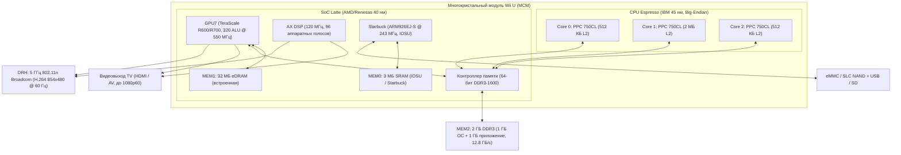
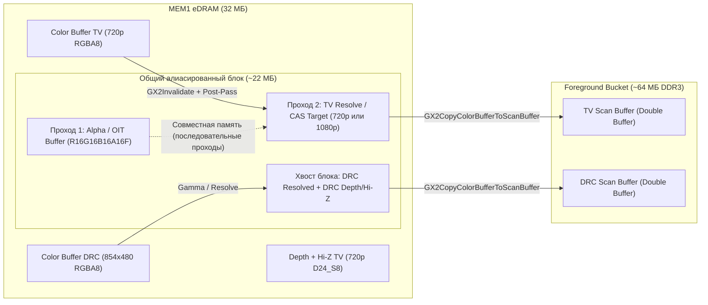

# Архитектура Nintendo Wii U: практический анализ для портирования

Nintendo Wii U (модель WUP-001, 2012) построена вокруг многокристального модуля (MCM), объединяющего трёхъядерный процессор PowerPC **Espresso** и графический/системный чип **Latte** в едином корпусе. В отличие от консолей восьмого поколения на базе x86-64 (PS4, Xbox One), Wii U представляет собой прямое архитектурное развитие линейки GameCube → Wii с добавлением современной для 2012 года программируемой графики класса AMD Radeon HD (TeraScale) и выделенного беспроводного видеотракта для контроллера GamePad.

Для инженера, переносящего или реконструирующего игровые движки под Wii U, ключевые ограничения определяются не пиковой производительностью GPU, а сочетанием **асимметричной кэш-иерархии PowerPC**, **узкой 64-битной шины DDR3 (12.8 ГБ/с)**, **жёсткого бюджета eDRAM (MEM1 = 32 МБ)** и необходимости одновременно обслуживать два независимых дисплея (TV + DRC).

## 1. Контекст платформы и аппаратная преемственность

Семейство домашних консолей Nintendo с 2001 по 2017 год базировалось на единой микроархитектуре IBM PowerPC 750:

- **Gekko** (GameCube, 2001): одноядерный PPC 750CXe @ 486 МГц, 256 КБ L2, SIMD-расширение Paired Singles, GPU Flipper.
- **Broadway** (Wii, 2006): одноядерный PPC 750CL @ 729 МГц, 256 КБ L2, GPU Hollywood со встроенным ARM926EJ-S (Starlet) для ОС и безопасности.
- **Espresso** (Wii U, 2012): трёхъядерный PPC 750CL @ 1.243125 ГГц, асимметричный L2 (512 КБ / 2 МБ / 512 КБ), MCM-компоновка с GPU **Latte** и сопроцессором безопасности ARM926EJ-S (**Starbuck**).

Обратная совместимость с Wii реализована аппаратно в режиме **vWii**: чип Latte содержит блок совместимости с фиксированным конвейером Hollywood (GX), а Espresso отключает ядра 0 и 2 и снижает частоту ядра 1 до 729 МГц. В нативном режиме **Cafe OS** доступны все три ядра, полный объём памяти MEM2 и программируемый GPU7 (GX2).



## 2. Сводные аппаратные характеристики

| Подсистема | Компонент | Спецификация | Инженерное ограничение при портировании |
| :--- | :--- | :--- | :--- |
| **CPU** | IBM Espresso (3× PPC 750CL) | 1.243125 ГГц, Out-of-Order (2-wide), Big-Endian | Нет SMT; отсутствие AltiVec; слабый межъядерный SMP |
| **Кэш CPU** | L1 / L2 на ядро | L1: 32 КБ I + 32 КБ D; L2: 512 КБ / 2 МБ / 512 КБ | Главный поток обязан работать на Core 1 (2 МБ L2) |
| **SIMD** | Paired Singles (Gekko/Broadway ISA) | 2× float32 в 64-битных FPR (`ps_madd`, `psq_l`) | Только 2-компонентные векторы; требуется ручная/компиляторная векторизация |
| **GPU** | AMD Latte (GPU7 / RV770-подобный) | 320 ALU (5-wide VLIW), 550 МГц, ~352 GFLOPS FP32 | Чувствителен к простоям скалярного кода и переполнению GPR |
| **eDRAM** | MEM1 (на кристалле Latte) | 32 МБ (доступно приложению ~22–32 МБ) | Все активные Color/Depth/Hi-Z буферы должны умещаться в eDRAM |
| **RAM** | MEM2 (4× 512 МБ DDR3-1600) | 2 ГБ суммарно: 1 ГБ Cafe OS + 1 ГБ приложение | 64-битная шина (12.8 ГБ/с) — главное узкое место при промахах L2 |
| **SRAM** | MEM0 (внутренняя память IOSU) | 3 МБ | Зарезервирована под ядро Starbuck/IOSU, недоступна приложению напрямую |
| **Аудио** | AX DSP (`sndcore2`) | 120 МГц, аппаратный GCADPCM / PCM16 | Требует строгого выравнивания буферов и учёта раздельного вывода TV/DRC |
| **GamePad** | DRC + хост-модуль DRH | 854×480 @ 60 Гц, H.264 по 5 ГГц 802.11n, VPAD | Аппаратный энкодер берёт готовый скан-буфер; 2-экранный рендер удваивает draw calls |
| **Безопасность** | Starbuck (ARM926EJ-S) | 243 МГц, исполняет IOSU | Обрабатывает FS, сеть, криптографию, `nn::save` через IPC |

## 3. Вычислительная подсистема CPU Espresso

Процессор **Espresso** объединяет три модифицированных ядра PowerPC 750CL на частоте `1.243125 ГГц` (частота шины `248.625 МГц`, множитель `5x`). Каждое ядро имеет суперскалярный внеочередной конвейер (out-of-order), способный выбирать и завершать до 2 инструкций за такт (плюс отдельный блок переходов BPU), два целочисленных ALU, один FPU с поддержкой Paired Singles и один блок Load/Store.

### Асимметрия кэша L2 и модель многопоточности

Наиболее нетривиальная особенность Espresso — асимметричный кэш второго уровня с обратной записью (write-back):

- **Core 0**: 512 КБ L2 (разделяется с фоновыми службами системы при возврате в HOME/оверлеях).
- **Core 1**: **2 МБ L2** — выделенное «основное» ядро для игрового цикла и рендер-потока.
- **Core 2**: 512 КБ L2 — вспомогательное ядро (аудио, потоковая подгрузка, асинхронные задачи).

:::warning Отсутствие современного SMP-скейлинга
Espresso не имеет общего L3-кэша. Поддержка когерентности между L1/L2 разных ядер выполняется по протоколу MESI через общую системную шину. Частый пинг-понг кэш-линий (false sharing) и интенсивное использование атомарных операций `lwarx`/`stwcx.` между ядрами резко снижают пропускную способность. Кроме того, Cafe OS использует **кооперативно-приоритетный планировщик** с фиксированной привязкой потоков (`OS_THREAD_ATTRIB_AFFINITY_CPU0/1/2`): поток, привязанный к одному ядру, не мигрирует автоматически на простаивающее ядро.
:::

### Порядок байт (Big-Endian) и SIMD Paired Singles

Espresso работает строго в **Big-Endian** (MSB first). При портировании кода с x86-64/ARM64 это требует:

1. Явной конвертации бинарных ассетов, сетевых пакетов и заголовков форматов (`__builtin_bswap16` / `__builtin_bswap32`, либо аппаратные инструкции `lhbrx` / `lwbrx` / `sthbrx` / `stwbrx`).
2. Проверки всех `union`-трюков, битовых полей (`bitfields`) и сериализации структур через `memcpy` на диск или в сеть.
3. Учёта 2-байтного `wchar_t` в стандартном ABI Cafe SDK (`-fshort-wchar`), если исходный проект использует широкие строки.

Вместо 128-битного AltiVec (VMX), присутствующего в Xbox 360 и PS3, Espresso унаследовал от Gekko расширение **Paired Singles** (PS): 32 64-битных регистра с плавающей точкой (`f0`–`f31`) интерпретируются как пары `float32` (`ps0`, `ps1`).

```text
Ключевые инструкции Paired Singles (PPC 750CL):
  psq_l   frD, d(rA), W, I   ; загрузка пары float/int8/int16 с аппаратной деквантизацией (GQR0..GQR7)
  psq_st  frS, d(rA), W, I   ; сохранение пары с аппаратной квантизацией
  ps_madd frD, frA, frC, frB ; (A.ps0 * C.ps0 + B.ps0, A.ps1 * C.ps1 + B.ps1) за 1 такт throughput
  frsqrte frD, frB           ; быстрая аппаратная оценка 1/sqrt(x) (~5 бит точности + 1 итерация Ньютона)
```

Практическая рекомендация по раскладке потоков на Espresso:

- **Core 1 (2 МБ L2)**: главный игровой цикл, отправка команд GX2 (command buffer recording), UI/HUD, сценарная логика с большим рабочим набором данных.
- **Core 0 (512 КБ L2)**: серверная логика / физика / чанки / фоновое сохранение (`CStorage`, сжатие `zlib`).
- **Core 2 (512 КБ L2)**: аудиоподсистема (`AXInit`, программное микширование/декодирование), асинхронный I/O потоков, перестройка вершинных буферов и освещения.

## 4. Подсистема памяти: MEM0, MEM1, MEM2 и когерентность

Адресное пространство Wii U разделено на три физически различных банка памяти с принципиально разными характеристиками латентности и пропускной способности:

1. **MEM0 (3 МБ встроенной SRAM)**: используется исключительно ARM-сопроцессором Starbuck (IOSU) для микроядра, драйверов файловой системы, Wi-Fi/USB-стека и криптографических буферов. Приложениям на Espresso напрямую недоступна.
2. **MEM1 (32 МБ eDRAM на кристалле Latte)**: высокоскоростная встроенная память с минимальной задержкой доступа со стороны GPU7. Доступна приложению через `MEMGetBaseHeapHandle(MEM_BASE_HEAP_MEM1)` (практический объём для пользовательских поверхностей составляет ~22–32 МБ в зависимости от конфигурации ОС). В MEM1 размещаются активные **Color Buffers**, **Depth/Stencil Buffers** и таблицы **Hi-Z**. Размещение render target в MEM2 возможно технически, но приводит к катастрофическому падению скорости заполнения (fillrate) из-за конкуренции с CPU на шине DDR3.
3. **MEM2 (2 ГБ DDR3-1600, 64-битная шина)**: основная оперативная память с пиковой теоретической пропускной способностью **12.8 ГБ/с**. Ровно 1 ГБ зарезервирован под Cafe OS, системные апплеты (HOME Menu, браузер, Miiverse/eShop), а **1 ГБ** (при `max_size = 0x40000000` в `cos.xml`) выделяется приложению под код (RPX), кучу (`MEM_BASE_HEAP_MEM2`), текстуры, вершинные/индексные буферы и аудиоданные.
4. **Foreground Bucket (`MEM_BASE_HEAP_FG`)**: отдельная область объёмом ~64 МБ, передаваемая приложению только пока оно находится на переднем плане (между `ProcUI` событиями Acquire/Release). Предназначена для двойных scan-буферов TV (`GX2SetTVBuffer`) и DRC (`GX2SetDRCBuffer`), а также временных буферов вроде миниатюр сохранений. При уходе в фоновый режим (нажатие кнопки HOME) приложение обязано освободить MEM1 и Foreground Bucket.

### Кэш-когерентность CPU ↔ GPU

CPU Espresso и GPU Latte **не поддерживают автоматическую когерентность кэшей** при обмене данными через MEM2 и MEM1. Любой буфер, записанный процессором (вершины, текстуры, униформы, байткод шейдеров, команды GX2), до обращения со стороны GPU должен быть сброшен из кэша данных CPU (размер строки кэша — 32 байта, рекомендуется выравнивание на 64 или 256 байт):

- `DCFlushRange(ptr, size)` — принудительно записывает грязные строки L1/L2 CPU в RAM (DDR3).
- `DCInvalidateRange(ptr, size)` — сбрасывает строки кэша CPU перед чтением данных, записанных GPU или DMA (например, при захвате скриншота/миниатюры).
- `GX2Invalidate(mode, ptr, size)` — управляет внутренними кэшами GPU7:
  - `GX2_INVALIDATE_CPU` — сброс кэша CPU для буфера перед передачей GPU;
  - `GX2_INVALIDATE_CPU_SHADER` — обязательный сброс после загрузки шейдерной программы в память;
  - `GX2_INVALIDATE_COLOR_BUFFER | GX2_INVALIDATE_TEXTURE` — барьер между записью в render target и последующим чтением этой же поверхности как текстуры (например, перед пост-обработкой или resolve).

Пропуск `GX2Invalidate` — одна из самых частых причин трудновоспроизводимых графических артефактов на реальной консоли (при том что эмулятор Cemu часто скрывает отсутствие инвалидации кэшей).

## 5. Графический конвейер Latte (GPU7) и API GX2

Графическое ядро **Latte (GPU7)** основано на архитектуре **AMD TeraScale (семейство R600/R700, близко к Radeon HD 4650/4670)** с рядом аппаратных доработок под eDRAM и консольный API **GX2**.

### Вычислительная структура GPU7

- **4 SIMD-движка × 16 потоковых процессоров × 5 ALU (VLIW5)** = **320 потоковых ядер** на частоте `550 МГц`.
- Каждый 5-элементный пакет VLIW способен за такт выполнять 4 операции `FMAD` (`x, y, z, w`) и 1 трансцендентную операцию (`t`: `RCP`, `RSQ`, `LOG`, `EXP`, `SIN`, `COS`). Если шейдер содержит последовательные скалярные зависимости, часть слотов VLIW простаивает.
- **16 текстурных блоков (TMU)**, **8 блоков растеризации (ROP)**, аппаратная поддержка тесселяции (базовая, уровня R600), геометрических шейдеров и **Command Processor (CP)** с DMA-выборкой командных буферов из MEM2.
- Внутренний регистровый файл шейдеров разделяется между стадиями конвейера вручную вызовом `GX2SetShaderModeEx(mode, numVsGprs, numVsStack, numGsGprs, numGsStack, numPsGprs, numPsStack)` — например, `48` GPR под VS и `200` GPR под PS при `GX2_SHADER_MODE_UNIFORM_REGISTER`.

### Бюджет MEM1, eDRAM aliasing и Early-Z / Hi-Z

Объём eDRAM ограничен 32 МБ (из которых система оставляет приложению порядка 22–32 МБ). Для сравнения, один несжатый 1080p буфер цвета `RGBA8` занимает ~8.3 МБ, буфер глубины `D24_S8` — ещё ~8.3 МБ, а 16-битный HDR-буфер `R16G16B16A16_FLOAT` в 720p — ~7.4 МБ. Если игра рендерит два экрана (TV + DRC) и использует буферы прозрачности/пост-обработки, прямолинейное выделение всех поверхностей одновременно гарантированно исчерпает MEM1.



Стандартные инженерные приёмы работы с GPU7 и GX2:

1. **eDRAM Aliasing (переиспользование памяти)**: поверхности, жизненные циклы которых внутри кадра не пересекаются (например, буфер накопления прозрачности и финальный буфер пост-обработки TV), указывают на один и тот же базовый адрес `imagePtr` в MEM1. Обязательным условием является барьер `GX2Invalidate` при смене роли буфера.
2. **Hi-Z (Hierarchical Z) и Early-Z**: включение `GX2InitDepthBufferHiZEnable` создаёт компактную иерархическую карту глубины (дополнительные десятки/сотни килобайт в MEM1), позволяя отбрасывать целые тайлы пикселей до запуска фрагментного шейдера. Критически важно рисовать непрозрачную геометрию от ближней к дальней и избегать `discard`/`kill` (alpha test) там, где это не требуется, поскольку `discard` отключает Early-Z.
3. **Ограничения GrabPass и прозрачности**: классический `GrabPass` (копирование текущего буфера цвета в текстуру для преломлений/воды в середине кадра) дорог на GPU7, так как требует сброса конвейера ROP, инвалидации кэшей и дополнительного буфера. Для массовой прозрачности (например, стекло, вода, частицы) применяются либо отсортированные проходы, либо Order-Independent Transparency (OIT) с 16-битным буфером накопления в MEM1.
4. **Тайлинг поверхностей**: GPU7 эффективно работает только с тайловыми режимами (`GX2_TILE_MODE_2D_TILED_THIN1` и др.). Линейный формат (`GX2_TILE_MODE_LINEAR_ALIGNED`) следует применять только для поверхностей, которые читаются напрямую CPU (например, рендер миниатюр сохранений).

### Компиляция шейдеров: GFD и CafeGLSL

GPU7 не принимает исходный код GLSL во время исполнения в продакшене — драйвер GX2 загружает бинарный микрокод R600/R700 в структурах `GX2VertexShader` / `GX2PixelShader` / `GX2GeometryShader`, обычно упакованных в контейнер **GFD (`.gsh`)**.

- В оригинальном SDK использовался проприетарный оффлайн-компилятор `gshCompile`.
- В экосистеме homebrew и открытых портов применяется библиотека **`CafeGLSL`** (обёртка над компилятором `glslcompiler.rpl`, встроенным в прошивку Wii U / доступным через Aroma, либо оффлайн-генерация микрокода и структур `GX2PixelShader` с последующей сериализацией в `.inc`/`.gsh`).
- Каждому вершинному шейдеру необходим **Fetch Shader** (`GX2InitFetchShader`), описывающий раскладку вершинных атрибутов, форматы и перестановку байт (`GX2_ENDIANSWAP_8IN32` и т. д.).

## 6. Аудиоподсистема: AX DSP и маршрутизация TV / DRC

Обработку звука выполняет выделенный **AX DSP** на частоте `120 МГц` (эволюция DSP из GameCube/Wii), управляемый системной библиотекой **`sndcore2.rpl`** (интерфейсы `AXInit`, `AXAcquireVoice`, `MIXInit` и т. д.; в ранних играх также встречалась устаревшая `snd_core.rpl`).

Ключевые свойства подсистемы:

- **Частота дискретизации**: нативный вывод AX работает на **32 кГц** или **48 кГц** (выбирается при инициализации драйвера; многие мультиплатформенные движки и Miles Sound System используют 32 кГц для снижения расхода CPU/памяти).
- **Аппаратное декодирование**: DSP поддерживает без нагрузки на Espresso форматы **PCM16**, **PCM8** и **GCADPCM** (4-битный ADPCM Nintendo с коэффициентом сжатия ~3.5:1). Другие кодеки (например, Bink Audio `.binka`, Vorbis, Opus, IMA-ADPCM) декодируются программно на Espresso (обычно на **Core 2**), после чего PCM-поток скармливается голосам AX через кольцевые буферы.
- **Аппаратные голоса**: до **96 аппаратных голосов** одновременно. Если игровой движок (например, Miles) декларирует больше виртуальных голосов (128), программный микшер сводит их на CPU в итоговые каналы перед отправкой в AX.
- **Раздельная маршрутизация TV и DRC**: каждый голос AX имеет независимые матрицы усиления для шины **TV** (до 6 каналов LPCM 5.1 по HDMI или стерео) и шины **DRC** (стерео на динамики/разъём 3.5 мм GamePad). Это позволяет программно отправлять на телевизор и на GamePad совершенно разные звуковые сцены — например, при двухэкранном кооперативе без разделения экрана.

## 7. Контроллер Wii U GamePad (DRC) и радиотракт DRH

Wii U GamePad (**DRC — Display Remote Controller**) — это тонкий беспроводной клиент с резистивным сенсорным экраном **854×480 @ 60 Гц** (соотношение 16:9), стереодинамиками, микрофоном, камерой, NFC-ридером и 9-осевым IMU (акселерометр, гироскоп, магнитометр).

### Радиотракт DRH и видеопоток

Внутри консоли установлен выделенный Wi-Fi модуль **DRH (Display Remote Host)** на чипе Broadcom BCM43362/BCM43237, работающий в диапазоне **5 ГГц (802.11n)** по проприетарному протоколу с минимальной задержкой (~1 кадра / ~16–20 мс). Аппаратный энкодер на стороне Latte берёт готовый двойной scan-буфер из `GX2SetDRCBuffer`, сжимает его в низколатентный поток **H.264** и передаёт на DRC.

Опрос состояния контроллера выполняется через библиотеку **`vpad.rpl`**:

- `VPADRead(VPAD_CHAN_0, buffers, count, &error)` возвращает до 16 отсчётов с частотой опроса ~60 Гц (кнопки, аналоговые стики, данные акселерометра/гироскопа и сырые координаты тачскрина).
- `VPADGetTPCalibratedPoint()` преобразует сырые координаты резистивной панели (0..4095) в экранное пространство `854×480` (или `1280×720` в зависимости от `VPADTPResolution`).

:::note Цена независимого двухэкранного рендера
В режиме зеркалирования (Off-TV Play) стоимость вывода на DRC минимальна: один полноэкранный проход копирования/даунскейлинга 720p → 854×480. Однако при **независимом 3D-рендеринге** для двух игроков (TV + GamePad) нагрузка на CPU (обход сцены, фрустум-куллинг, запись команд GX2) и на GPU (вершинная обработка, заполнение глубины и цвета) фактически удваивается, а бюджет MEM1 обязан одновременно вместить отдельный буфер глубины DRC (`D24_S8` + Hi-Z) и целевой буфер цвета.
:::

## 8. Программный стек Cafe OS, форматы сборки и квоты сохранений

### Cafe OS, IOSU и динамическая линковка RPX / RPL

Программная среда Wii U разделена на два домена:

- **IOSU** (на ARM Starbuck): привилегированное микроядро, драйверы файловых систем (MLC NAND, SLC, USB, SD, ODD), сетевой стек, управление аккаунтами (`ACT`) и квотами сохранений.
- **Cafe OS** (на PowerPC Espresso): пользовательское ядро (`coreinit.rpl`) и набор системных динамических библиотек **RPL** (`gx2.rpl`, `sndcore2.rpl`, `vpad.rpl`, `padscore.rpl`, `nn_save.rpl`, `nn_ac.rpl`, `nn_swkbd.rpl`, `zlib125.rpl`, `nlibcurl.rpl` и др.).

Исполняемые файлы Wii U — **RPX** (основной бинарник) и **RPL** (разделяемые библиотеки) — представляют собой модифицированный формат **ELF32 PowerPC Big-Endian** со сжатыми (zlib) секциями и таблицами импорта `.fimport_*` / `.dimport_*`. При запуске загрузчик Cafe OS распаковывает секции в фиксированные диапазоны виртуальной памяти (код обычно от `0x02000000`, данные от `0x10000000`) и патчит вызовы к системным RPL.

Для разработки с открытым исходным кодом используется **WUT (Wii U Toolchain)** поверх `devkitPPC` (GCC) или специализированные компиляторы (например, RedHills Clang для совпадения с оригинальным Green Hills C++ ABI). WUT предоставляет заголовки Cafe OS, списки экспорта системных RPL (`.def`) и утилиты упаковки (`elf2rpl`, `wuhbtool`).

### Сравнение форматов поставки: Aroma (`.wuhb`) vs WUP Installer

| Критерий | Aroma Bundle (`.wuhb`) | WUP Installer (`.app` / `.h3` / `TMD` / FST) |
| :--- | :--- | :--- |
| **Среда запуска** | Aroma CFW (прямой запуск из Wii U Menu / homebrew) | Установка в NAND (MLC) или на USB-накопитель через WUP Installer |
| **Внутренняя структура** | Единый файл-контейнер (RPX + встроенный RomFS + метаданные/иконки) | Шифрованные контентные файлы (`00000000.app`..`N.app`), хэш-деревья `.h3`, `title.tmd`, `title.tik`, `title.cert` |
| **Монтирование ассетов** | Через `wuhb`/RomFS (`/vol/content` проецируется с SD-карты) | Нативная файловая система WFS/FST через IOSU (`/vol/content`) |
| **Лимиты памяти (`cos.xml`)** | Наследуются от хост-приложения (Mii Maker / Health & Safety, с патчами Aroma) | Собственные `app.xml` и `cos.xml` (полный контроль `max_size`, прав IOSU, `Title ID`) |
| **Сохранения (`nn::save`)** | Часто перенаправляются на SD (`sd:/wiiu/apps/...`) или общую квоту | Выделенный каталог сохранения по `Title ID` и слоту аккаунта в MLC/USB |
| **Скорость I/O** | Ограничена контроллером SD-карты (~10–20 МБ/с) | Выше на MLC/USB; стабильнее при стриминге крупных архивов и аудио |

### Подсистема сохранений `nn::save` и квоты

В нативных тайтлах Wii U запись пользовательских данных осуществляется через библиотеку **`nn_save.rpl`** поверх файлового API `FS`. Размеры квот объявляются статически в `meta/meta.xml`:

- `common_save_size` — общий каталог для всех профилей консоли;
- `account_save_size` — индивидуальная квота на каждый профиль пользователя (`nn::act::GetSlotNo()`).

Работа с квотой **транзакционна**: изменения файлов (`SAVEOpenFile`, `FSWriteFile`, `FSCloseFile`) фиксируются только после явного вызова `SAVEFlushQuota()`. При ошибке записи, нехватке места или аварийном прерывании приложение вызывает `SAVERollbackQuota()`, откатывая файловую систему слота к последнему согласованному состоянию. На этапе проектирования порта это требует строгого учёта размера квоты, выравнивания размеров файлов по гранулярности блоков NAND и обязательной обработки события `ProcUI` (`SaveCallback` → `OSSavesDone_ReadyToRelease()`) при выходе из приложения.
