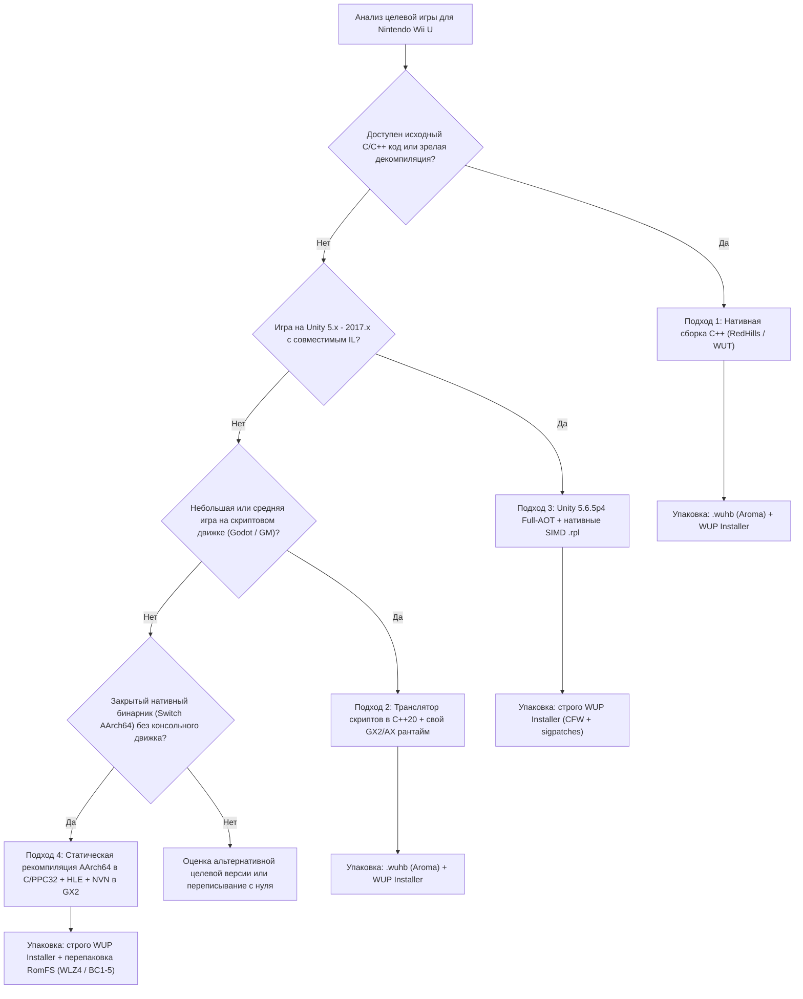

# Сравнительный анализ 4 методов портирования на Nintendo Wii U

Перенос современных или кроссплатформенных игр на **Nintendo Wii U** определяется жёстким набором аппаратных и системных ограничений:

- **CPU Espresso:** 3-ядерный 32-битный PowerPC 750CL Big-Endian на частоте `1.24 ГГц` с асимметричным кэшем L2 (`512 КБ` на Core 0 и Core 2, `2 МБ` на Core 1) и векторным блоком Paired Singles (`2× float32`).
- **GPU Latte (GX2):** архитектура семейства AMD R600/R700 (TeraScale 2) с `32 МБ` встроенной eDRAM (**MEM1**), критически чувствительная к вытеснению рендер-таргетов в медленную основную память.
- **Память MEM2:** `1 ГБ` игровой ОЗУ (из `2 ГБ` физических; второй гигабайт зарезервирован под Cafe OS).
- **Исполняемая модель Cafe OS:** бинарники `.rpx` и динамические библиотеки `.rpl`, отсутствие стандартного JIT-компилятора в пользовательском пространстве и разделение сред запуска (автономный `.wuhb` в Aroma против системной установки WUP Installer).

Единого универсального метода портирования не существует. В проектах Parhelio на практике выработаны и доведены до рабочих сборок **четыре принципиально разных инженерных пайплайна**, выбор между которыми диктуется наличием исходного кода, типом исходного движка и целевым бюджетом кадра.

---

## Подход 1. Полная C++-реконструкция под оригинальный ABI

**Применение в Parhelio:** [Minecraft: Wii U Edition](/games/minecraft/) (`Update v688`, `00050000101D7500`).

### Архитектура пайплайна

Исходный код игры воссоздаётся на уровне C++ (декомпиляция и реконструкция структур данных) и компилируется непосредственно под целевую архитектуру PowerPC32 и системный ABI Cafe OS. В проекте Minecraft используется тулчейн **RedHills** (Clang 19 с поддержкой Green Hills C++ ABI), **LLVM 22** и библиотека **WUT**:

- Кодовая база насчитывает `3 753` файла `.cpp` и `4 016` заголовочных файлов `.hpp`.
- Результирующий исполняемый модуль `Minecraft.Client.rpx` занимает `9.38 МБ` и содержит `0%` оригинального машинного кода (чистая пересборка из C++).

### Ключевые системные возможности

Полный контроль над исходным кодом позволяет перепроектировать подсистемы, недоступные для поверхностного патчинга:

- **Двухэкранный рендер в бюджете MEM1:** режим `SeparateGamePad` реализует две независимые камеры и HUD (TV 16:9 для Игрока 1 и GamePad `854×480` для Игрока 2) за счёт алиасинга последовательных рендер-пасов внутри `22 МБ` MEM1 при раздельном DRC-буфере (`D24_S8` + HiZ).
- **Апскейл без лишнего прохода памяти:** кастомный fused-шейдер `GammaCASShader` совмещает гамма-коррекцию и **AMD FidelityFX CAS** (`sharpness=0.38`) для масштабирования `720p → 1080p` на TV.
- **Контроль потоков и памяти:** явная привязка потоков к ядрам Espresso (`Core 0 / 1 / 2`), собственная арена `dlmalloc` в MEM2, а также перенос реконструированного аудиостека Miles + BinkA на **Core 2** (`AXInit`, 128 голосов 32 кГц) с двумя 3D-слушателями и раздельным выводом на HDMI и разъём GamePad 3.5 мм.

### Ограничения

Трудоёмкость декомпиляции и верификации поведения пропорциональна объёму кодовой базы. Подход экономически оправдан только при наличии существующего сообщества декомпиляции или открытых исходников самой игры; для произвольной закрытой игры с нуля он требует нескольких человеко-лет работы.

---

## Подход 2. Трансляция скриптов и ассетов в собственный C++20-рантайм

**Применение в Parhelio:** [Buckshot Roulette](/games/buckshot-roulette/) (`Build 116 / v44`, `000500001337B001`).

### Архитектура пайплайна

Вместо портирования исходного движка (Godot Engine 4), чьи требования к памяти, Vulkan/GLES3-бэкенду и динамическому скриптовому рантайму избыточны для Wii U, создаётся узкоспециализированный нативный **C++20 / PowerPC / WUT** рантайм, реализующий только используемое игрой подмножество возможностей:

- Инструмент `gd_to_cpp_transpiler.py` транслирует игровую логику на GDScript в статически типизированный C++20; асинхронные конструкции `await`, таймеры и сигналы отображаются на нативные бесстековые корутины (`co_task.h`, `timer_queue`).
- Ресурсы Godot (сцены, иерархии узлов, скелеты, анимации) на этапе офлайн-сборки компилируются в компактные бинарные форматы `.blayout` и архивы `OBPK`.
- Весь исполняемый код укладывается в единый бинарник `game.rpx` размером `4.17 МБ`.

### Графика и аудио

- **Офлайн-шейдеры GX2:** вместо рантайм-компиляции GLSL все `28` графических шейдеров (освещение, постобработка vignette/posterize, процедурное небо, VHS-эффекты, `720p → 1080p` AMD CAS) собираются заранее через `CafeGLSL 1.0.0-rc1` в формат `.gsh` / GFD. Загрузка tiled BC-текстур вынесена на Core 2 строго вне render pass.
- **Аппаратное сжатие звука:** собственный `AXAudioEngine` без прослойки SDL-микшера использует `4-bit IMA-ADPCM` (с `O(1)` позиционированием) и фоновый стриминг треков длиннее `512 КБ` на Core 2. Это сократило итоговый объём дистрибутива с `~1.28 ГБ` до `303 МБ` (`.wuhb`) / `313 МБ` (WUP) и обеспечило маршрутизацию `TVOnly` / `DRCOnly` / `Both` для локального режима 1v1.

### Ограничения

Собственный рантайм требует ручной реализации всех задействованных игрой узлов, физики, UI и парсера форматов. Метод хорошо подходит для инди-игр и проектов малого/среднего масштаба на скриптовых движках (Godot, GameMaker, Ren'Py), но плохо масштабируется на большие AAA-игры с десятками тысяч уникальных компонентов и сложных графов материалов.

---

## Подход 3. Full-AOT перенос на консольный рантайм Unity 5.6.5p4 и нативные `.rpl`

**Применение в Parhelio:** [Slime Rancher](/games/slime-rancher/) (`v42 NoLog`, `0005000021000002`), [Subnautica](/games/subnautica/) (`R&D v18`, `0005000021000003`).

### Архитектура пайплайна

Для игр на базе Unity (версий `5.x`–`2017.x`) используется официальный консольный бинарник движка `Unity-master.rpx` (ветка `5.6.5p4`) в связке с полной офлайн-компиляцией управляемого C#-кода в нативный машинный код PowerPC32:

1. **IL-совместимость и 100% Full-AOT:** вызовы API, отсутствующие в Unity 5.6.5p4 (например, из `Unity 2017.1` в Slime Rancher), переписываются на уровне байткода IL. Далее компилятор AOT переводит **все 100% методов** в динамические библиотеки `.rpl`: `50 719 / 50 719` методов в 12 `.rpl` для Slime Rancher и `45 582 / 45 582` метода для Subnautica.
2. **Вынос горячих путей в нативные C/PPC модули:** критичные по CPU подсистемы заменяются нативным кодом на C с использованием инструкций Espresso Paired Singles SIMD (`psq_l`, `ps_madd`, `frsqrte`). В Slime Rancher плагин `slime_wiiu_nolog.rpl` (`-DWIIU_NO_LOG`) выполняет пространственный куллинг `512` акторов на Core 2; в Subnautica нативный `fmodstudio.rpl` (`486` экспортов) выносит микширование FMOD на Core 2.

### Графическая и ресурсная адаптация

Ключевая сложность Unity-портов — перевод тысяч PC-шейдеров (DX11/HLSL) и избыточного числа draw calls в жёсткие рамки Latte GX2 и MEM1:

- **Массовая компиляция шейдеров:** `3 786` шейдеров (`2 821 PS + 965 VS`) в Slime Rancher и `5 600` шейдеров в Subnautica. Обязательным этапом является удаление `GrabPass` (вызывающих дорогие копирования MEM1 → MEM2) и нестабильных циклов `while(true)`, а также восстановление аппаратного Early-Z (`KILL_ENABLE=0`).
- **Офлайн-оптимизация геометрии и отсечения:** статический батчинг сцены `level3` в Slime Rancher сократил число батчей с `24 434` до `2 686` (`-70 436` объектов), меши переведены в `Float16 VBO` с оптимизацией кэша вершин Тома Форсайта, построен двухъёмный `Dual-Volume WPVS` (`12 742` ячеек, отсечение свыше `32%` батчей).
- **Рендер-бюджет MEM1:** в Subnautica прозрачность океана реализована через `Single-RT WBOIT` с апскейлом `768×432 → 1280×720` AMD CAS (`sharp=0.80`) и нативным 720p UI, что удерживает рендер-таргеты в пределах `23–29 МБ` внутри `32 МБ` MEM1 при стабильном профиле MEM2 `554–563 МБ`. В Slime Rancher применён Single-RT Luma-only AMD CAS + DRS (`720p → 648p → 576p`) и 100% аппаратный звук `GCADPCM` (`583/583` клипов на AX DSP 120 МГц).

### Ограничения

- Из-за архитектуры загрузчика `Unity-master.rpx` + набор `.rpl` запуск через `.wuhb` невозможен: дистрибутив существует **только в формате WUP Installer** (требуется CFW с sigpatches).
- Производительность ограничена потолком однопоточного цикла Unity 5.6 и скоростью потоковой подгрузки ассетов (в Subnautica на реальной консоли ~10 FPS в океане при 24–30 FPS в Cemu).

---

## Подход 4. Статическая рекомпиляция бинарного кода AArch64 → C → PPC32 + HLE + NVN→GX2

**Применение в Parhelio:** [Animal Crossing: New Horizons](/games/animal-crossing/) (`Wave 9`, `0005000021AC0001`).

### Архитектура пайплайна

При отсутствии исходников и консольного аналога движка (проприетарный движок Nintendo для Switch) применяется полная статическая рекомпиляция машинного кода Nintendo Switch (`AArch64` Little-Endian) в переносимый C, который затем компилируется в нативный PowerPC32 Big-Endian (`WUT 1.9.1`):

- **Масштаб трансляции:** `149 716` функций игры v1.0.0 разложены на главный модуль `acnh.rpx` и `12` динамических библиотек `.rpl`.
- **Оптимизация регистров и кэша L2:** статическое распределение `10/18` регистров PPC32 снизило число обращений к стеку (spills) на `68.3%`; реализовано `51 357` прямых байпасов вызовов; профиль PGO сгруппировал `1 403` самые горячие функции в единый модуль `acnh_hot_0.rpl` размером `1.22 МБ`, полностью помещающийся в `2 МБ` L2-кэша Core 1.

### Слой HLE и трансляция API Switch → Cafe OS

1. **Нативные C HLE с побитовой верификацией:** `62` критических функции (Tiers 1–5: скелетная анимация `g3d`, окклюзия, BCSV, физика ветра/листвы, LiSPSM, `nn::vfx`) + `20` перехватов `fontll` и AES-128 переписаны на нативный C с Paired Singles SIMD. Корректность подтверждена `10 378 / 10 378` дифференциальными тестами на эмуляторе Unicorn (`ARM64 vs C`, допуск `0 ULP`).
2. **Трансляция NVN → Latte GX2:** командный буфер NVN переводится в асинхронную очередь GX2 на Core 0 (`-90%` вызовов `GX2Invalidate`, zero-copy UBO). Все `4 299` шейдеров Maxwell (Switch) сконвертированы в R600 (Latte) с `0` ошибок компиляции; теневая карта `768×768 D16+HiZ` размещена в MEM1; работает 5-ступенчатый 3D-only DRS (`75%–100%`) + Luma AMD CAS и нативный 720p UI.
3. **Аудио и перепаковка RomFS:** сервисы Switch `audren:u` / `audout:u` транслируются в нативный `sndcore2` AX DSP 48 кГц (TV + DRC). `61 597` архивов RomFS перепакованы из Zstd/Yaz0 в быстрый `WLZ4` (`3–5×` быстрее на Espresso), текстуры ASTC/BC7 переведены в линейный BC1–5 без дорогого GOB deswizzle, видео `OpeningMovie` перекодировано в H.264 720p30; итоговый объём RomFS сократился с `6.3 ГБ` до `3.4 ГБ` (WUP `3.6 ГБ`).

### Ограничения

Наиболее ресурсоёмкий метод по однопоточному оверхеду CPU: эмуляция 64-битного адресного пространства, перестановка порядка байтов (endianness) и семантика AArch64 на 32-битном Espresso создают высокую нагрузку в тяжёлых 3D-сценах. По замерам Cemu 2.6 в Wave 9 загрузка идёт при `57–60 FPS`, аэропорт — `14.5–20.7 FPS`, 3D-остров — `10–14 FPS` (пик `24.3 FPS`, `fb=0`). Продолжается перенос горячих функций в HLE и калибровка на физическом железе.

---

## Сравнительная матрица решений

| Критерий | 1. C++-реконструкция (RedHills) | 2. Трансляция в C++20-рантайм | 3. Full-AOT Unity 5.6.5p4 + `.rpl` | 4. Стат. рекомпиляция AArch64 → PPC32 |
| :--- | :--- | :--- | :--- | :--- |
| **Проекты Parhelio** | Minecraft | Buckshot Roulette | Slime Rancher, Subnautica | Animal Crossing: NH |
| **Оверхед CPU** | Минимальный (нативный C++ под PPC32) | Минимальный (статический C++20, без VM) | Средний (рантайм Unity 5.6 + Mono AOT; снижается через SIMD `.rpl`) | Высокий (трансляция 64-bit LE → 32-bit BE; снижается через C HLE и PGO L2) |
| **Профиль RAM / MEM1** | Полный контроль: кастомная арена MEM2, ручной алиасинг `22 МБ` MEM1 | Минимальный: компактный `game.rpx` (`4.17 МБ`), предсказуемый бюджет | Тяжёлый: накладные расходы Unity и ассетов (`554–849 МБ` MEM2, строгая укладка RT в `32 МБ` MEM1) | Высокий: пул транслируемой памяти Switch + кэши GX2; требует сжатия RomFS (`WLZ4`) и урезания RT |
| **Сложность шейдеров** | Низкая (прямая правка исходных шейдеров GX2 / CafeGLSL) | Низкая–средняя (ручное написание `~28` специализированных GFD-шейдеров) | Высокая (автоконвертация `3 700–5 600` DX11-шейдеров, вырезка `GrabPass`, возврат Early-Z) | Очень высокая (трансляция бинарных шейдеров Maxwell → R600, `4 299` программ, эмуляция NVN-состояний) |
| **Аудиоподсистема** | Нативный Miles/BinkA → `AXInit` на Core 2 (`128` голосов 32 кГц, 2 выхода) | Собственный `AXAudioEngine` + 4-bit IMA-ADPCM + стриминг на Core 2 | Аппаратный `GCADPCM` на AX DSP (`~0%` CPU) либо `fmodstudio.rpl` на Core 2 | HLE `audren:u`/`audout:u` → `sndcore2` AX DSP 48 кГц (TV + DRC) |
| **Упаковка** | `.wuhb` (Aroma) и WUP Installer | `.wuhb` (Aroma) и WUP Installer | **Только WUP Installer** (`.rpx` + десятки `.rpl`) | **Только WUP Installer** (`.rpx` + 12 `.rpl`, большой RomFS) |
| **Разделение кода и ассетов** | Чистый пересобранный код (`0%` оригинала); игровые ресурсы поставляются в контейнере | Чистый C++20-код + пересобранные ассеты `.blayout`/`OBPK` | Требуется `Unity-master.rpx` + перепакованные ассеты (для Subnautica прорабатывается модель адаптера поверх ПК-копии) | Рекомпиляция оригинального бинарника и перепаковка RomFS (строго R&D / адаптер поверх легального дампа) |

---

## Алгоритм выбора метода портирования

---

## Сквозные инженерные паттерны всех четырёх подходов

Несмотря на различие компиляторных фронтендов, на нижнем уровне все четыре подхода сходятся к одним и тем же архитектурным практикам Wii U:

| Подсистема | Инженерный паттерн Parhelio | Практический эффект |
| :--- | :--- | :--- |
| **Распределение ядер Espresso** | Core 1 (`2 МБ` L2) — основная логика / PGO-код; Core 0 (`512 КБ` L2) — отправка команд GX2 / рендер-поток; Core 2 (`512 КБ` L2) — аудио, I/O-стриминг и Paired Singles куллинг | Устранение конкуренции за кэш L2 и стабильный frame pacing |
| **Укладка в 32 МБ MEM1 + CAS** | Уменьшенный 3D-буфер (DRS `432p–720p`) + Single-RT постобработка + финальный `AMD FidelityFX CAS` + нативный UI (`720p` / `1080p`) | Отсутствие вытеснения RT в MEM2 при сохранении читаемости текста и контуров |
| **Аппаратное аудио AX DSP** | Перевод клипов в `GCADPCM` / `4-bit IMA-ADPCM` или прямой вывод на `sndcore2` `120 МГц` DSP с раздельной маршрутизацией TV / DRC | Снижение нагрузки CPU на декодирование звука практически до нуля и уменьшение размера образа |
| **Верификация WUP-контейнера** | Полная проверка шифрования NUS (`AES-CBC`), `title.tmd`, хэш-деревьев `H0–H3` и таблицы файловой системы `FST` перед публикацией | Гарантированная установка через WUP Installer GX2 / NUSspli без ошибок подписи контента |

:::warning Критические инварианты платформы
1. **Запрет JIT:** любые скриптовые и управляемые среды (C#, GDScript, AArch64-код) должны транслироваться в нативный PowerPC32 **строго на этапе сборки** (Full-AOT, C++20-трансляция или статическая рекомпиляция).
2. **Ограничения формата `.wuhb`:** автономный бандл Aroma подходит только для однофайловых WUT-приложений (`Minecraft`, `Buckshot Roulette`). Как только архитектура требует динамического связывания десятков `.rpl` или системных разделов контента, единственным корректным контейнером становится WUP Installer.
3. **Контроль регрессий на реальном железе:** эмулятор Cemu скрывает штрафы за промахи L2, вытеснение MEM1 и пропускную способность чтения с NAND/USB; финальное профилирование всегда требует прогона на физической Wii U.
:::
